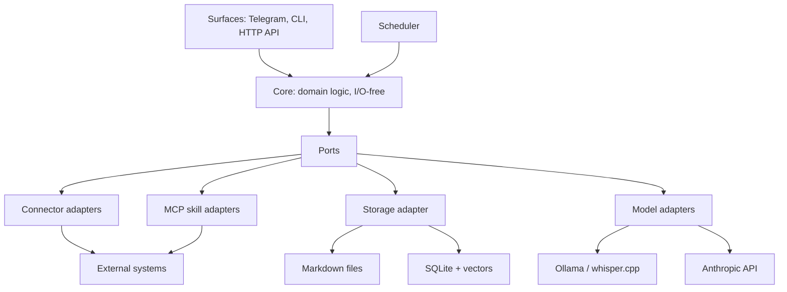
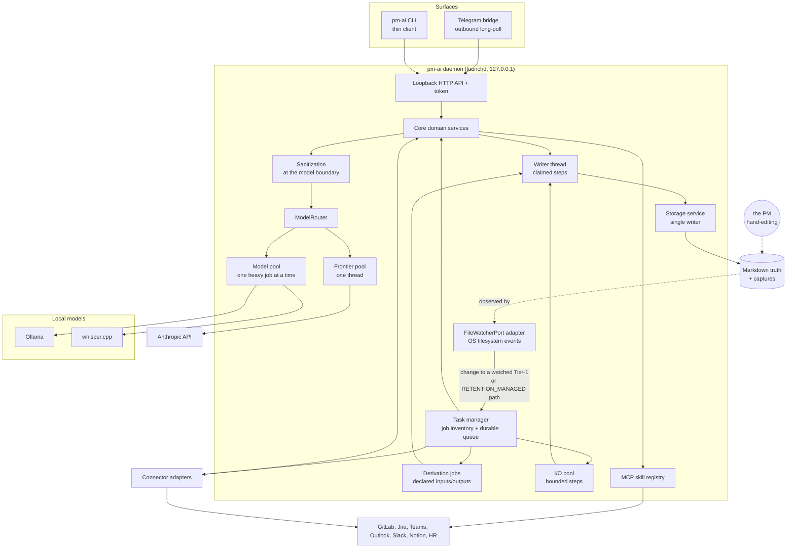
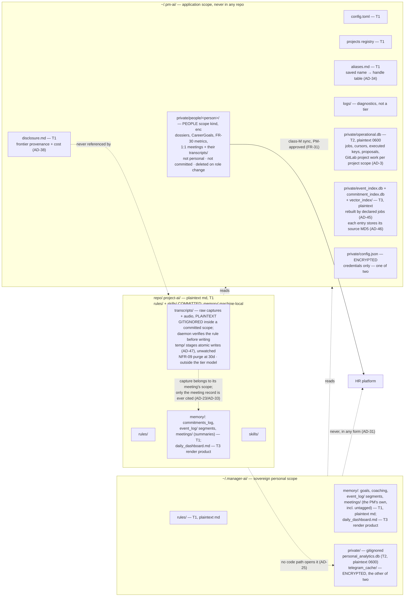
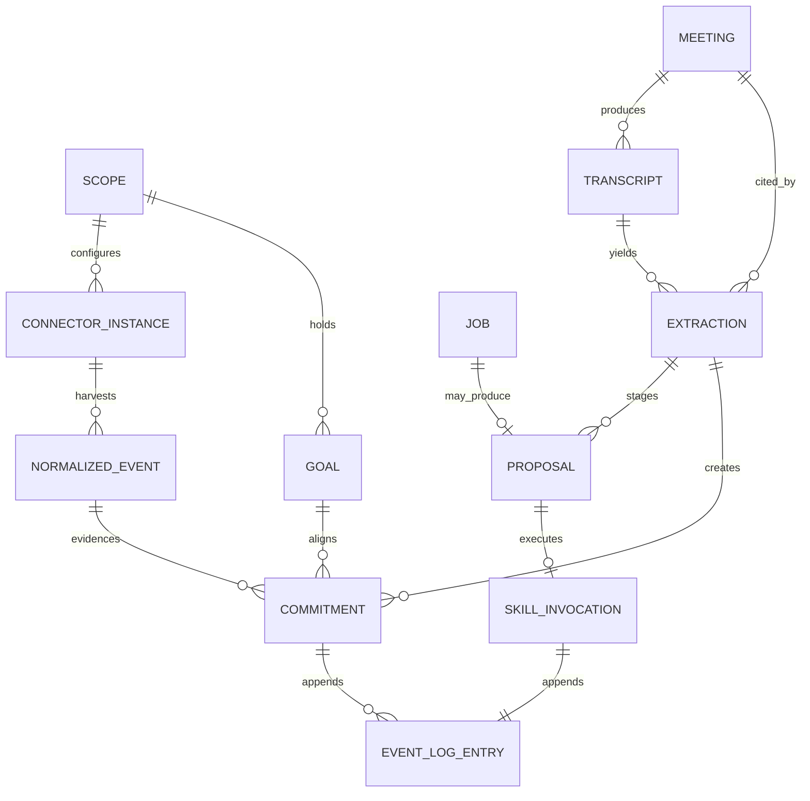

# Architecture Spine — pm-ai

## Design Paradigm

**Hexagonal (ports & adapters) around a plugin kernel.** The core holds all domain logic and is I/O-free; everything that touches the outside world is an adapter behind a port. Ingestion within that shape runs as **pipes-and-filters**: `harvest → attribute → normalize → index → extract → stage/execute` (sanitization is not a stage — it binds at the model boundary, AD-12).

| Layer | Namespace | Contents |
| --- | --- | --- |
| Composition root | `pm_ai.app` | Wiring, dependency injection, pipeline orchestration, daemon lifecycle. The only layer that may import every other (AD-30) |
| Domain | `pm_ai.domain` | Entities, enumerations, state machines, the closed taxonomies (AD-27). Imports nothing from `pm_ai` |
| Core (I/O-free) | `pm_ai.core` | Services: extraction, commitment lifecycle, proposal lifecycle, alignment/planning, scheduling policy, anchor matching |
| Ports | `pm_ai.ports` | `ConnectorPort`, `ModelPort`, `StoragePort`, `ScopePathPort`, `VcsPort`, `KeychainPort`, `CryptoPort`, `SkillPort`, `ConfigPort`, `DaemonPort`, `CredentialProbePort`, `GraphAuthPort` — protocols expressed in domain types, **and the refusals raised on both sides of a layer boundary (AD-49)**. `TranscriptSourcePort` is named by AD-23 and not yet written; `SurfacePort` is named by no AD and does not exist |
| Inbound adapters | `pm_ai.connectors` | Per-service harvesters (GitLab, Teams, Outlook, Slack, Jira, Notion, HR) — hot-loadable plugins |
| Outbound adapters | `pm_ai.skills` | Registry-authorized MCP skill modules — the only home of **class M** egress (AD-1) |
| Storage adapter | `pm_ai.storage` | The single writer: markdown, SQLite, vectors, encrypted blobs |
| Platform | `pm_ai.platform` | OS-facing adapters behind ports: paths, keychain, version control, startup diagnostics. A sibling of the other adapters, and forbidden an HTTP client (AD-1) |
| Model adapters | `pm_ai.models` | `local` (Ollama over loopback, class LM; whisper.cpp, class L), `frontier` (Anthropic Tool Runner, class F), and the one router (AD-15) |
| Surfaces | `pm_ai.surfaces` | Telegram bridge, CLI client, loopback HTTP API |

Two extension points, and only two: **a new connector** (inbound) and **a new MCP skill** (outbound). A feature that needs neither belongs in the core.

## Invariants & Rules



Dependencies point inward only: `app` → `surfaces` → adapters → `core` → `ports` → `domain`. Core services import `ports` and `domain`, never an adapter. Adapters are independent siblings — none imports another. Surfaces reach adapters only through core. `domain` imports nothing from `pm_ai`, which is what lets `ports` express protocols in domain types without a cycle.

`pm_ai.app` is the single exception: as the composition root it may import everything, because something has to know how the pieces fit (AD-30).

### AD-1 — Egress is classified; only class **M** can carry a model-driven effect `[ADOPTED — revised 2026-08-19, 2026-10-16]`

- **Binds:** all, FR-36, Non-Goals, `7a`, `7c`
- **Prevents:** a feature reaching an external system on a path that skips authorization, logging, or sanitization — and equally, a blanket rule the stack contradicts on day one, which gets weakened to nothing the first time someone hits it; a model client that reads a host or proxy from the environment and sends cleaned meeting text off the machine `[2026-10-16]`
- **Rule:** External traffic is classified, and each class has exactly one legal home:

  | Class | What | Where | Constraints |
  | --- | --- | --- | --- |
  | **M** — Mutation | Any change to external state | `pm_ai.skills` (MCP) only | Registry-authorized with declared permissions (AD-18); idempotency-keyed (AD-20); one entry per invocation in the owning scope's `event_log/` (AD-38) |
  | **H** — Harvest | Read-only fetches from external systems | `pm_ai.connectors` | Read-only by construction — a connector that mutates is a defect, not a shortcut |
  | **F** — Model | Frontier API calls | `pm_ai.models.frontier`, via the router, **in the daemon only** `[2026-10-16]` | Prompt data governed by the model data boundary; can cause an external effect **only** by emitting a tool call that re-enters class M. **One client, built one way** `[2026-10-16, 7c]`: key and constant base URL passed explicitly, `max_retries=0`, its own `httpx2` client built with `trust_env=False` and `follow_redirects=False`, no `fallbacks` field (a test asserts it is absent). **The SDK's own environment reads are neutralised** `[2026-10-16, gate]`: passing the key and base URL does not stop the pinned SDK reading `ANTHROPIC_CUSTOM_HEADERS` (merged into every request, able to override the key header) or `ANTHROPIC_LOG` (logs request bodies), so while either, or any OpenTelemetry setting the pinned SDK reads, is set, every frontier call is refused by name, naming the variable. A test pins that list against the SDK, so a bump that adds a read fails. Every request to Anthropic leaves from the daemon, the key check (listing models) included; the CLI reads the key at a hidden prompt and hands it to the daemon over AD-8's channel, and makes no frontier request itself |
  | **LM** — Local model `[2026-10-16, 7a]` | Requests to the local model server (Ollama) | `pm_ai.models.local`, via the router | Loopback only, by construction: one HTTP client with the constant base URL `http://127.0.0.1:11434`, the environment and proxies ignored, no redirects, no authorization header, no host setting. **Remote models are refused before the request** `[2026-10-16, gate]`: the local server forwards a cloud model (a `:cloud` or `-cloud` tag) off the machine, and a response naming `remote_host` or `remote_model` arrives only after the prompt has left, so the adapter, `setup` and `doctor` ask `/api/show` first and refuse by name a model whose answer names `remote_host` or `remote_model` or whose tag is a cloud tag; `setup` and `doctor` also name `OLLAMA_NO_CLOUD=1`. A 503 from an overloaded server is refused, not retried. **One other kind of request reaches the server** `[2026-10-16, gate]`: the presence check `setup` and `doctor` make (which models are pulled, whether a named one runs locally). It carries no prompt text, is a method of the same adapter on the same client, and is reached through the composition root; there is never an HTTP client in `pm_ai.platform` or `pm_ai.surfaces`, and AD-8's exchange in `doctor` reaches the daemon's port only. Carries only pm-ai's instructions and `Sanitized` text (AD-12), after the flow check (AD-31). Not class L — no subprocess — and not AD-8's loopback to the daemon: the server is a separate program that could forward what it is sent |
  | **S** — Surface | Telegram outbound poll | `pm_ai.surfaces.telegram` | Delivers only to the cryptographically paired user (AD-2) |
  | **L** — Local subprocess | whisper.cpp; read-only local queries (`git check-ignore`, `git ls-files`) | `pm_ai.models.local` for whisper.cpp, `pm_ai.platform` for local queries — nowhere else | argv list, `shell=False`, bounded timeout, and the load-bearing one: **every argv element is supplied by this codebase, never derived from model output or from external payload text.** That — not read-only-ness — is the property holding the line; a mutating local command would be just as dangerous with a model-supplied argv and just as safe without one, which is why the constraint is on argv provenance. A read-only query additionally is not *egress*: nothing external is contacted or mutated. **Enforcement gap, stated not hidden:** `pm_ai.platform` is absent from the AD-1 AST scan's layer list, so `shell=True`, `os.system`, `eval` and `exec` are unchecked there, and `git` is located by `PATH` lookup rather than an allowlisted absolute path. See Open Risks. |

  The LLM core holds zero shell capability and no direct network capability. **Its only route to an external effect is class M.** That is the security property; the earlier "100% of reads and writes route through MCP" was a stricter-sounding claim that the connector, frontier, and transcription paths each contradicted.

### AD-2 — Loopback-only binding; Telegram is outbound-only `[ADOPTED]`

- **Binds:** daemon, Telegram bridge, CLI, NFR-14
- **Prevents:** an inbound listener appearing on a public interface as a side effect of a feature
- **Rule:** The daemon binds strictly to `127.0.0.1`. Zero public listening ports, ever. Telegram uses **outbound long-polling only** — webhooks are prohibited, because they require a publicly reachable HTTPS endpoint or tunnel. Access is restricted to cryptographically paired Telegram user IDs; unpaired senders are rejected and logged.

### AD-3 — Three storage tiers; only Tier 3 is disposable `[ADOPTED — revised 2026-09-03, 2026-10-16]`

- **Binds:** storage, NFR-11, FR-02, FR-37, AD-9, AD-20, `8t`, `7e`
- **Prevents:** the earlier version's own contradiction — it called `event_telemetry.db` disposable while the job queue, connector cursors, and idempotency ledger lived inside it, so the documented recovery path would have silently discarded pending external writes and reset every cursor, with the AD-3 test still passing; and an issue's current state stored as events, which the natural key (AD-34) would keep at their first state `[2026-10-16]`
- **Rule:** Persistent state falls in exactly one tier, and each tier has its own durability promise:

  | Tier | Contents | Promise |
  | --- | --- | --- |
  | **1 — Truth** | `event_log/` segments per scope (incl. harvested telemetry per FR-27), `commitments_log.md`, coaching history, goals, rules, meeting records, the application-scoped `disclosure.md` ledger (AD-38), and the application-scoped `aliases.md`, the saved name → handle table (AD-34) `[2026-10-16]` | Plaintext markdown, append-only, hand-editable. In `BACKUP_TARGETS`. Bounded by FR-37 compaction, which replaces whole sealed segments rather than rewriting lines (AD-5). **Git-diffable only where the artifact's own declaration says so** — see the exclusion note below. |
  | **2 — Operational** | Job queue and its `PENDING_RETRY` buffer, connector cursors, **harvest coverage windows and harvest failures**, executed-idempotency-key ledger, the harvest dedup set, staged proposals, **GitLab project work** `[2026-10-16]`, `config.json`, and `personal_analytics.db` | Durable and **not derivable from Tier 1**. In `BACKUP_TARGETS`, and the tier that most needs one. Losing it loses pending external writes and resets harvest position — a real consequence, not a cache miss. |
  | **3 — Derived** | `event_index.db` (search), `commitment_index.db`, `vector_index/`, and `daily_dashboard.md` in both scopes `[2026-10-09]` | Disposable. Rebuildable from Tier 1 with zero loss, **by a declared job** (AD-45). |

  **Tiers are physically separated, not merely labelled.** The earlier version named three tiers while the job queue (Tier 2) and the search indexes (Tier 3) shared one `event_telemetry.db` file — so "rebuild Tier 3 only" was unimplementable, and the natural implementation of a rebuild (delete the file, recreate it) would have destroyed pending external writes and every connector cursor.

  | Tier | Artifact | Rebuild target? | In `BACKUP_TARGETS`? |
  | --- | --- | --- | --- |
  | 1 | markdown segments per scope, `~/.pm-ai/disclosure.md`, `~/.pm-ai/aliases.md` `[2026-10-16]`, config | no | **yes** |
  | 2 | `~/.pm-ai/private/operational.db` (plaintext, `0600`), GitLab project work included `[2026-10-16]` | **never** | **yes** |
  | 2 | `~/.manager-ai/private/personal_analytics.db` (plaintext, `0600`) | **never** | **yes** |
  | 3 | `~/.pm-ai/private/event_index.db`, `commitment_index.db`, `vector_index/`, `memory/daily_dashboard.md` (personal and project) | yes | no |

  **`daily_dashboard.md` is a render product, Tier 3** `[2026-10-09, Andrei]`. It was declared Tier 1 and rewritten whole on every render, so the tier's hand-editable promise was false for it; Andrei's ruling is that the existing behaviour is the intent — every render replaces it and no edit survives — so it takes the tier whose contract says exactly that: produced by a declared job (the render, `9b`), replaced whole, never watched (so a scheduled render cannot loop, AD-45/46), deleted and re-rendered by `pm-ai reindex`. **It is Tier 3 because nothing in it is truth, not because a rebuild reproduces it** `[2026-10-10]`: its inputs are Tier 1, Tier 2's last recorded harvest failure per instance, a live calendar read (meetings not yet held are never persisted) and the clock, so it declares no watched inputs, is triggered by schedule and by request only, a request always runs it (AD-45's checksum short-circuit applies to watched inputs, which it has none of), and `pm-ai reindex` re-renders it with whatever answers now, promising no byte-identity with what it deleted — and touches the project copy only under the git exclusion AD-43 verifies, since deleting a tracked file inside a repository is a working-tree change. Path and the four sections (CAP-9) are unchanged; both scopes' copies move together (AD-44). The flip at `scope_model.py:540,733` is owed by `9b`.

  **GitLab project work is Tier 2, keyed by project scope and connector instance** `[2026-10-16, 8t; key tightened at the gate]`. `operational.db` holds, per `(project scope, connector instance)` — never by the scope alone — the members, the issues and their assignees, the merge requests and the issues they link, and a read status per section (complete or unread, the reason, the instant of the last complete read). It is current state that each harvest replaces, and it is not derivable from Tier 1, so it is Tier 2 by this AD's own test. It is not the event log: the event log's natural key is the reference (AD-34), so an issue's later states would be dropped as duplicates of its first. It is written in one claimed step (AD-5) and read through `StoragePort.project_work(scope)`, never by a project page opening a file beside the store. A project scope has at most one GitLab instance for now (AD-10), so `project_work(scope)` names one; the instance in the key is what lets a second be allowed later without merging two repositories' issues by number.

  `pm-ai reindex` deletes and rebuilds the Tier-3 artifacts and *cannot* reach Tier 2, because Tier 2 is a different file. That is a structural guarantee rather than a careful implementation. Discarding Tier 2 is a separate, explicitly-named operation whose consequences the CLI states first.

  **Raw captures are outside the tier model on purpose.** `transcripts/` and `telegram_cache/` hold transient input the pipeline consumes and NFR-09 purges at 30 days. They are **not Tier 3**: Tier 3 promises *rebuildable from Tier 1 with zero loss*, and no rebuild reconstructs a recording. They are never a backup target and nothing may depend on them surviving (AD-33). The exclusion is asserted in code against the tier table rather than left implicit — an artifact absent from every set is an oversight, which is how `personal_analytics.db` came to be covered by no backup; an artifact named as excluded is a decision.

  **Tier 1 is not uniformly committed, and `[revised 2026-09-03]` it is mostly not.** "Git-diffable" was read as a tier-wide promise; it is per artifact, derived from the `gitignored` declaration on its node (AD-44). `disclosure.md` and `connectors/` were already Tier 1 and excluded. On 2026-09-03 the **project** tree's `memory/` and its four members — `event_log/`, `commitments_log.md`, `daily_dashboard.md` (Tier 3 since 2026-10-09, still gitignored), `meetings/` — joined them, leaving `rules/` and `skills/` as the only committed project artifacts.

  The reason is that a merge falsifies every mechanism that makes Tier 1 trustworthy. Two machines on one repository append to the same `%Y-%m.md`; the whole-file publish clobbers lines pulled in between; the dedup set is per machine, so the next harvest re-appends a teammate's events; sealed segments are declared immutable and a merge rewrites them; and "file order is arrival order, and it is the only exact one" is false after a merge. A shared Tier 1 would need a merge story none of AD-5, AD-35 or FR-37 has.

  **This bears on backup and diffability only, never on the cross-scope wall.** AD-38's invariant is a scope relation with no git term in it `[2026-09-03]`, so nothing here relaxes what a project record may cite. Saying so explicitly, because the fork between these two readings was a live leak path for the few hours between the two amendments.

  The cost is deliberate: a teammate's project events, meetings and commitments do not reach this machine, so every project-level aggregation is per-machine. `rules/` and `skills/` stay shared because they are human-authored and nothing local is derived from them. The `people` tree already had this shape, which is why it is a correction rather than a new design.

  **`[revised 2026-09-03]` `BACKUP_TARGETS` declares what a backup would cover; it does not promise one exists.** Backup is **out of scope** — see Deferred. The tier rows above said "must be backed up", and the only mechanism the spine ever named for project Tier 1 was Deployment's "project rides in git", which Q6 removed. Nothing in the codebase performs a backup either: the set is derived from the tier table and only re-exported, with no consumer. Rather than invent a mechanism nobody asked for, the promise is relaxed to what the set actually is — a declaration of scope for a future capability. Every artifact stays classified, so when a backup is built it has its target list already; what is withdrawn is the assurance that something is doing it.

  **There is a third exclusion set, and finding it proved the rule above.** `logs/` is annotated "diagnostics, not a tier" in the storage diagram, and was in *no* set — precisely the oversight this AD warns about, sitting inside the AD that warns about it. `DIAGNOSTIC_ONLY` now names it, asserted pairwise disjoint from the tier table and from `RETENTION_MANAGED`. It is deliberately **not** folded into `RETENTION_MANAGED`: a rotating diagnostic log is not a raw capture, and putting it there would place it under an NFR-09 purge promise nothing implements. So the complete statement is: every persistent artifact is in exactly one of the three tiers, `RETENTION_MANAGED`, or `DIAGNOSTIC_ONLY` — and the sets are derived from the scope model (AD-44), so an artifact cannot enter one without a declaration to derive it from.

  **`personal_analytics.db` is Tier 2, despite being computed.** AD-25 calls it "derived telemetry" in the ordinary sense of *calculated from something else* — which is not what Tier 3's "Derived" means. Tier 3's test is narrow: **rebuildable from Tier 1 with zero loss**. Burnout and workload trends are longitudinal and outlive their inputs, because FR-37 compaction prunes the telemetry they were computed from — so a rebuild after compaction would silently return a shorter history, not the same history. It fails the Tier-3 test and is therefore durable, backed up, and never a rebuild target.

  It previously had **no tier at all**: it appeared in neither the rebuild set nor the backup set, so the one artifact holding months of personal trend data was the one artifact no backup covered. Two words meaning different things — "derived" as a calculation and "Derived" as a durability class — is the same collision that split `scope` four ways.

  **One index file per rebuilding job, not one file per tier `[2026-08-27]`.** The single `derived.db` split into `event_index.db` and `commitment_index.db` because a job declares its whole `outputs()` (AD-45) and two jobs cannot each own half a file — and because their owners ship at different times, so one file would have to exist before either index did. `event_index.db` is named for its principal input and also covers `rules/` and `meetings/`.

  **"Caches" left the tier on the same date.** No capability asked for one, and an undefined member of the disposable tier is an invitation to put something non-rebuildable there. The entry rule is now explicit: **an artifact is Tier 3 only if a declared job can rebuild it from Tier 1 alone.** Anything that cannot belongs in another tier.

  **Two boundaries on the zero-loss guarantee, stated rather than implied:**

  - NFR-11 scopes to **Tier 3**. Tier 3 rebuilds to the fidelity Tier 1 *currently holds* — compaction (AD-5) is a deliberate, recorded reduction, so a rebuild after compaction reproduces the compacted view, not the pre-compaction detail.
  - **Restoring Tier 2 from a backup opens a re-execution window.** Mutations performed after the backup point are absent from the restored executed-key ledger, so a replayed job can act twice. Restore is a recovery event: the CLI must warn, and reconciliation against the external system is the operator's call, not something the idempotency key alone solves.

### AD-4 — Three top-level scopes, and a fourth kind for other people's data `[revised 2026-09-23]`

- **Binds:** all storage paths, FR-16, FR-30, FR-31, NFR-07, AD-31
- **Prevents:** project configuration contaminating the sovereign personal scope and breaking its portability across roles and companies — and, added after the scope model was found to have no legal home at all for a direct report's career record, that record landing in the one scope that travels to your next employer or the one scope your team can read
- **Rule:** Three top-level scopes. `~/.pm-ai/` holds application-level state: daemon settings, project registry, per-project connector configuration, credentials. `~/.manager-ai/` holds sovereign personal material only — coaching, career, principles, goals, personal briefings — and contains **no** project-specific information or configuration. `<repo>/.project-ai/` holds per-project material, of which `[revised 2026-09-03]` **only `rules/` and `skills/` are committed** — human-authored context and automation, the things a team shares. Everything under `memory/` is machine-local (Q6, AD-3), as are `transcripts/`, the raw captures of its meetings (AD-23). Writing project config into `~/.manager-ai/` is prohibited.

  **A scope is an ownership boundary, not a sharing setting `[2026-09-03]`.** The three scopes were easy to read as "personal is private, project is shared", and Q6 broke that shorthand: most of the project scope is now machine-local. What the boundary decides is unchanged and was never about git — *whose* material this is, therefore which rules govern it, where it is written, and what it may reference (AD-38). Whether any given artifact travels is a separate answer, declared per node and derived into `GITIGNORED` (AD-44).

  **"Personal" is subject ownership, not subject matter `[clarified 2026-09-23]`.** The rule governs *whose* material this is, not the topics the material happens to mention — a personal briefing naturally discusses projects, and always did. The clarification is forced by meeting scoping: a calendar row whose categories map to no project is filed personally rather than refused, so a project meeting the PM forgot to tag lands here. That is correct, because an untagged meeting is the PM's own until they say otherwise, and refusing it would drop a real meeting off the dashboard they read that morning. It is not a leak, and `meetings/` is deliberately outside the personal-subject artifact set that would have made it one.

  Raw meeting transcripts previously sat in the application scope — documented as holding *no personal records*, which a recording of a meeting plainly is. Material now lands in the scope that owns its subject, the same rule AD-38 applies to log entries, and each scope holds its captures at the same relative path rather than in a directory of its own.

  **`people` is a fourth scope *kind*, stored as a sub-scope of the application scope** at `~/.pm-ai/private/people/` — encrypted, gitignored, never committed. It holds material about direct reports: career dossiers, goals agreed in a team 1:1, per-employee monitored metrics (FR-30, FR-31).

  It is a distinct kind and not merely a directory, because two rules turn on telling it apart and neither can be written against a path:

  | | `personal` | `people` |
  | --- | --- | --- |
  | Whose data | the PM's own | a direct report's |
  | Source flow | UJ-1, PM ↔ pm-ai (FR-12/14/15) | UJ-4, PM ↔ team member (FR-30/31) |
  | HR egress | **never** (AD-31) | **yes**, on explicit approval |
  | Survives a company change | yes — that is its purpose | **no** — it is deleted |

  So `people` is `is_personal = false` (AD-31's prohibition does not apply to it) and `is_git_committed = false` (AD-38's prohibition does apply to it). Filing it under the application scope means that scope no longer holds "no personal records", and the compensating obligation is that **`people/` is a single deletable directory**: leaving a role is one removal, not an audit. Retention beyond that is the employer's policy, not this system's to assume.

### AD-5 — One writer for all persistent state `[revised 2026-08-27, 2026-10-14, 2026-10-16]`

- **Binds:** all
- **Prevents:** two components racing on the same file or row; half-written ledger entries; a start-up permission walk queued as claimed steps, or forbidden outside storage by a reading of "no other component opens a file for writing" `[2026-10-16]`
- **Rule:** A single storage service inside the daemon owns every write — markdown, SQLite, vectors, encrypted blobs. No other component opens a file for writing. SQLite runs in WAL mode with the storage service as sole writer.

  **Append-only means no file is ever edited in place.** A status change is a new entry keyed by id, never an edit to an earlier one. To make that compatible with FR-37's compaction — which the earlier wording contradicted outright — logs are **segmented**:

  - Each ledger is a directory of dated segments (`event_log/2026-08.md`). Exactly one segment is *open* and appended to; all earlier segments are **sealed and immutable**.
  - **Compaction never edits a file.** It writes a *new* summary segment, records which sealed segments it supersedes, and only then may the superseded segments be pruned. Boundedness comes from replacing whole segments, not from rewriting lines.
  - **Compaction is the only operation that destroys Tier 1, and both halves of that are now bound `[2026-08-27]`.** The ordering above was right and incomplete: a sealed segment is deleted only after its milestone summary is **confirmed present**, because a crash between the delete and the summary loses the segment with nothing replacing it and Tier 1 means there is no source to rebuild from. The asymmetry that exposed the gap: the NFR-09 purge may delete a *raw capture* — outside the tier model, depended on by nothing (AD-33) — only after verified conversion, while compaction had a precondition of age alone for the tier defined as *"it is the source"*.
  - **The record goes in the open segment, and names checksums.** Every compaction appends an entry to the **open** segment of the *same scope's* event log, in the ordinary entry format, naming each replaced segment with the MD5 it had when deleted and the summary that replaced it. The open segment specifically: compaction deletes only *sealed* segments, so a record written into a sealed one is deletable by the next compaction. Checksums rather than filenames alone — a filename says *a file called this was deleted*, a checksum says *this exact content was*, and it makes a restore decidable: a backup copy whose MD5 matches the record is content compaction already replaced. **A milestone summary carries forward the compaction entries of the segments it replaces**, or the audit trail is the first thing compaction erases.
  - A reader folds across segments deterministically by `(occurred_at, entry_id)` (AD-35), so the result does not depend on segment boundaries.

  **Every `pm-ai` invocation that writes is a writer, the daemon among them, and what serializes them is one cross-process claim** `[2026-10-09; one primitive since 2026-10-11, slice 1r; the daemon under it since 2026-10-12, slice 4e]`. The "single storage service inside the daemon" is still the rule. **`StorageService.exclusive` is the one door**: a façade over `ClaimPort`, whose adapter `FlockClaims` (`platform/claims.py`) takes a `flock` on a sidecar `<name>.lock` beside the artifact, keyed on its path canonicalised by the parent directory, so two spellings of the directory hold one lock and a symlinked artifact never puts its sidecar outside the scope; a symlinked or hard-linked file reached by another name gets a lock of its own. A kill releases the lock (pm-ai forks no child that could share the descriptor); the sidecar is never unlinked. The lock serializes processes on this machine only: a client-local mount (macOS `locallocks`, Linux `nolock`/`local_lock`) accepts it with no effect across machines. The sidecar is declared structure, not a tier node: `CLAIM_SIDECAR_SUFFIX` in the scope model, no declared node may be spelled like it, collection listings hide it, and an enrolled project's `.gitignore` carries `/.project-ai/**/*.lock`. `config.json` (the sealed token store), `meetings/` and the project registry all claim through it. `ArtifactBusy` is the one refusal — `ClaimHeld`, the domain type the adapter raises, is translated inside storage and caught by no command. **Re-entry is per thread** `[2026-10-12, slice 8q]`: a second claim on a path the same thread already holds raises `ClaimReentered`, a programming error raised before any directory is created, never retried and never `ArtifactBusy` — a busy refusal would blame a process that does not exist. A claim held by another thread of the same process is ordinary contention and refused as `ArtifactBusy`, whose message names no process. `ClaimReentered` is non-retryable by its type, never by a default flag. **A claim's body is synchronous and runs start to finish on the thread that entered it**: no `await` inside it, no hand-off to another thread, no wait on another thread that claims, and no claim taken by a bounded step of a job, the only kind of step a deadline may abandon (below) `[2026-10-14]`. Anything slow or interactive (the keychain fetch) must happen before the claim `[2026-10-14]`; outside the daemon today that rests on callers fetching the key first (`assert_writable`), and nothing enforces it; in the daemon the master key is asked for once, at start (below). `StoragePort.holds_claim` is the one answer to whether this thread holds a claim, and every writer offered `claimed=True` checks it. Connector rows (`connectors/<instance>.json`) are written under `config.json`'s claim. Known limits: the guard is thread-local, so asyncio tasks sharing one thread are indistinguishable — the rule above is what keeps that from mattering; the daemon keeps it by entering every claim on its one writer thread (below), built by `4r` (pull request #66) `[2026-10-14; built 2026-10-16]`; and it compares path text, so two case spellings on case-insensitive APFS are two guard entries (every path today comes from `ScopePaths.resolve`). A fault that is not "busy" is named and never reported as busy: a filesystem without locks (`ENOTSUP`, `EOPNOTSUPP`, `ENOLCK`, naming the mount) or a sidecar that is a directory, FIFO, symlink or unreadable. An older build's `.<name>.claim` marker is reported on stderr and not obeyed. No caller waits except the sealed credential store, whose wait (`attempts × interval`, named once in wiring) is the only wait; in the daemon that wait belongs to the worker that hands the save to the writer thread, between attempts, never a sleep on the writer thread and never inside a bounded call `[2026-10-14]`. A job that meets the refusal fails that attempt with the claim named in its result, for the scheduler's recorded backoff: `run_harvest` records a busy `meetings/` as a retryable failure naming the record it stopped at, cursor and coverage unchanged. **Appends rely on the record rule instead (AD-47)**, which holds only while one record is one write; neither POSIX nor Darwin promises an append is atomic at any size, so the bound is measured — two concurrent appenders never interleaved for single writes up to 1 MiB on this machine (x86_64 under Rosetta, APFS, 2026-10-10; the largest size tried, not a ceiling found), recorded beside `MAX_ENTRY_LENGTH` (slice `1q`). A harvest batch is one write of all its lines with no size bound of its own, so a batch above 1 MiB is outside what was measured (open). An append-only ledger is created at its declared mode and an existing one keeps its mode (`1q`). **The daemon keeps the claim** `[2026-10-12, slice 4e]`: `1r` landed first, and the daemon (`pm-ai daemon run`) takes the same claim for any whole-file read-modify-write it makes — in this slice it makes none: it writes its token by exclusive create, its request log to `logs/`, and `operational.db` only on opening it (WAL mode, schema, migrations — as every invocation does), and its status endpoint only reads — while the commands that still write for themselves (`dashboard`, `connector add`, `connector sign-in`, `goal set`, `setup`, `project add` and the rest) keep writing directly, until the cutover that makes the daemon the sole writer with the CLI going through it. That cutover is assigned to story 10 but is not yet in story 10's `stories.yaml` description, so it has no owner until it is recorded there (through `bmad-spec`). The daemon and a command that still writes can meet on `operational.db`: WAL, so readers never wait for the writer, and the standard library's five-second busy wait (pm-ai sets none of its own today; from `4r` the daemon's own connection waits at most 100 ms, below `[2026-10-14]`); a write refused as busy — after the wait, or at once because its snapshot went stale, which WAL refuses without waiting — is refused by name (`OperationalStoreBusy`, saying which of the two was measured), never left hanging.

  **Inside the daemon, one writer thread makes every write and enters every claim** `[2026-10-14]`. Workers and the event loop hand work to it and wait for the result; neither calls the writer directly. Every claim is entered on that thread, so the per-thread re-entry guard above is sound in the daemon. A writer call made from the writer thread itself runs at once, not queued. Plain reads that are not the read half of a read-modify-write are not writer calls: they run on the calling worker, on its own read-only `operational.db` connection or as a plain file read.

  **A writer call is short and never waits** `[2026-10-14]`. It makes no network call, no keychain call, no `git` call (AD-43 asks git in a bounded step just before) and no sleep, and does no sanitization, normalization, extraction or model work: those are prepared on a worker, and the writer call only saves the prepared bytes. It tries a claim once; a held claim refuses it as `ArtifactBusy`. The daemon's SQLite busy wait is at most 100 ms (the commands that still write keep the standard library's five seconds). Any retry, the sealed credential store's included, is the worker handing the step over again after its interval. No code on the writer thread waits on a future from the I/O pool, the model pool or the loop. A harvest's claimed step is bounded in size by the harvest page cap `[2026-10-14]`; its duration at the cap is measured by the slice that builds it (`9a` for the harvest save) and recorded in that slice's spec, and the spine states no figure until it is measured. A client request waits at most one second for the writer thread; past that it is answered "busy, try again in N seconds" (HTTP 503) `[2026-10-14]`.

  **`operational.db` transactions** `[2026-10-14]`. Each claimed step either saves all of its database changes or none of them, and a change that depends on the old value checks that nobody else changed it first. The writer's connection runs with `autocommit=True`; each claimed step that touches `operational.db` opens `BEGIN IMMEDIATE` and ends with `COMMIT` or `ROLLBACK`, and checks that no transaction is open when it returns, so a busy refusal undoes only that step. A conditional update checks how many rows it changed (`rowcount`); zero means another writer got there first. A row that a command that still writes (before story 10) also writes, such as `9b`'s `renders`, changes only through one statement, never read in one statement and written in another: a conditional update (`WHERE state = ?` or `WHERE version = ?`) when the new value depends on the old, an insert-or-replace when it does not `[2026-10-14]`.

  **A job is a sequence of steps, each either bounded or claimed** `[2026-10-14]`. A bounded step (a network fetch, a provider call, anything with a deadline) runs on a worker, takes no claim and writes nothing. A claimed step runs on the writer thread, contains no network call, and is handed over whole: a claim, and every `operational.db` transaction, opens and closes inside one claimed step. A job may alternate the two: `9a`'s harvest is calendar fetch, save, transcript fetch, save, and the position, coverage and failure that `9a` saves "together" are one claimed step. Each claimed step leaves storage complete without the steps after it. A deadline (the shutdown wait, a fetch budget, `run_bounded`) may abandon only a bounded step; a job stopped at a bounded step is marked `failed`, naming the last claimed step it finished. Bounded steps run only through `run_bounded` or a pool of background threads that do not keep the process alive when it exits `[2026-10-14]`, never `asyncio.to_thread` or the default executor.

  **A refreshed credential is saved when it is issued, not at the end of the fetch** `[2026-10-14]`. The fetch hands only two kinds of claimed step to the writer thread, around the bounded call to the provider `[2026-10-14]`: a read of the stored credential, and a compare-and-save. The save is made only if the stored entry still equals the one the refresh started from; otherwise the new token is dropped and the lost race is logged. At most one refresh per connector instance is in flight in the daemon. These are the only kinds a bounded step may hand over. A save handed over by a fetch that a deadline has since abandoned is still made while the writer is open; once the writer has closed it is refused and logged. Every job that may refresh (a harvest, a render's calendar read, `connector check`) has this path, and in the daemon the credential store handed to a connector cannot write by itself: its save hands a compare-and-save step to the writer thread and waits for the answer `[2026-10-14]`. Microsoft documents that Graph does not revoke the old refresh token when it is redeemed, which is why a dropped token is not fatal for Graph; it may be for another provider.

  **Shutdown** `[2026-10-14]`. Stop listening and cancel the timers. From then on the writer thread accepts no new claimed step except a credential save and the shutdown's own step that marks still-running jobs `failed` `[2026-10-14]`. It finishes the step it is running and every step already queued to it, with no time limit. Jobs whose bounded step is still running are marked `failed`; a claimed step they hand over later is refused and logged by name. Then the writer closes. The daemon waits for the writer at the very end of its own stop sequence, where a second Ctrl-C cannot skip it `[2026-10-14]`. A stop on a schema-version mismatch skips the marking: it writes nothing more to the store, and the next start's restart pass marks those jobs (below) `[2026-10-14]`.

  **Every claimed step is safe to kill partway** `[2026-10-14]`. A second interrupt, or a supervisor's kill (launchd's SIGKILL after its exit timeout), ends the process at once. So ledgers only append (AD-47), files are published by rename, and the rows that belong together are written in one transaction, last. A forced stop leaves the claim's `flock` released, the open SQLite transaction rolled back the next time the store is opened, and each file whole, old or new, by `os.replace`. A test kills a claimed step partway and checks that nothing is half-written.

  **The daemon asks the keychain for the master key once, at start** `[2026-10-14]`, on the writer thread, before it serves any request. A locked keychain or a key it cannot read refuses the start (refused, exit code 3), naming it. A key not yet enrolled does not refuse the start: the daemon runs, and each step that would read or write an encrypted file is refused, naming `pm-ai key enrol`, with no further keychain call. A key enrolled after start takes effect at the next start, said in the shared restart sentence. With encryption turned off for the process (AD-6), no key is asked for. After start, no keychain call is made on the writer thread or inside a claim.

  **Changing a file's mode is not a write** `[2026-10-16, 1s]`. It touches no content and no store row and only removes permission bits (AD-6), so it cannot conflict with a write in progress. The daemon's start-up mode walk runs after the port is bound and AD-7's lifetime lock is held, and before the writer thread starts or any request is served; it takes no claim and is never handed to the writer thread. A path that disappears mid-walk is skipped. **It is bounded and descriptor-based** `[2026-10-16, gate]`: it runs under a time budget, and on overrun it stops and logs what it skipped, which the next start walks again; each entry is opened `O_NOFOLLOW` and its mode set with `fchmod` from that descriptor's own `fstat`, never by path, so a file published by rename mid-walk never receives another file's mode.

  **The start order, as built** `[2026-10-16]`: the port is bound (a second daemon meets it), the lifetime lock is taken (AD-7), the mode walk runs, the writer thread starts and opens the store, the master key is asked for, the I/O pool starts, the restart pass settles stale jobs, and only then are requests served.

  **The read half of every read-modify-write is inside the claim** `[2026-10-14]`, never a copy composed earlier or cached in memory. What the daemon reads from an artifact another command may write is refreshed at one declared point:

  - enrolled projects (`projects.toml`): at daemon start only. A command naming a project enrolled since start is refused, naming the restart;
  - `config.toml`, the connector list and each connector row, and credentials: read again at the start of every job and every command the daemon runs for a client — each harvest cycle, each render, each line `4r` answers, each `connector check`;
  - `strategic_goals.md` `[2026-10-16, 4t]`: read again for every line and command the daemon runs that reads it — `goal list`, `goal show`, `goal update`, `goal delete`, each render;
  - `aliases.md` `[2026-10-16, 7e]`: read again for every render and every command that resolves a name (`member link`, `member unmatched`); `member name` appends to it from the client's own process.

  An artifact a client process writes and the daemon reads that is not on this list has no refresh point; adding one is a spine amendment, never a default to caching `[2026-10-16]`.

  The scheduler never acts on a scope the daemon has not composed: a connector row filing into a project enrolled after the start is skipped, and named, until a restart. A command whose change waits for a restart says so, in one sentence shared by every such command.

  **A new table arrives by `CREATE TABLE IF NOT EXISTS` on open and does not move the schema version; a change to an existing table is a migration and does** `[2026-10-16, gate]` (as `8t`, `33g` and `7b` add theirs). **`operational.db` is migrated only under its own claim** `[2026-10-14]`, and only by a process the version check allows (until story 10, any writer). In the daemon, the schema-version check is the first statement inside the `BEGIN IMMEDIATE` of each claimed step that touches `operational.db` `[2026-10-14]`, so a migration by another process cannot land between the check and the write. When the store has moved past the version the daemon knows, the daemon stops and writes nothing more to the store: it records the version it found in the diagnostic log (`~/.pm-ai/logs/`, AD-24) and prints it as its refusal (refused, exit code 3). The job it was running stays `running` in the store; the next daemon start's restart pass (built by `4r`) marks stale `running` rows `failed`, naming "the daemon stopped on a schema-version mismatch; see the diagnostic log" when the log holds that line for the job, and its usual restart reason otherwise.

  **Built** `[2026-10-14; built 2026-10-16]`. The owners recorded on 2026-10-14 have landed: `4r` (pull request #66) built the writer thread, the I/O pool, the steps for request jobs, the shutdown above, the master-key fetch at start, the migration under its own claim, the version check inside the transaction, the credential compare-and-save and the shared restart sentence, and moved status off the loop; `4q` (#67) the prompt as the daemon's client; `9a` (#68) AD-7's lifetime lock (`~/.pm-ai/private/daemon.lock`), the timers, the harvest steps, the connector and config refresh, and the skip for projects enrolled after start; `9b` (#69) the render steps and the render's refresh. What each left owed is in `deferred-work.md`.

### AD-6 — Scoped encryption, keychain-held key, no persistent off switch `[revised 2026-08-27, 2026-09-25, 2026-10-16]`

- **Binds:** storage service, NFR-08, `1s`, every path that creates a file or folder
- **Prevents:** a future feature encrypting a markdown file "for consistency" and destroying git-diffability and hand-editability — a Tier-1 promise, not a Markdown one `[2026-10-10]`: a Tier-3 `.md` such as the dashboard has no human region, no `## Notes`, and no parser owes it tolerance; the next render replaces it whole. And `[2026-10-16]` a file's mode tied to whether it is kept out of version control, which left the personal scope `0644` inside `0755` (measured in the field test), or `0600` set on files git checks out for teammates
- **Rule:** **Exactly two artifacts are encrypted:** `~/.pm-ai/private/config.json` (credentials) and `~/.manager-ai/private/telegram_cache/` (the PM's own voice notes and dialogue state). Everything else pm-ai keeps private is plaintext at `0600` inside `0700`, under FileVault.

  **What "private" covers, and what keeps the umask** `[2026-10-16, 1s]`. Private is everything inside `~/.pm-ai` (the team-member scope included) and `~/.manager-ai`, the two roots included, files the person put there included; and, in a project, `.project-ai/memory/` and `.project-ai/transcripts/` and everything inside them. **A project's shared parts keep the operating system's default (the umask)**: `.project-ai/` itself, `rules/`, `skills/` and the repository's `.gitignore` travel through the repository, are never created through the private-folder rule, and are never walked. A file's mode follows this rule, never its `gitignored` declaration (AD-44), which keeps its own job. A file is created at its mode, never widened then narrowed; a folder is created and then set to `0700` again, since a umask can strip owner bits. Each daemon start tightens what already exists (AD-5: a mode change is not a write; bounded by a time budget, set on open descriptors, never by path): the old mode minus the group and other bits and nothing else, links not followed. No mode is ever widened, there is no setting to turn this off, and nothing found too open refuses a start or a write.

  **All `.md` files in every scope stay plaintext by design** — transparency over one's own record is a product principle, not an oversight.

  **Dropped from the encrypted set on 2026-08-27**, and SQLCipher with them: `operational.db` (queue state and cursors rather than record content), `personal_analytics.db`, `transcripts/` in every scope that holds them, the derived indexes, `connectors/`, and `private/people/`. Nothing encrypted is a database any more, which is why the dependency left entirely — it had no macOS wheel and would have been a source build for one file. `connectors/` holds connector configuration and implementation; anything confidentiality-critical a connector needs is in `config.json`.

  **Encryption tracks confidentiality; the tier tracks durability, and the two are independent.** `config.json` is Tier 2 and encrypted; `operational.db` is Tier 2 and not.

  The master key lives in the macOS Keychain so the daemon starts unattended, fetched lazily on first use so a fresh install boots without one; raw key export/import is the documented migration path. The daemon is the exception: it fetches the key once, at start, and, with no key enrolled, starts and refuses each encrypted read or write instead (AD-5) `[2026-10-14]`. **The key must be configured before the first run that writes an encrypted artifact** — the invariant is restored by that ordering, not by an eager fetch that would refuse to boot.

  **There is no persistent way to disable encryption.** No `config.toml` key, no stored debug profile, no CLI flag that survives a restart. The whole mechanism is the `PM_AI_DISABLE_ENCRYPTION` environment variable, which dies with the process — so **restarting restores encryption unconditionally**, with no expiry mechanism, no re-announcement schedule, and nothing to audit. A console warning scrolls away within minutes and an event-log entry is weeks old by the time anyone wonders why a credential file is readable, which is why a durable switch is not an acceptable substitute. Parsed against an explicit allowlist, never truthiness: `=0` reads to a human as *off* and must not read as *on*. Read in exactly one place, `pm_ai.platform.environment`, because two callers need the same answer — the composition root, which acts on it, and `pm-ai doctor`, which reports it. Off is never the state of a fresh install.

  **When off, the two announcements happen at different moments** `[2026-09-25]`, and **both belong to the process that owns the writer** — the one that reads the flag and chooses the plaintext cipher, never a client driving it. The console warning prints when that process composes, because it costs nothing permanent. The `event_log/` entry — `security`, application scope — is written **just before a writer's first protected write in plaintext**, never at start-up and never on a read, so the append-only log does not gain a line for every `--help` or mistyped command. **If the entry cannot be written, the protected file is not written either**: no protected file is written in plaintext without an entry first. One entry per writer, not per process — the already-recorded fact lives on that writer's cipher, never in a module global (AD-30) — and every writer the composition root builds is bound this way.

  **The entry records a writer's state, not a file.** It says a writer ran with encryption off and was about to write a protected file; it names no file, and a publish can still fail after it. Whether plaintext protected files exist is answered by examining the files, never by reading the log.

### AD-7 — One long-lived daemon; every other process is a thin client `[revised 2026-10-14, 2026-10-16]`

- **Binds:** all runtime
- **Prevents:** two processes independently owning schedules or SQLite writes; CLI and Telegram implementing divergent copies of the same feature
- **Rule:** A single daemon owns all background life — connector scheduling, calendar triggers, the Telegram bridge, the job queue, and the pruning pipeline. The CLI is a thin client that holds no state and performs no scheduling. Telegram and CLI must reach identical functionality through the same core services; no feature may exist on only one surface.

  **One daemon is enforced by its port** `[2026-10-12, slice 4e]`: a second `pm-ai daemon run` meets the first one's listener on `daemon_port` and is refused before it touches the token. That holds only while both read the same `daemon_port` — a daemon started after the key changed runs beside the first. So **the daemon holds a per-user exclusive lock for its lifetime that does not depend on the port** — built by `9a` (pull request #68) before its timers `[built 2026-10-16]`. It is not an AD-5 claim `[2026-10-14]`: it is taken once at start, after the port is bound and before the writer thread exists, on a file no command claims, and released only when the process ends. The start-up permission walk (AD-6) runs while it is held, before the writer thread starts `[2026-10-16, 1s]`.

  **What the daemon composed at start is a cache with one declared refresh point per artifact** `[2026-10-14]`: projects at start only; `config.toml`, connector rows and credentials at the start of every job and every command the daemon runs for a client; `strategic_goals.md` for every line and command that reads it `[2026-10-16, 4t]`; `aliases.md` for every render and every command that resolves a name `[2026-10-16, 7e]`. The list, and the rule that the scheduler never acts on a scope it has not composed, is in AD-5.

### AD-8 — CLI ↔ daemon over authenticated loopback HTTP

- **Binds:** CLI, daemon API
- **Prevents:** each feature inventing its own IPC; any local process driving the daemon unauthenticated
- **Rule:** One transport: HTTP on `127.0.0.1`, authenticated by a per-user token file at `0600`, with SSE for streamed responses. Requests without a valid token are rejected.

  **Loopback to the daemon is not egress** `[2026-10-12, slice 4e]`: traffic to the daemon's own `127.0.0.1:daemon_port` is outside AD-1's classes. It has one client, the exchange in `pm_ai.platform.doctor`, which `4q` reuses rather than writing a second; it connects only to the loopback address and the configured port.

### AD-9 `[revised 2026-09-23, 2026-10-16]` — Connectors are uniform pull adapters; the daemon owns all scheduling

- **Binds:** FR-02, FR-35, every connector, `23b`, `23e`
- **Prevents:** per-connector schedulers competing for rate limits; each connector inventing its own event shape or applying sanitization inconsistently; a calendar read the closed surface never named, given a cursor by one connector and a harvest window by another `[2026-10-16]`
- **Rule:** A connector's surface is closed and small: `harvest(since: Cursor) -> HarvestResult`, `emits() -> frozenset[ObservedEventType]` naming the subset of AD-27's taxonomy it produces, `sample_events()` for the AD-34 minted-id gate, and `check_health() -> Probe`. Nothing else, except the one optional calendar read below `[2026-10-16]`. A connector does only auth, fetch, and map-to-schema, and never runs its own thread, timer, or polling loop. `HarvestResult` carries the events, the next `Cursor`, the `HarvestOutcome`, any `HarvestFailure`, per-row refusals, the domain records the harvest earned, and `answered_at` `[decided 2026-10-09; built 2026-10-11, slice 8p]`, the instant the provider answered, which every result whose first page body arrived carries — absent when the provider answered only with an error — and a coverage window must start at. The type refuses an `EMPTY` result or a coverage window without it, and an instant that is not aware UTC; it checks presence and shape, not provenance — where the instant came from is the connector's word, pinned by each connector's tests. GitLab's harvest still builds its final result outside a report-not-raise wrapper, so a bad clock there raises rather than reports (deferred to `8n`). **It is this machine's clock, read once by the connector when the first page's body is in hand** `[2026-10-10]` — never a provider header, never read at the request or at the headers, never re-read or restamped by storage — and the connector's `now` and the storage clock are the one clock the composition root builds, so a window, an `answered_at` and an `ingested_at` are comparable by construction. **Coverage is `CoverageWindow | None`, and `None` is the honest answer** `[revised 2026-09-23, again 2026-09-24]`: the window was mandatory until story 8a found a connector fabricating one from the clock to satisfy the field, which the fail-closed guard then read as evidence. A window is *refused* from a harvest that could not look, in three cases 8a named and 8i keeps: a `FAILED` fetch; rows that arrived carrying no clock pm-ai can believe, so nothing says *when* it looked; and rows it refused wholesale, which is pm-ai's own mapping defect rather than a quiet provider. **A harvest that reached the provider and was told "nothing here" records its window** `[8i, 2026-09-24]`: `EMPTY` is reachable only after a request completed with nothing refused in it, both bounds are pm-ai's own clock — the start is the instant the provider's first answer arrived (`answered_at`, AD-9, slice `8p` `[2026-10-09]`) and the end is the walk's finish — and no row ever supplied one. 8a's repair conflated the two empties and required that *something came back* as the proof of having looked, which held everywhere except the ordinary case on a quiet project — so coverage was never recorded there and `BROKEN` was unreachable. The daemon's scheduler invokes it (4h default per FR-02) and owns cursors, backoff, and rate limiting. Sanitization, dedup, indexing, and persistence happen outside the connector, uniformly — **indexing specifically belongs to a declared job under a task manager (AD-45)**, which is who "outside the connector" means; before 2026-08-27 this clause named the work without naming an owner. `Cursor` is **opaque to everything but its own connector** — provider-defined bytes the scheduler persists and replays verbatim, never parsed or compared by core; cross-connector ordering uses the envelope's `ingested_at` watermark, never cursor contents.

  **One optional read sits beside the closed surface: the calendar-only read** `[2026-10-16, 23e; inherited from 33d]`. A calendar connector may implement `CalendarReadPort.read_calendar(start, end)`: two aware UTC instants, which the dashboard render passes as its display day — local midnight to the next local midnight in `display_timezone`, so a daylight-saving day is 23 or 25 hours. It reads the calendar alone over that range, persists nothing, saves no cursor, records no coverage, and is called only by the render, inside its bounded step (AD-5). A fetch given both a cursor and a range refuses rather than mixing them. A calendar connector without the read is asked through `harvest`, and the render selects the day from what it returns; this fallback is accepted as it stands `[2026-10-16, gate]` — Graph is the only calendar connector, and it implements the read. The harvest's window, cursor and coverage are untouched by it.

### AD-10 — Connector instances are per-project

- **Binds:** FR-02, FR-35, UJ-10
- **Prevents:** one builder assuming global connector config while another assumes per-project; shared cursors causing cross-project gaps or duplication
- **Rule:** A connector instance is the tuple `(scope, connector_type, config, cursor)` with its own cadence and cursor. Each registered project gets independently-scheduled harvesting — git/GitLab (work items, wiki, MRs, CI/CD) by default, plus any of Teams, Outlook, Slack, Jira, Notion enabled per project. Personal-scope instances (HR platforms, article sources, personal calendar) are separate instances under the personal scope.

  **One row, several scopes, when its entries say so** `[2026-10-16, gate; 33i]`. A connector row may list entries — channels, chats, calendar categories — each naming the one scope it files into, each with its own cursor, each filed by AD-4's rule into that scope alone. The row itself belongs to the scope that holds its credential (the Graph row: `personal`). An entry's scope comes only from its own declaration, never from the row's: a listed Teams channel may file into an enrolled project or, since `33i`, into the personal scope.

  **At most one GitLab instance per project scope, for now** `[2026-10-16, gate]`: a reader cannot yet tell which repository a bare `#N` means, so `connector add` refuses a second GitLab row filing into a scope that has one, naming the first (AD-3).

### AD-11 — Projects are registered explicitly `[revised 2026-09-25]`

- **Binds:** CLI, Telegram bridge, FR-35
- **Prevents:** filesystem scanning silently opting a repository into telemetry harvesting; two commands deciding which project they act in by different orders
- **Rule:** Projects enter the system only via `pm-ai project add`; the registry lives in `~/.pm-ai/`. No auto-discovery. The CLI, when run inside a registered repository, binds to that project scope, under the selection order below; Telegram has no working directory and requires explicit project selection or a configured default. Connector configuration is reachable from both surfaces and operates on the one registry through the daemon.
- **The folder rule is implemented** `[2026-09-24, story 4l]`. `entry._acting_project` matches the working directory against each enrolled repository **by containment, innermost first**, and asks git nothing — a project is onboarded at a directory and is not required to be a repository, so `working_tree` would refuse the command from inside a perfectly good project. A single enrolled project binds from any directory at all. Outside every enrolled project with more than one enrolled, the command is **refused** — naming each project and its directory — rather than bound to a guess. Three states refuse and each composes its own sentence: outside them all, one directory registered under two ids, and a working directory that cannot be read. None of the three is a fault, so `pm-ai doctor` carries a `project selection` probe that is **always `OK`** — it says which project this invocation binds to, or that the directory names none, without letting the working directory decide an exit code. This is the half of AD-11 that was prose until 4l: `Path.cwd()` appeared once in the package, and only to absolutise a `project add` argument.
- **Selection order for a CLI command** `[2026-09-25]`. A command that acts in a project acts in the first of:
  1. **a project named on its command line**;
  2. the enrolled project whose folder contains the working directory, innermost first;
  3. the only enrolled project, from any directory.

  Otherwise it is refused, naming each enrolled project. The rules around the order:
  - **The named project is the project the command acts in**, not only its output target. Every write the command makes and the cross-scope citation guard (AD-38) read it, so a command never holds a target in one project and an acting project in another.
  - **A named project wins over the folder** when they disagree. The name is settled before the working directory is read, so it lifts all three folder refusals — outside every folder, one folder under two ids, an unreadable working directory.
  - **A named project that is not enrolled is refused**, never passed on to the folder or the single-project rule.
  - **The command line is parsed once**, and selection runs on that parsed result, never on a second reading of `argv`.
  - **One spelling:** `--scope project:<id>`, the form `pm-ai dashboard` already parses, naming the project's id. No second flag names the same thing.
  - **A command whose target is not a project needs no selection** and is never refused for the lack of one. The personal dashboard, `goal set`, and anything else aimed at personal or application scope run from any directory.
  - **The folder decides which project a command acts in, never a command's default target.** `pm-ai dashboard` with no `--scope` renders the personal dashboard (CAP-9) wherever it runs.

  **Built 2026-10-08 by story `4m`** `[was "not yet built", 2026-09-25]`. The command line is parsed once, before composition; a named project wins over the folder and lifts the three folder refusals; an unenrolled name is refused naming the enrolled projects; the refusal sentences and `doctor`'s `project selection` line say how the choice was made. **One case is still open** `[2026-10-09]`: with *no* project enrolled at all, commands aimed at the personal or application scope are still refused before their target is read, which the sentence above says may not happen — slice `4o`, which Andrei confirmed on 2026-10-09: those commands run, composed with no watched project (the "leaf cannot take `--scope`" gap was measured by the 4m review, 2026-10-08). Also still open: only a command without subcommands parses `--scope`, so a leaf such as `connector add` cannot take it.

### AD-12 — Sanitization binds at the model boundary, for every externally-sourced field `[revised 2026-09-23, 2026-10-16]`

- **Binds:** FR-36.2, all connectors, transcript sources, `7a`, `7b`, `7c`, `7e`
- **Prevents:** a new connector or transcript path feeding unsanitized text into an LLM context
- **Rule:** No externally-sourced text — commit messages, MR/PR descriptions, issue comments, calendar invites, email bodies, meeting transcripts, chat messages — reaches a model context unsanitized. **The producer does not enforce this; the consumer does.** A pipeline pass was tried and deleted (story 8e): it computed a sanitized value and discarded it, under a comment asserting the protection, and it read a field name only one payload class had — so seven of eight payload types sanitized the empty string. A producer-side rule is one forgotten call site away from being false, and that line was the proof. The raw is what persists; the derived copy is rebuilt at the point of use.

  **Enforced at the consumer, not only at the producer.** This AD's Prevents names a *consumer* failure — unsanitized text reaching an LLM context — so a rule that only obliges every producer to remember is one forgotten connector away from being false. `ModelPort` (AD-15) is the single chokepoint every model call already passes through, and sanitization already yields a distinct `Sanitized` type. **The port accepts only that type for externally-sourced text**, so the omission becomes a construction error at the boundary that matters rather than a review catch at the boundary that doesn't. `Sanitized` is unforgeable in the two ways that matter: `for_model` must be a fixed point of the sanitizer, and the type is `@final` — the second closes a subclass with a no-op validator, and both are static guarantees rather than runtime ones.

  **Two limits, stated because a guard believed wider than it is, is worse than none.** The port's `instructions` parameter is a plain `str`, so a caller who interpolates provider text into it type-checks — the chokepoint makes the honest call easy and the omission loud, not the dishonest one impossible; `7b`'s instructions are constants pm-ai wrote, and a test says so for its prompts. The transcript path's pattern extraction does not reach the port at all: `Extraction` flattens the pair into two bare `str` fields and builds `detail` from the raw utterance, which story `11b` owns.

  **The third limit is retired** `[2026-10-16, 7a]`: "nothing in `pm_ai/` implements or calls `ModelPort` yet". From `7a` the local adapter implements the port, widened once for both adapters to `complete(*, task_class, instructions, external, flow, shape=None) -> ModelAnswer` — `flow` names the scopes the fragments came from and the destination the answer is bound for, and `ModelAnswer` carries what AD-31's ledger needs; from `7b` a pipeline calls it. `external` stays `Sequence[Sanitized]`. Text a reader takes from a Tier-2 table rather than a payload (GitLab titles, labels, display names, `8t`) sits outside AD-48's declarations, so the prompt builder that uses it sanitizes each value here, at the boundary (`7e`).

### AD-13 — One Proposal entity for every staged-then-approved flow `[revised 2026-10-22]`

- **Binds:** FR-06, FR-21, FR-31, FR-34, UJ-9
- **Prevents:** five divergent approval mechanisms with five card formats and five answers to "what if he never approves"
- **Rule:** The core defines a single `Proposal`: id, type, summary, payload, target executor, expiry, version, status (`staged → approved → executing → executed`, or `→ rejected | expired | superseded`). `executing` is a real state, not a transient — it is the CAS latch AD-37 uses to make expiry and execution mutually exclusive. An edit **supersedes** rather than mutating in place, per AD-5. One card renderer serves both surfaces (Telegram inline keyboard, CLI approval queue). Features never build approval flows; they **register a proposal type** with a payload schema and either an executor callback or what approval means (`13a`) `[2026-10-22, Andrei, 13a]`. No external mutation derived from implicit extraction may execute without an approved Proposal. **Expiry is owned by the scheduler, not by features**: a registered type may override the default TTL (7 days) but never implements its own expiry sweep, and an expired proposal never executes.

  `[2026-10-22, Andrei, 13a]` The allowed transitions are a table in `domain`, and any other is refused: `staged → approved | rejected | expired | superseded`; `approved → superseded` for every type; `approved → rejected` for a type with no executor whose approval records no commitment `[2026-10-24, Andrei, 15a]`; `approved → executing | expired` for a type with an executor; `executing → executed`. A proposal of a type with no executor stays `approved` and never enters `executing`. A proposal waits for review from the instant pm-ai staged it, for the longer of its stored and its type's registered time to live, and a staged proposal past that is expired to every reader and refused by every change, whether or not the sweep has reached it. An edit inserts a replacement in the superseded proposal's state, in the same step; editing an expired proposal stages a replacement, at most one live one, and leaves the expired one as it is. A re-stage keeps the staging instant and the time to live, and moves the version up only when the summary or payload changes.

### AD-14 — Commitment lifecycle is a domain state machine, distinct from Proposal `[revised 2026-10-22, 2026-10-25]`

- **Binds:** FR-33, FR-34, `15a`, `15c`
- **Prevents:** conflating approval status with real-world fulfillment status in one overloaded field
- **Rule:** `PENDING → FULFILLED | ALTERED | BROKEN | UNKNOWN | ERROR | WITHDRAWN` is a domain state machine driven by execution telemetry (commits, MR merges, ticket closures). Approving a proposal produces a commitment in `PENDING` `[2026-10-22, Andrei, 13a]` `[2026-10-24, Andrei, 15a]` — one `pending` line appended to the `commitments_log.md` of the scope that owns the meeting when the PM approves, never while the proposal waits (`STAGED_APPROVAL` is a proposal state and is never written to a ledger), keyed by the proposal's root id, so an edit's replacement revises the same commitment; the approval is committed first and the line follows, and a missing line is written later, never twice; the line stores the meeting's day the due was resolved against, and a due resolved on an estimated day is marked estimated and never alone makes a commitment late; once approved, such a proposal is no longer rejected, and the commitment changes only through its own lines — the PM's mark (`fulfilled`, `altered`, `broken`, `withdrawn`), a due or owner he sets, or a telemetry verdict, and a verdict never replaces the PM's `fulfilled`, `broken` or `withdrawn` mark, while his `altered` mark keeps the commitment tracked, so a later telemetry verdict still applies `[2026-10-24, Andrei, 15a]`; `WITHDRAWN`, an approval the PM says was a mistake, is terminal and is never counted as broken; approval status is a *Proposal* state (AD-13) and the two lifecycles never share a status field — their member names are disjoint, asserted at import.

  **`UNKNOWN` is where an overdue commitment lands when the window has no harvest coverage** (AD-35). Only `FULFILLED`, `BROKEN` and `WITHDRAWN` are terminal, and only the PM's own mark moves a commitment out of one `[2026-10-25, 15c]`; the one other way out is his undo of his own `fulfilled` mark, within 4 hours of that mark and while no later line of the commitment follows it, which returns the commitment to the state before the mark and is recorded as a line of its own `[2026-10-26, Andrei, 15c]`. Without this state the machine has no way to say "I cannot see", and a sleeping laptop reads as a broken promise.

### AD-15 — All model access flows through one router, keyed by declared task class `[revised 2026-09-23, 2026-10-16]`

- **Binds:** NFR-12, NFR-13, all model use, `7a`, `7c`
- **Prevents:** a cheap path silently calling a frontier model; per-feature model clients that escape accounting; a class added later with no declared side, served by whichever adapter answers `[2026-10-16]`
- **Rule:** One `ModelPort` with two adapters — local (Ollama, whisper.cpp) and frontier (Anthropic Tool Runner). No feature instantiates a model client. Routing is by **task class declared at the call site**, typed rather than stringly (`TaskClass`), required and un-defaulted — a default would answer for the one thing a call site exists to declare. `transcription | extraction | classification | embedding | fuzzy_match | header_reading` are **local-only, always**; `coaching | briefing_synthesis | research | draft_generation | inquiry_synthesis | meeting_summary` are frontier-eligible. **`meeting_summary`** `[2026-10-16, 7c]` is one meeting's summary, called only on the PM's explicit request (`transcript summarize --by claude`), never by ingestion, a harvest, or as a fallback in either direction; `7b`'s local summary stays `extraction`. **`header_reading`** `[2026-10-21, Andrei, 11e]` reads a dropped transcript's header lines, cleaned, when no fixed reader knows the layout; never the body.

  **The vocabulary is open, and that is a decision** `[2026-09-22]`. Those twelve are its current contents (ten until `meeting_summary` joined, 2026-10-16; eleven until `header_reading` joined, 2026-10-21), not its limit: a later story that needs a class none of them names adds one, and that is an ordinary act rather than a violation. Closing it was refused on evidence — this architecture's own implementer review had already walked FR-06's summary card, FR-07's fact-check digest and FR-25's drift audit and found "none of those is any of the ten" — so a closed set would have made an already-incomplete vocabulary unforgeable. **A class declares its side and tier in the router's table** `[2026-10-16, 7c; closes the Deferred entry]`. `pm_ai/models/router.py` holds one table naming, for every `TaskClass` member, whether it is local-only or frontier-eligible and, if frontier-eligible, its tier; a class added later is added there, and a test checks the table against `TaskClass` so no member is unrouted. The router checks the flow (AD-31) before any adapter is reached; with no local model named, frontier routes still work and local ones refuse. Tier within the frontier class: `coaching` and `research` → `claude-opus-5-5`; the rest, `meeting_summary` included → `claude-sonnet-5-5` `[2026-10-16, gate; was claude-opus-5 / claude-sonnet-5, which Anthropic now lists as legacy models]`.

### AD-16 — The frontier adapter is a Tool Runner over the MCP skill registry, never a built-in-tool agent `[revised 2026-10-16]`

- **Binds:** FR-36, frontier adapter, `7c`
- **Prevents:** an agent framework's default toolset reintroducing the shell and filesystem access the firewall exists to forbid; a second client or an agent loop reached for a one-shot call `[2026-10-16]`
- **Rule:** Frontier calls use the Anthropic SDK Tool Runner (`client.beta.messages.tool_runner`), whose tool set is exactly the MCP skills the registry has authorized for that flow. Libraries that ship built-in Bash/Read/Write/Edit tools — including the Claude Agent SDK — are prohibited in this layer.

  **A flow authorized for no skill runs with no tools and one iteration** `[2026-10-16, 7c]`: the Tool Runner with an empty tool set and `max_iterations=1`, so nothing is sent a second time without the PM. No retry and no server-side fallback. *Assumed, checked when `7c` is built:* that the API accepts an empty tool set through the Tool Runner; if it does not, the answer is an amendment to this AD, raised from `7c` `[2026-10-16, gate]` — calling `messages.create` without tools would contradict the Rule above.

### AD-17 — Cost accounting is observability, not enforcement `[revised 2026-10-16]`

- **Binds:** ModelRouter, NFR-13, `7c`, `7d`
- **Prevents:** a builder implementing silent quality degradation or feature cutoff that was never requested; "surfaces in briefings" met nowhere the PM looks each morning, or the ledger's scope names reaching a team page `[2026-10-16]`
- **Rule:** Every frontier call logs token counts and a cost estimate to the application-scoped disclosure ledger (AD-38); the running monthly total surfaces in briefings and CLI. At threshold breach the system **warns only** — no degradation to local models, no hard stop, no feature blocking. The $20 figure is a monitored target for understanding real efficiency, not a circuit breaker.

  **Where the total surfaces** `[2026-10-16, 7c, 7d]`. A frontier call's reply states that call's tokens and cost and the month's total (UTC months), with a warning past $20. The personal dashboard carries one line in Leadership Notes — completed calls, their total against the $20 target, calls of unknown cost if any, a warning past it, or the reason the ledger could not be read. **Never on a project dashboard**: the ledger names every scope. Cost is computed from a dated price table beside the adapter (Sonnet 5.5 $2/$10 and Opus 5.5 $4/$20 per million tokens, cache prices per the Cost-model note, `[2026-10-16, gate]`); a model with no row refuses the call rather than guessing a price.

### AD-18 — MCP skills are an explicit local allowlist; signing is deferred, the firewall is not

- **Binds:** FR-36, MCP layer
- **Prevents:** "unsigned" being read as "the firewall is optional"
- **Rule:** The skill registry is an allowlist of first-party modules, each declaring the **`SkillPermission`s** it may exercise (`read`, `comment`, `edit`, `transition`, `create`, `send`); the daemon refuses to invoke an unlisted skill or a call exceeding its declared permissions, and logs the violation. `SkillPermission` is a distinct type from `DataScope` (AD-4) and is never called "scope" — the two were one word in an earlier draft, which is how a project literally named `personal` could have satisfied a privacy check. Cryptographic signature verification is deferred (see Deferred), and the skill load path must stay pluggable so a verification step can be inserted without restructuring. **pm-ai may not add to this allowlist**, and may not author or execute a skill of its own (AD-42): a self-improving system whose improvements include widening its own permissions has no permissions. Everything else in AD-1 remains binding.

### AD-19 — One asyncio loop for waiting and scheduling; blocking work on the writer thread and two bounded pools `[revised 2026-10-14, 2026-10-16]`

- **Binds:** all background work, NFR-12, `7a`, `7b`, `7e`
- **Prevents:** a 30-second transcription making the Telegram bridge and CLI unresponsive; unbounded parallel model loads thrashing 16GB unified memory; a rule requiring a server setting the daemon cannot make, read as satisfied by a client-side semaphore `[2026-10-16]`
- **Rule:** One asyncio event loop owns all waiting and scheduling: Telegram long-poll, the loopback API, timers, and awaiting work handed elsewhere `[2026-10-14]`. Blocking work never runs on it. Storage runs on the writer thread (AD-5). Blocking I/O, connector harvests included, runs on the daemon's pool of four I/O workers (`4r`). Heavy local models run on the model pool below. No library may seize or replace that loop (see the Telegram lifecycle prerequisite in Stack). CPU/GPU-bound work (whisper.cpp transcription, embedding generation, Ollama inference) runs in a bounded worker pool and never on the loop. The bound is **one heavy local-model job at a time**: the daemon's model pool of one thread (below). It is not a setting `[2026-10-16, gate]`. It is only half the guard, because Ollama keeps models loaded in its own process; the other half is the server's own limits, which pm-ai names and cannot set (below).

  **What pm-ai guarantees, and what it only names** `[2026-10-16, 7a; replaces "the daemon must also constrain the server"]`. pm-ai neither starts nor configures the Ollama server, so it cannot set the server's limits: `setup` and `doctor` print `OLLAMA_MAX_LOADED_MODELS=1` and `OLLAMA_NUM_PARALLEL=1` and how to set them, and `doctor` says it cannot read the server's settings. pm-ai itself guarantees two things: every request sends `keep_alive: 0` (so "before dispatching transcription" holds trivially), and the daemon's **model pool is one thread**, started and stopped with the I/O pool. A model call never runs on the loop, the writer thread or an I/O worker; its deadline is the request's own timeout, and the slot is held until the request has actually ended, so a second job never overlaps a generation still running. A deadline or the shutdown abandons the job as a bounded step (AD-5): the connection is closed and nothing it would have written is written. `OLLAMA_NUM_PARALLEL` defaults to 1 on current servers, so naming it guards older ones; on macOS the Ollama app reads its settings only through `launchctl setenv` followed by an app restart, and `setup`'s help says so (a shell `export` does not reach it) `[2026-10-16, gate]`.

  **The pool is chosen by the router's side, and no I/O worker waits on the model pool** `[2026-10-16, gate]`. A caller hands the router a request and never chooses a pool. Local classes run on the model pool (one thread). Frontier calls never run on the I/O pool or the model pool: they run on a frontier pool of one thread of their own, so a 300-second wait for Anthropic neither holds an I/O worker nor the one local slot. A job prepares its input on an I/O worker and that step ends there; the job is then handed to the model (or frontier) pool, and the step after the call is handed on again — an I/O worker is never held across a model queue.

  **Nothing on the loop thread blocks** `[2026-10-14]`: no keychain call, subprocess, file or SQLite access, writer call or claim. Each is handed to the writer thread (AD-5) or the I/O pool (`4r`); the model pool takes model work only. CPU work that is not a model (sanitization, normalization, extraction) runs on the I/O pool. `4e`'s status handler and its request log line were the exceptions; `4r` (pull request #66) moved both off the loop `[built 2026-10-16]`.

### AD-20 — Every unit of deferred work is a durable row; external mutations are idempotent

- **Binds:** FR-02, FR-04, FR-07, NFR-10
- **Prevents:** in-memory timers losing work on restart; duplicate external writes on replay
- **Rule:** Nothing is scheduled in memory only — every deferred unit of work is a persisted row in the Tier-2 job queue. FR-04's offline buffer is not a separate mechanism; it is the same queue in `PENDING_RETRY`. Delivery is at-least-once, so every job that mutates an external system carries a mandatory idempotency key. The key is **derived deterministically** from `(job_type, target_ref, payload_hash)` — never randomly generated per attempt, which would silently defeat the guarantee — and the skill layer refuses a mutating invocation that arrives without one.

  **The ledger is written before the call, not after.** A key checked against a ledger that is only appended once the provider responds leaves a window: crash after the external write and before the append, and the retry executes a second time — the duplicate this AD exists to prevent, on the ordinary path rather than the rare one. The sequence is therefore **intent → call → outcome**: record the key as `in_flight` first, invoke, then settle it to `executed` with the returned `external_id`. A key found `in_flight` at retry is **not** a licence to re-execute; it is a reconciliation task, because the previous attempt's outcome is unknown. Where the provider accepts a client-supplied idempotency token, send this key as that token and let the provider deduplicate — the only mechanism that closes the window rather than narrowing it.

### AD-21 `[revised 2026-10-09, 2026-10-16, 2026-10-19, 2026-10-22, 2026-10-25]` — Anything slower than 5 seconds on the daemon's request path acknowledges and delivers asynchronously

- **Binds:** Telegram bridge, the REPL, the daemon API, job queue, UJ-5, `4s`, `4t`, `4w`, `7b`, `7c`, `7e`, `11f`, `13a`, `15c`
- **Prevents:** some flows blocking and others acking, so neither users nor builders can predict behavior; each new command choosing its own answer to "inline, acknowledged, or terminal only" `[2026-10-16]`
- **Rule:** Any request on the **daemon's request path** — a line typed at the REPL (slice `4f`), a Telegram message — whose expected duration exceeds **5 seconds** returns an acknowledgement token plus a job id immediately, then delivers the result over the same channel. Requests under 5 seconds may answer inline. One pattern across both conversational surfaces.

  **The request path is a transport, not a posture** `[2026-10-10]`: everything that arrives through the daemon API — every REPL line, every Telegram message — is on it, whoever is waiting, and a REPL or Telegram spelling of a subcommand acks at 5 seconds and delivers the same output the terminal would (AD-7). A bound belongs to the pipeline, declared once beside it in `app`, and every caller — the terminal verb, the REPL, the scheduled job — inherits it; a connector budget inside the pipeline is bounded by the pipeline's, never the reverse.

  **Foreground administrative commands are exempt** `[2026-10-09, Andrei]`: exactly the `pm-ai <verb>` subcommands `entry` parses from `argv`, which a person runs at a terminal and waits for — `connector check`, `connector add`, `connector sign-in`, `setup`, `dashboard`, `doctor`, `project add`, `goal set`, `key enrol`, `config show`, and `[2026-10-16]` `goal update`, `goal delete`, `goal list`, `goal show` (`4t`), `logs` (`4w`), `connector categories` (`4s`), `transcript summarize` with `--by local|claude` (`7b`, `7c`), `frontier key` (`7c`), `member name`, `member link`, `member unmatched` (`7e`), and `[2026-10-22, Andrei, 11f]` `transcript list` (`11f`), daemon-routed at the prompt in `DAEMON_BOUNDS`, inline, and `[2026-10-22, Andrei, 13a]` `proposal list` and `proposal show` (`13a`), daemon-routed at the prompt in `DAEMON_BOUNDS`, inline, under 1 second, `proposal approve`, `proposal reject` and `proposal edit` (`13a`), the same, under 2 seconds, and `proposal review` (`13a`), in `TERMINAL_BOUND`, and `[2026-10-25, 15c]` `commitment list` and `commitment show` (`15c`), daemon-routed at the prompt in `DAEMON_BOUNDS`, inline, under 1 second, `commitment done`, `commitment altered`, `commitment broken`, `commitment withdrawn`, `commitment due`, `commitment owner` and `[2026-10-26, Andrei, 15c]` `commitment undo` (`15c`), the same, under 2 seconds, and `commitment review` (`15c`), in `TERMINAL_BOUND` — runs inline and **names its bound in its help where it has one** — *not yet built* beyond `connector check`, which prints its ten seconds today (CAP-35); `dashboard`'s live calendar read (meetings not yet held are never stored, so the read stays live) is a bounded step (AD-5) `[2026-10-14]` and gets its bound from the per-connector fetch budget, connectors run one after another, declared beside the pipeline in `app` (slice `4r`), while `9a` makes the scheduled harvest the one cursor-owning read; `connector sign-in` is slice `8m`. The earlier wording bound the CLI as a whole, which a CLI with no job queue could not honour and which would have made CAP-35's own bound a violation; the narrowing keeps one pattern where a person is conversing and names the bound where a person is operating.

  **Typed at the prompt, each of these commands is in exactly one of two tables** `[2026-10-16]`: the daemon's table of bounds (`DAEMON_BOUNDS`), which runs it through the daemon under the 5-second rule above, or the set that needs the client's own terminal (`TERMINAL_BOUND`) — it asks questions, reads a secret, or holds the terminal until Ctrl-C, as `logs` does — which the daemon refuses by name, as `4q` routes. A command in neither is a test failure, never a guess at the call site. `dashboard` and `config show` were already daemon-routed this way. **Two commands need the daemon from a terminal too** `[2026-10-16, gate]`, each refused naming `pm-ai daemon run` when no daemon answers: **`transcript summarize`**, sent over the loopback API and acknowledged as a job — only the daemon summarises (`7b`); and **`frontier key`**, which reads the key at a hidden prompt, never on the command line, and hands it to the running daemon (AD-1 class F). **A command that may ask questions for some arguments asks them in the client's process and sends the daemon a fully specified request; the daemon never asks** `[2026-10-16, gate]`. `transcript drop` asks nothing: at the prompt it is sent as typed, and the daemon decides every field from the file and the records `[2026-10-21, Andrei, 11e]` (it replaces `11d`'s sentence, under which the prompt's process asked for the title, start, attendees and duration and sent them as options `[2026-10-19]`).

### AD-22 — Retrieval and synthesis have separate latency budgets

- **Binds:** FR-23, FR-25, FR-32, FR-33, FR-37, NFR-04
- **Prevents:** a builder targeting 150 ms for an LLM-synthesized answer, which is not achievable
- **Rule:** **Retrieval** — SQLite plus vector lookup with no model in the path — targets 50–150 ms; this is FR-37's real budget. **Synthesis** — retrieval plus a model call — targets ≤60 s and is always asynchronous under AD-21.

  **These are per-call budgets and they do not compose into a pipeline promise.** The PRD's end-to-end SLAs — voice triage NFR-02, meeting ingestion NFR-03, research NFR-05, missed-meeting recovery NFR-06 — each span several stages plus queue wait, and none is satisfied by summing the two numbers above. A multi-stage flow **declares its own end-to-end budget and the stage allocation that meets it**; a stage with no declared allocation inherits the generic budget and is a defect if the total then exceeds the flow's SLA. Queue wait counts against the flow, not against the stage.

### AD-23 `[revised 2026-09-23, 2026-10-16]` — Transcript acquisition sits behind a port with a working fallback

- **Binds:** FR-03, FR-06, FR-07, FR-08, UJ-3, UJ-6, UJ-7, UJ-8, `11d`
- **Prevents:** the entire meeting pipeline blocking on tenant-admin consent, and being untestable without a live tenant; a reader chosen by file extension, or Graph's transcript path suggesting a file drop `[2026-10-16]`
- **Rule:** All transcript ingestion goes through `TranscriptSourcePort`. **The Protocol does not exist yet** `[2026-09-23]` — the shipped Graph transcript adapter implements nothing declared, and the name survives only in a module docstring. The rule stands as a commitment rather than a fact; stories `11b` and `33e` owe it, and until one lands there is no port to conform to. The primary adapter is Microsoft Graph. A **manual adapter is built from day one**: a drop command and, later, a watched folder (`10a`), both accepting `.vtt` / `.txt` / `.md` / `.docx` `[2026-10-16, 11d; was .vtt / .docx / .txt]`, plus a local-recording-and-transcribe path. Readers are chosen by content, never by extension; the four formats are accepted by those two manual paths only, never by the readers shared with Graph's transcript path; a `.docx` is read for its paragraph text by the standard library, as a stream, and stored as text. The extraction pipeline must be exercisable end-to-end using only the fallback adapter. **Every ingested transcript binds to a `Meeting`** (AD-33) — to its calendar event where one exists, otherwise the drop supplies title, start, and attendees to mint the record. **A transcript is stored in its meeting's scope**, never a scope of its own: the capture cannot be more or less shareable than the event it records, so a project meeting's transcript is project-owned and a report 1:1's transcript is `people`-owned. Every scope holds its captures at the same relative path, `transcripts/`, the way each holds its own `event_log/`.

  Captures are plaintext (AD-6, since 2026-08-27; corrected 2026-10-16) and never committed. For the project scope that means `<repo>/.project-ai/transcripts/` **excluded by a `.gitignore` rule**, because the scope around it *is* committed — so the exclusion rests on a rule rather than on a directory boundary, and a rule can go missing. **The daemon verifies exclusion before writing a capture and refuses if it cannot confirm it** — by asking git, not by matching the rule text, which AD-43 shows gets two of three real configurations wrong. Losing a transcript is recoverable, since it is transient input nothing may depend on (AD-33); publishing verbatim meeting minutes to the team's repository is not. An unbound transcript is rejected rather than allowed to mint attributed provenance from an unattributed file; the manual path is also never an auto-execute source (AD-32).

### AD-24 — The event ledger is domain truth and never carries debug output

- **Binds:** all components
- **Prevents:** debug noise destroying the value of the audit trail
- **Rule:** `event_log/` records decisions, actions, and telemetry events — append-only and human-readable. **The ledger is a directory of dated segments** (`event_log/2026-08.md`), not a single file, per AD-5; "append-only" and FR-37's boundedness are reconciled by sealing and superseding whole segments, never by rotating or rewriting one. It exists **per scope**, and an entry belongs to the scope that owns its subject; an entry needing two scopes is two entries (AD-38). Diagnostic logging goes to rotating structured JSON under `~/.pm-ai/logs/`. Disclosure and cost records go to the application ledger (AD-38), not here. Writing debug output to the event ledger is prohibited.

### AD-25 — Personal analytics are physically separated from project scope `[revised 2026-09-23, 2026-10-26]`

- **Binds:** FR-16, NFR-07
- **Prevents:** FR-16's privacy charter being enforced only by a tag someone remembers to check
- **Rule:** Personal-only computed telemetry — burnout metrics, workload and calendar-density dynamics, coaching analytics — lives in **`~/.manager-ai/private/personal_analytics.db`**: its own SQLite database, encrypted, `0600`, and gitignored so it never rides along when the personal scope is backed up as a private repository. Project-scope rendering never opens it, so personal analytics cannot be joined into any project-scope output.

  **The wall that ships is a signature, not a discipline** `[revised 2026-09-23]`, and it guards a second personal artifact this rule never named: the goal register. There are two dashboard renderers rather than one with a scope branch, and the project renderer *has no goals parameter* — so passing personal goals into a project render is impossible to express rather than forbidden by review. A shared renderer with a datasource list was the alternative and was rejected: it made the leak one line long and the defence a test somebody had to remember to keep accurate. Operational telemetry lives separately in `~/.pm-ai/private/`.

  **The wall is the scope boundary, not the directory.** This store previously sat in a fifth top-level location, `~/.manager-ai-private/`, which belonged to no scope kind and therefore fell outside AD-4's ownership rules and AD-38's cross-scope invariant — the two mechanisms that actually stop personal material reaching a committed artifact. Inside the personal scope it is governed by both, and the separation that matters — a distinct database project rendering has no code path to open — is unchanged.

  **`people`-scope metrics are a different store again.** FR-30's per-employee monitored metrics describe a direct report, not the PM, and belong in `people` (AD-4) — never in the personal analytics database. The separation runs both ways: your burnout signal must not reach a report's dossier, and a report's performance trend is not personal-scope material that follows you to your next job.

  **Per-member activity on a project page** `[2026-10-16, gate; Andrei's kernel amendment of 2026-10-16, 23g, 7e]`. A project page may list each member's own assigned work and what moved on it, from project-scope data only (the project's GitLab work, its meetings), ordered by something that does not depend on activity (name, milestone). It never prints a ranking, a comparison between members or with another day, or a per-member total, rate, trend or score — those are FR-30's monitored metrics, which live in `people` (AD-4) — and it never reads personal-scope or `people`-scope data. `[2026-10-26, 15d]` A project page may list the project's open commitments, ordered by due and never grouped, counted or ranked by member, from that project's ledger only, shows no more about a confidential issue than its Team Activity row does, and shows no broken or past-due mark `[2026-10-27, Andrei, 15d]`.

### AD-26 — macOS-only in v1, with OS-touching concerns behind ports

- **Binds:** install, supervision, keychain
- **Prevents:** macOS APIs called from core code, turning the later Linux port into a rewrite
- **Rule:** v1 targets macOS on Apple Silicon only. Keychain access, process supervision, and packaging paths sit behind ports so Linux adapters slot in without restructuring. No `Foundation`/`launchd`/Keychain call appears outside its adapter.

### AD-27 `[revised 2026-09-23, 2026-09-27]` — Core owns closed taxonomies; adapters map into them

- **Binds:** all connectors, every component writing to the event ledger, FR-27
- **Prevents:** two connectors describing the same real-world change as different event types, so commitment verification misses evidence from one of them; two features writing incompatible entry shapes into the audit trail
- **Rule:** The set of `NormalizedEvent` types and the set of `event_log/` entry types are **closed enumerations defined in `domain`**. A connector maps its provider's vocabulary into an existing type; it may not mint one. Adding a type is a deliberate change there, reviewed against existing types for overlap.

  **The `event_log/` entry grammar evolves additively, and carries no version marker** `[2026-09-27]`. It covers payload fields, envelope fields and the fields a self-action type requires.
  - **Only additions.** A field may be added; none may be removed, renamed, change its type, or take a new meaning — a changed meaning is a new field name. The two enumerations follow the same rule: a type may be added, never removed or renamed.
  - **An added field is always optional**, and a field never moves from optional to required. That includes a self-action type's required fields, which are checked when a line is parsed, so growing that list would make every older line of the type unreadable.
  - **A reader treats a missing field as absent and ignores a field it does not know**, so every line ever written stays readable under every later grammar. The reverse is not promised: an older build refuses an entry type added after it.
  - **One encode/decode pair in `domain`** turns a payload into its `p.`-prefixed line fields and back into the payload. No reader looks a field up by a literal name, because "missing means absent" turns a misspelled lookup into a silent empty read.
  - **A list field** (`tuple[str, ...] | None`) is its elements joined by `,`, with `,` and `\` inside an element backslash-escaped. The list layer sits inside the line layer: the joined string is one field value, which the line then quotes and escapes by its own rules, and a reader undoes the line layer first, then splits — a hand edit follows the same two layers. An element may not be empty, so an empty list and a list of one empty string never share bytes. An empty list is written as an explicitly empty value, and a list field defaults to `None`, not empty: an omitted field means *not recorded* — a connector that never asked — which is a different fact from *none*.
  - **A line is never re-rendered.** Anything that moves one — compaction included (AD-5) — copies its bytes.
  - **Enforcement** `[2026-09-27; built 2026-10-11, slice 2m]`: a test pinning each payload class's field names, resolved types, optionality, defaults and order, each category's payload binding, each self-action type's required fields, and both enumerations' members; a round-trip test of the encode/decode pair (`domain/payload_fields.py`, the one place the `p.` prefix is spelled) over every payload class; and a scan refusing a literal payload-field lookup in the shapes it covers. One correction of an existing field's on-disk form rode in `2m` under a dated exemption: a person-typed field was written as Python's repr and is now a single text value, never a display name — no machine had written an event-log line, so nothing on disk was retyped. **What that value is was settled on 2026-10-11** (Andrei, AD-34): a person handle `<system>:<handle>` — `graph:<user id>`, `email:<address>` — for the envelope actor, `assignee` and every `mentions` member alike, resolved to a person only when read. `2m` built the earlier spelling (`unresolved:<system>:<handle>` beside a resolved actor id); the slice that switches to handles replaces it before `33d` writes the first real line. A mention with no user (a channel, team, tag or bot) is not a member. `23c` decides "mentions you" through `pm_identity()` (AD-34): `graph:<the PM's user_id from 8q>` for every Graph row, enabled or disabled, plus any handle the handle → person table maps to the PM once that table is persisted (AD-34 names two tables; this is not the saved name → handle one `[2026-10-16]`).

  This replaces the versioning clause withdrawn on 2026-09-23, a `GRAMMAR_VERSION` constant that nothing wrote into a line and nothing read. It settles the choice that clause left among a per-line token, a segment header and a dated table: none is needed while no change is non-additive, and the rule forbids the non-additive ones. **Scope:** `event_log/` only. Meeting records and the disclosure ledger keep their own strict line formats, outside this rule.

  **A closed type over an open payload is half a contract.** Each *observed* event type binds exactly one payload shape, registered in `domain` and enforced at construction — otherwise two connectors agree on `work_item_closed` and disagree on everything inside it, and the verifier silently misses evidence from one of them.

  **The two vocabularies bind differently, and the difference is enforced** `[2026-09-23]`. A self-action type is *refused* from the payload registry and binds a set of required — not exhaustive — field names instead. A self-action is pm-ai's own record of something it did, so there is no provider payload to pin; the guard exists because one registry serving both vocabularies would let a connector declare a member only pm-ai may write.

### AD-28 — Commitments belong to the scope that owns their meeting; coaching commitments are a separate entity

- **Binds:** FR-16, FR-34, AD-4, AD-25, `15a`
- **Prevents:** a 1:1 coaching undertaking being written into a commitment ledger, or a commitment into a ledger of the wrong scope `[2026-10-24, 15a]`, where it belongs to the wrong subject and — while the project scope was committed in full — was published to a repository `[motive restated 2026-09-03]` — and, symmetrically, a report's career goal being filed as either
- **Rule:** Three distinct entities, no shared storage and no shared code path; a `Commitment` is kept in the scope that owns its meeting `[2026-10-24, Andrei, 15a]`:

  | Entity | What it is | Scope |
  | --- | --- | --- |
  | `Commitment` | a team-facing promise, verified against execution telemetry (AD-14, AD-36) | the meeting's scope: project — `.project-ai/memory/commitments_log.md`, or personal — `~/.manager-ai/memory/commitments_log.md` `[2026-10-24, Andrei, 15a]`; never `people` (AD-4) |
  | `CoachingCommitment` | the PM's own undertaking from a Socratic 1:1 (UJ-1) | personal |
  | `CareerGoal` | a direct report's goal agreed in a team 1:1 (UJ-4), HR-syncable on approval | people (AD-4) |

  Neither commitment ledger has a code path that accepts a `CoachingCommitment` or a `people`-scope entity — the accessor takes only lines built from a `Commitment` — and a commitment is written only to its own meeting's scope: a personal meeting's never to a project's ledger, a project meeting's never to the personal one `[2026-10-24, Andrei, 15a]`. `CareerGoal` is not a `Commitment`: it is not verified against commit telemetry, and treating it as one would file a performance objective in the project's ledger, where it belongs to neither the right subject nor the right sharing rules.

### AD-29 `[revised 2026-09-23]` — Sanitization is non-destructive to the stored record

- **Binds:** AD-12, FR-36.2, citation conventions
- **Prevents:** stripping an injection payload from a transcript and thereby corrupting the evidence a `source_ref` points at
- **Rule:** Sanitization produces a *derived* copy; **the raw is never overwritten**, and that is the whole of the protection. The raw payload is stored unmodified (under the retention policy) so citations, drift checks, and audits resolve against the real source. The derived copy is **not** confined to model context `[revised 2026-09-23]`: a `for_model`-derived slice is what a staged `Proposal` carries as its summary, so it reaches `operational.db` and the card the PM reads. Two consequences are accepted rather than hidden — a stored summary can be one a later, wider rule would redact, and it is left as written because AD-5 supersedes rather than mutates. No component may overwrite a raw payload with its sanitized form.

### AD-30 — The composition root is the only place that wires adapters `[NEW]`

- **Binds:** source tree, layering contract, every pipeline
- **Prevents:** the pipeline having no legal home — core may not import adapters and adapters may not import each other, so under the previous layering the named `harvest → attribute → normalize → index → extract → stage/execute` sequence could not be written anywhere, and connector credentials had no route from encrypted storage to the connector that needs them
- **Rule:** `pm_ai.app` is the composition root: it constructs adapters, injects them into core services through ports, retrieves credentials from storage and hands them to connectors, orchestrates the ingestion pipeline, and owns the daemon lifecycle. It is the **only** module permitted to import from every layer. Core services receive their dependencies; they never construct or locate them. Surfaces reach adapters only through core — a surface importing `storage` or `models` directly is a layering violation even though both sit lower in the tree.

### AD-31 — The model data boundary, and what it must disclose `[NEW]` `[revised 2026-10-16]`

- **Binds:** FR-16, AD-15, AD-17, every frontier call, `7c`
- **Prevents:** each feature deciding independently what may enter a prompt — and a privacy charter whose central claim nothing can check; a paid call with no ledger line because the process stopped before the answer `[2026-10-16]`
- **Rule:** FR-16's adversary is **employer-controlled systems** — team channels, shared repositories, enterprise dashboards, HR platforms — not model APIs. Personal-scope material may therefore enter a frontier prompt, and the Socratic coaching flow routes to the Opus tier (`claude-opus-5-5`) as AD-15 specifies. Three obligations follow:
  1. **FR-16 must say so.** A charter that means something narrower than its words is worse than no charter, because it invites a reader to assume more protection than exists.
  2. **Every frontier call records scope provenance** to the application-scoped disclosure ledger (AD-38) — never to `event_log/`, which exists per scope, so "what has left this machine" would span N files — and whose project instance was committed in full when this was written. The record carries contributing scopes, task class, model, token counts, and destination. The CLI answers *"what has left this machine, and when"* from that one file. This converts the charter from an assurance into an audit. **Written before the request leaves, completed after** `[2026-10-16, 7c]`: a `sent` line — call id, task class, model, contributing scopes, destination, input unknown — is appended before the request, and a `completed` line with the same call id after, carrying the tokens the answer reported and the estimated cost; a failure after sending is `failed`, input unknown unless the answer reported usage. If the `sent` line cannot be written, nothing is sent. A call abandoned at its deadline or by the shutdown keeps its `sent` line. No secret and no prompt text in any line. The key check (listing models) carries no prompt and writes no line `[2026-10-16, gate]`.
  3. **The boundary is on the destination, not only the source.** Personal-scope material must never enter a prompt whose output is bound for a project-scope artifact or an external system. Burnout signals may shape your briefing; they may not reach a team-facing dashboard by way of a model that read both. **Checked on every model call, local ones included** `[2026-10-16, 7a]`: each call names its `flow` — the scopes its fragments came from and the destination its answer is bound for — and a closed table in `domain` allows it or refuses it by name before anything is sent: a flow the table does not list is refused.

  **The HR platform is an adversary to `personal`, and a destination for `people` — because they are two different 1:1s.** The distinction is whose data it is, not which tool holds it:

  | | UJ-1 — PM ↔ pm-ai | UJ-4 — PM ↔ team member |
  | --- | --- | --- |
  | Subject | the PM | a direct report |
  | Produces | `CoachingCommitment`, growth notes, burnout signal | the report's agreed goals and performance objectives |
  | Scope | `personal` | `people` (AD-4) |
  | May sync to HR | **never** — this is FR-16's whole point | **yes**, and FR-31 requires explicit PM approval first |

  A `people`-scope sync to HR is ordinary class-M egress (AD-1): a staged Proposal (AD-13), approved by the PM, executed by the HR skill, recorded in the executed-mutation ledger. **`personal`-scope material may never be a source for it** — not directly, and not by way of a model that read both, which is what obligation 3 above already forbids. The PM's own coaching record and a report's career record never enter the same prompt.

### AD-32 — Spoken commands auto-execute only when source, speaker, and verb all qualify `[NEW]`

- **Binds:** FR-05, FR-07, UJ-7, AD-13, AD-23
- **Prevents:** an untrusted transcript conferring authenticated authority — anyone in the meeting, or anyone able to write a file into the watched folder, obtaining unapproved external write access
- **Rule:** A spoken command executes without approval only when **all three** hold:
  1. the transcript came from a **provider-authenticated source** whose speaker identity is issued by that provider (a tenant account, not a VTT label);
  2. the speaker's handle is in `pm_identity()` (AD-34) `[2026-10-11; was "resolves to the PM"]`;
  3. the verb is **auto-executable** — registered in `domain`'s verb registry, keyed on `(provider, verb)`, and both `reversible` **and** not `notifies`.

  **Reversibility is not a property of the verb alone.** `jira:set_priority` is quiet and auto-executes; `gitlab:set_priority` is equally reversible but notifies ~30 people, and one-tap undo cannot recall a notification — so it stages. The registry is keyed on the pair for exactly this reason, and an **unregistered verb never auto-executes**: reversibility is asserted, never inferred.

  Any condition unmet ⇒ the command becomes a Proposal (AD-13). **Irreversible verbs always stage, regardless of source or speaker**: outbound email and DM (FR-26), MR/PR creation (FR-28), closures, deletions, and any external effect a later call cannot undo. The manual transcript adapter (AD-23) is **never** an auto-execute source — it is untrusted by construction — though it remains fully valid for extraction and staging. Every auto-execution emits a card carrying one-tap undo, plus its `event_log/` entry.

### AD-33 `[revised 2026-09-23, 2026-10-16]` — Cite the event, never the artifact that captured it `[revised 2026-09-03]` `[NEW]`

- **Binds:** every surfaced fact, FR-03, FR-25, FR-32, FR-33, FR-34, NFR-09, AD-29, `7b`, `7e`
- **Prevents:** provenance pointing at a derived artifact that has its own lifecycle — so a transcript purge silently empties every citation that depended on it, and the drift auditor reports **clean** against sources that no longer exist
- **Rule:** `source_ref` points at the **most upstream durable referent** — the thing that happened — never at a derived capture of it. A transcript is a derivative of a meeting, so meeting-derived facts cite `meeting:<id>` plus speaker, with an optional time offset used only for tracing. `[2026-10-24, Andrei, 15a]` A commitment from a spoken promise cites its meeting and its speaker, a name as said; one from a summary's action item cites its meeting and its owner, since the summary records who owns an item, not who said it. Commit SHAs, MR URLs, ticket anchors, and message IDs already satisfy this.

  **`Meeting` is a first-class Tier-1 record**: id, calendar event reference, title, start, duration, attendees, **scope**, plus the provider's tentative flag and its iCal uid. **It holds no transcript pointer and no processing status** `[revised 2026-09-23]`: the transcript's home is *derived* from the meeting's scope and id, which is the stronger form of this AD's own self-containment rule — there is no pointer to go stale. **Some fields are deliberately non-durable**: the tentative flag and the uid ride in memory and reach no file, and a future meeting is not persisted at all, because a calendar row that has not happened yet is a plan rather than a record. The stored record has two owners — a machine-written region and a human-written `## Notes` that no writer may touch. It is also where FR-03's Man-Hour Cost inputs live, so FR-03, FR-32, and UJ-8 key off one entity rather than three ad-hoc lookups.

  **A Meeting belongs to the scope that owns its subject, and `scope` is required rather than defaulted** — a team meeting to its project, a 1:1 with a direct report to `people` (AD-4), a purely personal session to `personal`. It decides two things no caller may guess: where the transcript is written, and whether a project-scope record may cite this meeting at all — `[revised 2026-09-03]` a **scope** question, not a git one, since AD-38's invariant tests the scope relation and holds for a project sitting in no repository.

  This was wrong until 2026-08-20, and wrong in a way that made AD-38 false on the main path: `meetings/` was filed in the **personal** scope while commitments live in the project ledger — then committed in full — so **every commitment extracted from a meeting referenced personal-scope material by `source_ref`** — the exact phrasing AD-38 prohibits. Nothing detected it, because the write guard checks the scope a record *belongs to* and never the scope it *points at*. Both directions are now checked.

  **One record per meeting, and the first record keeps its id** `[2026-10-09, Andrei]`. A hand-dropped transcript (matched by title and start) and a calendar harvest (matched by calendar event) can each arrive first. Whichever record exists first in a scope keeps its id and citations never move: a later drop binds to a record whose title matches ignoring case and runs of spaces and whose start is within 15 minutes; a later calendar harvest that finds such a manual-only record **adopts** it, writing the calendar reference into it, rather than minting a second. Two candidate matches refuse the drop, naming both; a drop matching nothing mints a record marked manual-only with a pm-ai id (`mtg_` plus random hex). Matching is within one scope — a meeting dropped into a project while its calendar row is untagged (and so filed personally) yields two records in two scopes, which is the untagged-meeting cost already recorded under enforcement gaps.

  **Tightened at the adversarial gate** `[2026-10-10]`. *Adoption is a lookup made on every write of a calendar-sourced meeting, not once:* the record accessor resolves first by calendar reference, then by the title-and-start rule, and only then mints. A connector's `meeting_id` is therefore a calendar reference and never a record id — the accessor returns the id it kept or assigned, and `app` fills the held-meeting event's `meeting_id` and `source_ref` from that id after the put and before the events are persisted, so a held-meeting event can only cite a record that exists. *On adoption the calendar's fields replace the manual ones* — title, start, duration, attendees — and the record id, `## Notes` and every pm-ai-written region a later slice declares (`## Summary`, `7b`) survive `[2026-10-16, gate]`; a region that does not parse is dropped and the row that owns it reset to be made again; the accessor re-files the record under the calendar start's day, the one legitimate move of a record between day files. *Candidates* are every record in the scope whose start lies in `[start − 15 min, start + 15 min]`, inclusive, read across day files; titles compare after NFKC case-folding, trimming both ends and collapsing every whitespace run to one space. *A calendar arrival with two manual-only candidates* adopts neither, mints its own record, and names both candidates in the harvest's refusals without refusing the row. Built by `33e` and `11b`.

  **A dropped transcript's record may hold estimates, and names beside handles** `[2026-10-21, Andrei, 11e]`. A record minted for a dropped transcript may have an **unknown duration** (the field omitted, accepted only beside manual-only) and an **estimated start**, marked by `start_estimated_from` naming its source (`docx-created`, `header`, `model-header`, `file-modified`), written only when the start is estimated. **`## Participants`** is a pm-ai region beside `## Summary` and survives adoption the same way. **A manual-only record with an estimated start is adopted by same day and title**: a calendar arrival whose title matches (the same normalisation) and whose start falls on the record's start's day, in UTC or in `display_timezone` when set, adopts it when it is the one candidate, rather than by the 15-minute window, since an estimate can be tens of minutes off; adoption replaces the start with the calendar's and clears `start_estimated_from`. A record whose start came only from the file's modification time (`file-modified`) is never adopted, and such a drop joins nothing: it names no day `[2026-10-21, Andrei, 11e decisions]`. A drop without `--start` binds the same way, to exactly one calendar-sourced record of the same title on the header's day; two candidates bind neither and mint a new record, naming both.

  **A decision cites itself, named by its meeting** `[2026-10-16, 7b]`. A `decision` event drawn from a meeting cites `decision:<meeting id>_<digest>`, the digest the first 12 hex characters of SHA-256 over the decision's cleaned, trimmed statement. The reference names its meeting, so tracing walks *decision → meeting → transcript if present*, and it depends on no capture. It is never keyed by position. Its actor is `none:` (a speaker label is not a person, AD-34), it is authored by pm-ai (AD-36: pm-ai's reading of a transcript is never evidence a commitment was kept), and its time is the meeting's start. Decisions accumulate: a re-summary that words a decision differently appends another and removes none. **The event log keeps every reading; the meeting record's decision list is the current set** `[2026-10-16, gate]`.

  **Derived records are self-contained.** A ledger or decision entry carries everything needed to act on it and never depends on its source artifact still existing — which is what makes NFR-09's 30-day transcript purge a purely operational matter. Tracing walks *fact → meeting → transcript if present*; nothing may treat the third hop as a dependency.

### AD-34 `[revised 2026-09-23, 2026-10-16]` — Event identity is fixed: reference grammar, actor resolution, natural key `[NEW]`

- **Binds:** every connector, AD-9, AD-27, AD-33, FR-30, FR-33, FR-34, `8t`, `7b`, `7e`
- **Prevents:** AD-27 closed the *type* enumeration and left every other field open, so two connectors could describe the same change compliantly and still fail to join — GitLab writing `source_ref` as a URL and Jira as a ticket key, or one engineer arriving as a commit email and a speaker label and becoming four people in the metrics that feed a performance review. And `[2026-10-16]`: a decision keyed by its meeting's reference and dropped by storage's seen-key, or attributed as outside evidence; one slice writing a GitLab username where another writes the numeric id, or one GitLab server's user 17 read as another server's; a per-project or per-slice map of spoken names, and a name shown resolved with nothing saved behind it
- **Rule:** Three identity elements are fixed in `domain`, not left to each adapter:
  1. **Reference grammar.** `source_ref` is `<system>:<scope>:<kind>:<native_id>` — `gitlab:alpha:commit:9f2a1c`, `jira:alpha:issue:PAY-102`. A closed set of **scopeless** systems takes the two-part form `<system>:<native_id>` — `meeting:mtg_01HX`, `goal:g_payments_latency` (AD-41 — a goal id is a PM-authored slug, not a minted surrogate), `decision:<meeting id>_<digest>` (AD-33) `[2026-10-16]`. **What makes a system scopeless** `[restated 2026-10-16; tightened at the gate]`: its id names one real-world entity without a scope component — the same id in two scopes is the same meeting or decision — and the scope that owns each record travels in the event's envelope and in the natural key below, never in the reference. A `decision` reference splits at its last `_`: the meeting id before it, the 12-hex digest after. The earlier wording, "global entities that belong to no project", was already untrue of `meeting:` — a meeting belongs to the scope that owns its subject (AD-33) — and `decision` is scopeless for the same reason: the meeting it extends is. So the same decision read again is one event per scope, and no decision is dropped beside its meeting's own calendar event. **`PM_AI_MINTED`** partitions the scopeless set by who mints the id: `goal` and `decision` `[2026-10-16]` are pm-ai's — a decision is pm-ai's reading of a transcript — so normalisation attributes them `pm_ai` and AD-36 never admits them as evidence; `meeting` happens in the world and stays external. Closed: adding a member is a deliberate change in `domain`, which is what stopped `goal:` being invented at a call site. Parseable, joinable, uniform across sources; free-form refs and bare URLs are rejected at normalization, as are refs naming a non-durable capture (AD-33). One type, one grammar: `TargetRef` (AD-37) additionally rejects sub-resource fragments, so a lock names one entity rather than one of its fields.
  2. **Actor resolution — at read time** `[2026-10-11, Andrei; was at normalization]`. A provider's account is not a person: one person has a Graph account, a commit email, a Jira user, and the pm-ai person is what joins them. So a line records **what the provider said**, and a reader decides **who that is**. Every person value on an observed event's line — the envelope actor, `WorkItemPayload.assignee`, each `MessagePayload.mentions` member — is a **person handle** `<system>:<handle>`, built by the one producer in `domain`; the line is never rewritten. Every reader maps a handle to a pm-ai person through the one mapping function over the handle → person table, so an alias added or corrected later applies to every past line. **One system name per kind of handle** `[2026-10-11, Andrei]`: `graph:` is always a Graph user id; `email:` is an email address (calendar organizers and attendees, commit authors); the handle → person table maps any number of handles to one person. The producer lowercases `graph` and `email` handles; a system added later states its own case rule. A display name, the bare `actor_unresolved` sentinel and a raw string without a system are refused — a raw string used silently as identity is what splits one person into several. **The handle systems are a closed set in `domain`** `[2026-10-11]`, each declared with its handle kind and case rule and kept apart from the scopeless-reference set (`meeting`, `goal`, `decision`): `graph` (a Graph user id), `graph_app` (a Graph application id — a bot sender, never mapped to a person), `email` (an address), `gitlab` (a GitLab server and a numeric user id on it, below) `[2026-10-16]`, and `none` — the one absence value, `none:`, for an observed event with no person behind it (a calendar entry with no address, a commit with no author email); only the producer emits it. A later system is added with its kind stated, so one slice cannot write a username where another writes a numeric id. **`gitlab`** `[2026-10-16, 8t; qualified by its server, Andrei]` is `gitlab:<host>:<numeric id>`: the GitLab server's host, lowercased, with its port kept only when it is not the scheme's default, then the user's numeric id, ASCII digits only, written `str(int(id))`. A handle is parsed at its last `:`, so a host with a port parses. A numeric id is unique on one server only, and AD-10 allows a different server per project, so the host is part of the handle; the earlier stated limit ("unique within one GitLab host only") is closed by it. A missing, null, boolean or non-integer id gives no handle, and that person is kept by display name and username only and never matched by id. Display name and username sit beside the handle for display and for name matching, replaced on every harvest, never identity. **Built code is unaffected, and nothing is renamed**: GitLab commit actors are `email:` handles today (`connectors/gitlab/__init__.py:308`), and `gitlab:<project id>` is only the built-in connector instance's name (`app/wiring.py:1248`) — an instance name, not a person handle. **`graph` handles stay as they are**: an Entra object id is a GUID, unique across tenants, so two tenants cannot collide; one person holding two Graph ids in two tenants is the handle → person question below, still open. `jira` and any other system are still to be added. A transcript speaker label is a display name and never a handle: an event drawn from an unauthenticated transcript has `none:` as its actor. `NormalizedEvent.actor` is a type only the producer constructs. **Self-action lines are outside this rule**: their actor is the one constant `pm-ai`, the acting component (a skill, a pipeline) goes in its own field, and a reader tells the two cases apart by the entry's vocabulary. **The PM is one function**, `pm_identity()` in `domain`, used by every reader that asks "is this the PM" (`23c`'s "mentions you", AD-32's speaker check): the `graph:` handle of every Graph connector row in the settings file, enabled or disabled, so disabling a row does not unmark past lines; once the handle → person table is persisted, also every handle it maps to the PM's person. Owed by a slice before `33d` (the producer, the mapping function, the envelope writer and 2m's person encoding switched to it; the Graph calendar's email lookups moved to `email:`). The handle → person table's persistence is open (Open Risks): `33d` and `23c` do not need it; the first reader that joins handles across systems does.

     **Two tables, and neither replaces the other** `[2026-10-16, 7e]`. The **handle → person** table above records which person a handle is; `person_for` and `pm_identity()` read it, and it is unchanged and still unsaved. The **saved alias table** records which handle a name is: a spoken name or a displayed name → a handle. It is Tier 1, application scope (`aliases.md`, beside `disclosure.md`, plaintext, gitignored), append-only, one row per name the PM confirmed, keyed by one `normalise()` (Unicode NFKC, case-folding, trimming, collapsing whitespace), optionally limited to one meeting; a later row removes or replaces a mapping. **It stays application-wide** `[2026-10-16, Andrei]`: a row's handle names its own system and, for `gitlab`, its own server, so one table serves every project without joining ids across servers. **Two people with one spoken name** are told apart only by a row limited to one meeting; otherwise one handle per name is confirmed app-wide, across every handle system, and a later row for the same name replaces it — an accepted limit. It is the one *saved* place a name becomes a handle `[2026-10-16, gate]`: a ledger records a name as said, the alias table what the PM confirmed, and a reader joins them, so a correction applies to every past line. Besides it, a reader may match a name to exactly one member's display name or username inside one project's GitLab member list (`7e`); that match is never saved and is made again on every read. No other matching is allowed: a Graph display name (`23f`) is never compared with anything. Later name resolution — Graph speakers, chat senders — reads the same table; there is no second map, per project or per slice. `7e` builds it. **A meeting's participants by name** `[2026-10-21, Andrei, 11e]`: a meeting record lists the speakers of a dropped transcript as names, as written, in its own `## Participants` region beside `attendees`, which stays handles only; a participant name is never written as a handle, and a reader links it to one only through the saved alias table, on the name's `normalise()` key, when it reads the record — an unmatched name stays a name.
  3. **Natural key.** Deduplication uses `(scope, source_system, source_ref)`, never the locally-minted id. The `evt_` id is a random surrogate assigned by the **storage service at persist time**; connectors never mint ids. Re-harvesting the same window must therefore be idempotent rather than doubling every metric.

     **`scope` is part of the key, and the dedup set is durable.** Without the scope component, AD-38's mandated cross-scope split — one operation writing a project entry and a personal entry — has its second entry silently swallowed as a duplicate, so the rule that exists to prevent a leak instead drops the record. And because the set decides whether a re-harvest doubles a metric, it is **Tier-2 state** by AD-3's own test: not derivable from Tier 1, and required to survive a restart. An in-memory set makes idempotency true only within one daemon lifetime.

### AD-35 — Two clocks, never mixed; and absence of telemetry is not evidence `[revised 2026-08-27]`

- **Binds:** AD-9, AD-3, FR-26, FR-33, FR-34
- **Prevents:** a verifier comparing `occurred_at` to a due date while a sweeper reasons in `ingested_at` — so a laptop asleep over a weekend fires irreversible "why isn't this done" messages about work already delivered — and a ledger that folds by file order producing different commitment states after a rebuild
- **Rule:**
  - **`occurred_at`** is when the thing happened in the world. Provider-supplied, possibly skewed, possibly absent. It governs **domain reasoning**: due dates, "did the commit follow the promise", ordering within a meeting.
  - **`ingested_at`** is assigned locally by the storage service at persist time. It governs **operational reasoning**: cursors, watermarks, replay, sweep windows.
  - The two are never substituted for one another. An absent or implausible `occurred_at` (future-dated, or preceding its meeting or repository epoch) is **flagged**, not silently backfilled from `ingested_at`.
  - **Ledger folding is deterministic**: entries fold by `(occurred_at, entry_id)`, a total order stable across rebuilds. Never file order — otherwise `pm-ai reindex` changes commitment states while AD-3's test still passes.
  - **Coverage is recorded whenever pm-ai actually looked** `[revised 2026-09-23, again 2026-09-24]`. A harvest returns a `CoverageWindow` **or `None`**, and `None` is a real answer rather than a gap to paper over — a mandatory field is what drove a connector to fabricate a window from the clock, which this very guard then read as evidence. A window is refused outright from a harvest that **could not** look, and there are three such harvests: one that failed; one that got rows back carrying no timestamp it can believe, which leaves it unable to say *when* it looked; and one that got rows back and refused every one of them, which is pm-ai's own defect and must never read as a quiet provider. It is **recorded** for a harvest that reached the provider and was told there was nothing there `[8i, 2026-09-24]` — the bounds are the connector's own clock either side of the request and were always in hand, so withholding the window threw away the only proof that a quiet project had been checked at all. Either way a harvest that failed is durably recorded as having failed, so "ran and learned nothing" survives the process as something other than silence, and is now distinguishable from it in the coverage table as well as in the failure row. The commitment sweeper must not declare `BROKEN` across a window it has no coverage for. Silence from a sleeping laptop is missing data, not evidence of a broken promise — and FR-26's nudges are irreversible, so this must fail closed.
  - **Two silences are distinguishable, and collapsing them was a defect.** A sleeping laptop made **no harvest attempts at all** — no attempt rows, no failures, genuinely missing data: `UNKNOWN`, fail closed. A connector with a dead token **did attempt**, and the attempts are in the log marked failed. That is not missing data; it is a machine reporting that it is broken. So the verdict set carries **`ERROR`** — harvesting failed for a reason a human must clear: refresh the token, re-authenticate, fix the link or the configuration. `ERROR` is never fail-closed patience and never a coverage gap; it is surfaced. Without it a permanently dead connector read forever as `UNKNOWN`, which looks like waiting.
  - **`ERROR` is a `CommitmentState`, and the input that produces it is required** (`pm_ai/domain/lifecycle.py`, 2026-08-28). It is the sixth member, alongside `UNKNOWN`, and `is_verdict` marks both as *epistemic*: they report that the system cannot answer, and why, rather than making a claim about the promise. Neither is terminal — both clear when the world or the machine changes. `evaluate_commitment` takes `harvest_failed` with **no default**, on AD-9's discipline: a default of `False` would be the *safe* verdict and would silently restore the indefinite waiting `ERROR` exists to end, which is the worst kind of default — correct-looking and self-defeating. **Order is fixed**: `covered` is consulted first, so a window that was harvested yields a real verdict and a connector breaking afterwards does not retract it. `ERROR` competes with `UNKNOWN` alone, never with `BROKEN`.
  - **The coverage question is asked in one clock, and it is `ingested_at`.** A `CoverageWindow` describes what the daemon did, so its operands are local. A commitment's deadline is `occurred_at`, so comparing the two directly re-introduces exactly the mixed-clock bug this AD forbids. The rule: a commitment overdue at `occurred_at = T` is covered only if every connector instance that could evidence it has a window enclosing **the ingestion interval in which a T-dated event would have arrived** — deadline plus the instance's harvest cadence and the provider's own publication lag. Absent a stated lag, the instance is treated as not covering, because `UNKNOWN` is the safe verdict and `BROKEN` is the irreversible one.

### AD-36 — pm-ai's own writes are never evidence `[NEW]`

- **Binds:** FR-06, FR-28, FR-33, FR-34, AD-1 class M
- **Prevents:** the closed loop closing on itself — FR-06's executor posts a comment to WI-108, FR-34's verifier later reads WI-108 activity as fulfilment evidence, and the system marks a commitment `FULFILLED` on telemetry it manufactured. Nothing crashes; the ledger simply becomes confidently wrong in the direction that looks like success
- **Rule:** Every event carries `authored_by ∈ {external, pm_ai, unknown}`. **Only `external` is admissible as evidence.** A transition to `FULFILLED` requires evidence authored by someone other than pm-ai; self-authored activity may be displayed for context but never counted. `[2026-10-24, Andrei, 15a]` The PM's own mark of a commitment as fulfilled, altered, broken or withdrawn is not evidence and needs none: it is his decision, recorded as a line of its own kind under his handle, counted apart from telemetry verdicts (SM-9's manual override; `withdrawn` excluded from every broken-promise rate), never produced by pm-ai and never read as telemetry having verified anything. `[2026-10-24, Andrei, 15a]` His `fulfilled`, `broken` and `withdrawn` marks outrank verdicts; his `altered` mark keeps the commitment tracked, so a later telemetry verdict still applies, under the admissibility rule above.

  **`unknown` is a required third value, not a convenience.** A two-valued enum has to default, and defaulting to `external` fails *open* — an event nobody could attribute would count as proof a promise was kept. Unattributed events therefore resolve to `unknown`, which is never evidence. `Provenance.UNKNOWN` is the envelope default, so an adapter that forgets to attribute fails closed rather than silently vouching.

  Attribution is established at both ends. **Neither end may be assumed present; each is a required, separately-testable step.**

  1. **Record.** The skill layer writes every class-M mutation to the Tier-2 executed-mutation ledger as `(target_ref, external_id, at)` — `external_id` being the identifier the provider returned for the artifact it created.
  2. **Match.** Normalization looks every harvested event up in that ledger **before** persisting it, and marks a hit `pm_ai`. The join key is `SourceRef.native_id == external_id` within the same `(system, scope)` — stated explicitly because the ledger is keyed by `TargetRef` and events by `SourceRef`, and leaving the mapping to each implementer is the identical defect AD-34 was written to fix. A skill whose provider returns no usable identifier must say so, and its mutations are then attributed by mechanism 3 alone.
  3. **Identify.** Where the connector authenticates as a distinct bot account, that account's handle is recorded at enrolment in a declared set of pm-ai's own handles, and normalization marks an event whose actor handle is in the set `pm_ai` — compared on the handle, with no alias lookup, because AD-34 resolves people only when read `[2026-10-11]`.

  **A connector may never assert `external`.** Provenance is decided during normalization, which is the only layer that can see the ledger; a connector emits `unknown` and normalization resolves it. A connector hard-coding `external` makes the fail-closed default unreachable and re-opens this hole in full — which is what the GitLab adapter does today (see Open Risks).

### AD-37 — Every shared-entity transition is a compare-and-swap `[NEW]` `[revised 2026-10-14, 2026-10-16, 2026-10-19, 2026-10-22, 2026-10-25]`

- **Binds:** AD-13, AD-14, AD-20, all surfaces, `7b`, `7c`, `13a`, `15a`, `15c`
- **Prevents:** a summary that loses a race having already overwritten the record and the staged items before its version check fails `[2026-10-16]`; approving the same proposal from Telegram and the CLI and creating two HR goals; and the expiry sweeper racing the job worker so that an eleven-day-old approved change posts after expiry, despite AD-13 stating that expired proposals never execute
- **Rule:** Proposal and Commitment transitions are versioned compare-and-swap: read version → attempt transition with the expected version → on conflict, **reload and re-evaluate**, never blind-retry. Terminal states are terminal — for a commitment, only the PM's own mark moves it out of one, or his undo of his own done mark within 4 hours while nothing has followed it (AD-14) `[2026-10-25, 2026-10-26, Andrei, 15c]` — and a worker re-checks state **at execution time**, not only at enqueue time. `[2026-10-24, 15a]` A commitment's lines are appended by compare-and-append: the writer folds the ledger, leaves out every line whose entry id is already there, and appends with the size it read checked in its claimed step; a ledger that grew is read again, never appended to blindly. `[2026-10-25, 15c]` A commitment's version is the entry id of its newest line in the file: it changes with every line appended for that commitment, never with another commitment's, and is compared only for equality, since entry ids are hashes and do not move up as a proposal's version does. A surface that displays a commitment carries that version, and a change it sends acts only while the commitment is still at it; a change that finds the PM's same mark, due or owner already in force is answered as already made, not as a conflict; a writer that loses the append reads again and decides again, and the lines it then writes are timed after the newest line it found.

  Expiry and execution are mutually exclusive by construction: the sweeper CASes `staged → expired`, the worker CASes `approved → executing`, and whichever loses observes the winner and stops. `[2026-10-22, Andrei, 13a]` Approval and rejection check expiry inside their own claimed step. A version only moves up, so a version a surface displayed matches only what it displayed. A lost compare-and-swap that finds the row already in the requested state is reported as done, not as a conflict. Mutations targeting the same external entity serialize through a per-target lock keyed by `target_ref`, so two approved changes to one work item cannot interleave.

  **Until the daemon is the only writer (story 10), the per-target lock is a row in `operational.db`, never a lock in one process's memory and never an AD-5 claim** `[2026-10-14]`. The row is taken by one conditional insert (only if no row exists for that `target_ref`) in a claimed step (AD-5). The provider call runs in a bounded step. The row is removed in the claimed step that records the outcome. A row left behind by a crash or an abandoned call is never released by time passing: it is the reconciliation task AD-20 names for a key found `in_flight`.

  **A multi-step write guarded by a version is fenced at its first write, not its last** `[2026-10-16, gate]`. A job that will write several artifacts on the strength of one row's version takes a lease with its first claimed step: a compare-and-set of the row from the version it read, naming the job. Every later claimed step of that job — for a meeting summary: the record's summary block, the decision events, the proposal supersession, the final state — checks the lease inside that step, on the writer thread, before it writes. A lost lease stops the job with nothing further written. A request that supersedes a running job moves the row to a new version, which revokes the lease, so the losing job stops before its next write rather than after its last. Binds `7b`'s and `7c`'s summary state row, `7b`'s re-open when `33g` stores a later part, and the calendar `put`'s reset `[2026-10-19, Andrei: the re-open is `7b`'s; `33g` ingests each new part on its own and takes no lease]`.

### AD-38 — The disclosure and cost ledger is application-scoped and never committed `[revised 2026-09-03, 2026-10-16]`

- **Binds:** AD-17, AD-24, AD-31, AD-4, FR-16, FR-27, `7c`, `7d`
- **Prevents:** the audit mechanism becoming the leak. `event_log/` exists per scope, and `<repo>/.project-ai/` was git-committed in full when this AD was written — so a disclosure record naming `scopes={personal, project:alpha}` would be pushed to the employer's repository, publishing exactly what AD-31 was built to protect. `[2026-09-03]` Q6 closed that route for the project log itself, but **this AD is unchanged in force**: the separation is what makes AD-31's "what has left this machine" and AD-17's monthly total answerable from one file, and `rules/` and `skills/` remain committed, so a repository is still reachable from a project artifact. Two independent reviewers found this; it inverts D1 rather than bending it. It also made AD-31's "what has left this machine" and AD-17's monthly total unanswerable, since both would span N files
- **Rule:** Two record kinds, deliberately separated:

  | Record | Home | Committed? |
  | --- | --- | --- |
  | **Domain events** — decisions, commitments, work-item activity, meeting outcomes | `event_log/` in the scope that **owns the subject** | **Never** `[revised 2026-09-03]`. Project `event_log/` was committed by design until Q6 made it, `commitments_log.md`, `daily_dashboard.md` and `meetings/` machine-local — see AD-3 |
  | **Disclosure & cost** — every frontier call's scope provenance, tokens, estimated spend | `~/.pm-ai/disclosure.md`, a **single** append-only Tier-1 ledger | Never. Application scope is outside every repository |

  Both AD-31's audit and AD-17's running total read one file, so both queries are answerable. **The ledger's line grammar gains the call id and the status** `[2026-10-16, 7c]` — `sent`, then `completed` or `failed` under the same call id (AD-31) — and the monthly total counts completed calls and states sent-but-unfinished ones as calls of unknown cost, never as free. **Tightened at the gate** `[2026-10-16]`: a call id is random (`uuid4`) and never reused; a call belongs to the UTC month of its `sent` line, and a reader pairs lines by call id across months; the total sums every line that reports usage, `completed` or `failed`, and states as unknown every `sent` line with no later line and every `failed` line without usage, never counting either as zero. `completed` means an answer arrived, not that it was written. A line written before `7c`, with no call id or status, counts as a completed call of the cost it states; the grammar is additive from here, as AD-27's is. And the general invariant that makes this safe rather than merely tidy:

  **No record written to the project scope may reference personal- or people-scope material** — not by content, not by `source_ref`, not by scope name. A cross-scope operation writes its project-visible part to the project log and everything else to the application ledger; it never writes one record naming both.

  **`[revised 2026-09-03]` The invariant does not mention git, and must not.** It read "written to a git-committed scope" and was implemented as `is_git_committed`, a scope-kind predicate (`identity.py:78-80`). That was safe only while every project artifact was committed. Once Q6 made the project log machine-local the two questions came apart, and each answer alone is wrong: keep the git test and a project record may never cite a 1:1 even though nothing leaves the machine; drop it and the only remaining protection is a `.gitignore` staying correct — one `git add -f`, one directory committed before the rule existed, one skill quoting a commitment into an MR description, and a report's 1:1 is published.

  So the subject is the **scope relation**, unconditionally. The material belongs to a different subject with different sharing rules, and that is true of a project sitting in no repository at all. This is AD-25's own principle — *"The wall is the scope boundary, not the directory"* — and the second correction of one conflation: `service.py:704-705` records `is_git_committed` being the wrong gate for the capture guard, in the opposite direction, and the fix was never propagated here.

  **`is_git_committed` is therefore retired in favour of `is_project`.** With both guards testing the scope relation it has no production caller, and a predicate whose docstring asserts "project scope lives in the employer's repository" with nothing consuming it is a claim nobody can check. Its siblings are `is_personal` and `is_people`.

  `people` is included for the same structural reason and a sharper consequence: a direct report's performance objective committed to a repository is readable by that report's peers. The scope is `is_git_committed = false`, and the guard is on the writing boundary rather than on anyone's discretion.

  `event_log/` routing is therefore unambiguous: an entry belongs to the scope that owns its subject, and an entry that would need two scopes is two entries.

### AD-39 `[revised 2026-09-23, 2026-10-09]` — Credentials have a lifecycle, and its failure is never silent `[revised 2026-08-27]`

- **Binds:** every connector, AD-9, AD-18, AD-26, AD-35, FR-02, FR-35
- **Prevents:** a whole dimension nobody owned. Seven OAuth-bearing services are in scope, AD-9 forbids a connector its own thread or loop, and nothing said how a token gets refreshed or how the user re-consents — so each connector would invent it. Worse, an expired credential and a sleeping laptop are **indistinguishable** under AD-35: both produce no telemetry, both resolve to `UNKNOWN`, and a permanently dead connector reads forever as "no coverage yet" instead of raising its hand
- **Rule:** Credentials are storage-held, daemon-owned, and connector-refreshed:
  - **Custody belongs to the daemon; the HTTP half of acquisition belongs to the connector** `[revised 2026-09-23]`. This resolves a contradiction the spine carried unnoticed: the rule used to say refresh was the daemon's and never a connector's, while AD-1 confines HTTP clients to adapters and forbids `pm_ai.platform` an HTTP client at all — so the layer the rule assigned the work could not perform it. A token endpoint is HTTP, so sign-in, refresh and rotation live in the connector. What stays the daemon's is custody: which secrets exist, where they live, that they are sealed, and that they are injected. **A connector never chooses where a secret lives and never reads another connector's; a rotated credential leaves it only through the store the composition root handed it**, which seals the new value under the credentials file's lock, writing that one instance's entry `[2026-10-09, story 8j]` — the lock is the file's, the write is the entry's. The earlier wording — "never writes one itself" — contradicted this bullet's own first sentence once a connector was the layer performing the refresh, and the "admitted limit" that followed it is closed: the in-memory store is no longer an enrolled connector's custody (it serves only `connector add graph`, before the first seal), the sealed store reads this instance's entry each time it is asked and writes a rotation back through `replace_credential`, a busy file is retried briefly and then reported — in the daemon, the read and the compare-and-save are claimed steps the fetch hands to the writer thread, the save made as soon as the provider answers, and the busy retry is the handing worker's (AD-5); not yet built, owed by `9a` `[2026-10-14]` — and a token the provider retired is recovered by the person re-running the sign-in (slice `8m`), never by the daemon.
  - **The scheduler still owns cadence**, not the connector `[revised 2026-10-09]`. The composition root (AD-30) retrieves credentials from encrypted storage and injects them. A refresh happens inside a job the daemon runs (a harvest, a render's calendar read, `connector check`) or a foreground command `[2026-10-14]`, during a bounded step, and its save is a claimed step handed to the writer thread as soon as the provider answers (AD-5) `[2026-10-14]`, never on a timer the connector owns, and **a connector never prompts for a credential**: an interactive sign-in is a foreground command the person runs (`connector add`, `connector sign-in`) or, once story 13 exists, a Proposal (next bullet).
  - **Re-consent is a Proposal** (AD-13) `[tightened 2026-10-10]`. Interactive re-authorization cannot happen inside a background harvest. A connector reports a credential the provider will not renew as a non-retryable harvest failure whose remedy names `pm-ai connector sign-in <instance>`, and as `FAILING` from its health check; **it stages nothing and reaches no proposal store** (AD-9's surface is closed). The scheduler (story 13) turns that failure into the staged item on both surfaces under a registered push occasion (AD-40), and the item's executor does not sign in — approval acknowledges the remedy, and the sign-in remains the foreground command, because a device code needs a terminal. Until story 13, the failure and the remedy are the whole of it.
  - **A connector reports an explicit health state when asked** — `OK | WARNING | ABSENT | FAILING` — distinct from its coverage `[revised 2026-09-23]`. It is not carried: nothing persists it, deliberately, because stale health on a diagnostic screen is worse than none. `ABSENT` means configured with no credential stored — an ordinary first-run state, not a fault. A provider needing re-consent reports `FAILING` with its own remediation. **`doctor` lists registered connectors without contacting anything; `pm-ai connector check` does the live probing** and owns the ten-second bound, which is why the bound is assignable to one command at all. **Absence of telemetry from an unhealthy instance is never reported as a coverage gap**, and never contributes an `UNKNOWN` that looks like patience — it contributes **`ERROR`** (AD-35). This AD already forbade the coverage-gap reading but named no verdict to report instead, which left `UNKNOWN` as the only available answer: the one that looks like waiting. **`pm-ai connector check` surfaces any instance not healthy, and the briefing surfaces every instance whose last recorded harvest attempt failed** `[revised 2026-10-09, tightened 2026-10-10]`: the briefing never probes — it reads Tier 2's recorded harvest failures, the input AD-35's `ERROR` is built from, and names the instance, its remedy and when that attempt was; `check_health` is called by `connector check` and by the enrolment commands' bounded check, and by nothing else. `doctor` lists the enrolled instances by name without contacting anything (slice `4n`) and points at `connector check`; **`connector check` reports every enrolled row, not every built connector** — a row the daemon did not build is listed with the reason (no project enrolled, a settings key missing), never omitted, so `doctor`'s count and `connector check`'s count are one count and any difference is a stated reason (slices `4n`, `4o`). The earlier sentence gave `doctor` both jobs, which contradicted the split two sentences above.
  - **The frontier key** `[2026-10-16, gate; 7c]` is held in `config.json` under its own top-level key, outside every connector entry; connector enrolment keeps it and no connector listing reads it.
  - **Secrets never leave the encrypted store in a durable form**: not into `event_log/`, not into diagnostics, not into a model prompt, not into a `Cursor`.

### AD-40 — The system may interrupt only on a declared occasion `[NEW]`

- **Binds:** FR-13, FR-26, AD-2, AD-7, AD-21, all surfaces, all push paths
- **Prevents:** the product's own stated failure mode. The PRD's Vision rejects a "noisy notification relay" and its Non-Goals forbid unsolicited mid-work interruption, but *when* the system may speak unprompted was never fixed — so each feature decides for itself, every decision is locally defensible, and the sum is the relay. Nothing here is caught by a test about correctness; the system works exactly as specified and becomes unusable
- **Rule:** Every unprompted message to the user is a **push occasion**, and the set of occasions is a closed enumeration in `domain` — the same closure AD-27 applies to events and AD-32 to verbs. A feature registers an occasion; it never invents one at the call site.
  - Each occasion declares its **trigger, surface, and whether it may arrive during declared focus time**. The default is that it may not: deferred to the next boundary, not dropped.
  - **Occasions are budgeted, and the budget is a spine-level number, not a per-feature preference.** The PRD's counter-metrics (draft volume, citation density, coaching cadence) are the budget's units — they exist precisely to stop each feature optimizing its own engagement — and a feature that exhausts its budget defers rather than degrading someone else's.
  - **Approval cards are not interruptions**; they are responses to work the user initiated, and are exempt.
  - Anything irreversible (FR-26 nudges) additionally clears AD-35's coverage guard before it may fire.

### AD-41 `[revised 2026-09-23]` — A recommendation cites a goal, or it is not surfaced as aligned `[NEW]`

- **Binds:** FR-09, FR-11, FR-13, FR-32, UJ-9, SM-1, AD-27, AD-33, AD-34, AD-38, AD-40
- **Prevents:** the system's central purpose degrading into a formatting convention. Continuous alignment of daily micro-decisions across goal horizons is what pm-ai *is*, and it had no invariant at all — it survived in this document only as a directory name and as three characters inside an FR-range in the capability map, which reads as coverage while fixing nothing. Three surfaces building "alignment" independently would each pick a tier vocabulary, one would omit the tag, and every choice would be locally defensible
- **Rule:**

  1. **Two closed enumerations in `domain`, deliberately separate.** `GoalDomain` — `project | team | personal` — is *what a goal is about*, and is the `<Tier>` in `[Strategic Alignment: <Tier>]`. `GoalHorizon` — `short | medium | long` — is *when it lands*, and is what UJ-9's Strategic/Tactical/Operational planning breakdown groups by. The PRD uses "tier" and "horizon" for both axes interchangeably: FR-11 says short/medium/long, §2.1 says Project/Team/Personal, UJ-9 says Strategic/Tactical/Operational. **Conflating them is how one surface tags `Team` and another tags `Long-Term`, both compliant with the requirement as written.** Closed, in `domain`, for the same reason AD-27 closes event types.

  2. **Goals have stable ids, and a recommendation cites one.** The id is **authored by the PM**, not minted `[revised 2026-09-23]` — goals are set in conversation or at a prompt, and a readable slug like `g_payments_latency` is what a human revising the file by hand can work with. It is validated against a charset, refused if duplicated, and referenced as `goal:<id>` under AD-34's grammar. This makes the id *more* rename-prone than a surrogate would be, which is exactly why the unresolved-citation clause below is load-bearing rather than defensive. `strategic_goals.md` is hand-editable Tier-1 markdown (AD-3), so an edit that removes or renames a goal must leave the citation **explicitly unresolved and visible** — never silently dropped. This is AD-34's actor rule applied to goals, and for the same reason: a reference that quietly degrades to nothing corrupts the metric built on it.

  3. **No recommendation is surfaced as aligned without a resolvable goal reference.** A task the engine cannot align is rendered *explicitly unaligned*. **Aligned-by-omission is the failure mode** — a briefing that reads as strategic while the tags mean nothing is worse than one that admits the gap, because it is the claim the product is sold on.

  4. **The Strategic Rationale Snippet is generated prose and never a substitute for the citation.** It explains the link; the `goal:<id>` *is* the link. AD-33's logic, applied one level up: cite the durable referent, not the model's sentence about it.

  5. **`strategic_goals.md` is personal scope**, so the alignment tag belongs on personal-scope surfaces — FR-09's briefing, FR-13's planning. A project-scope artifact may not cite a personal-scope goal (AD-38); project-scope alignment would require project-scope goals, which do not exist yet (see Deferred).

  6. **Alignment ranks, and it ranks everywhere the same way.** On any surface presenting a task list, an aligned task ranks above an unaligned one **at comparable urgency** — a citation to a goal is evidence that the work advances a stated growth path, and that is what makes it worth doing first. Alignment **lifts; it does not override**: an unaligned production incident still outranks a long-term refactor, because a ranking that buries genuine urgency behind strategy is one the PM stops trusting after the first outage. One ordering rule across FR-09, FR-13, and FR-32; a surface that invents its own is a defect.

  7. **Unaligned work is never hidden — it is the drift signal.** Unaligned tasks rank lower and stay individually visible: never collapsed, truncated, or summarized away. The **unaligned set is surfaced as a set**, because a week of unaligned work is precisely what FR-24's drift audit exists to catch, and burying it destroys the only evidence that the PM is drifting. Unaligned does not mean unimportant; it means *this may be pulling in a direction nobody chose*, which is a thing to look at rather than a thing to demote out of sight.

     The corollary is a guard against gaming the rank: **nothing may mark a task aligned in order to promote it.** Alignment comes only from a resolvable citation to a real goal (rule 2), never from a model's judgment that something feels strategic — otherwise the ranking rule creates an incentive to tag everything, and the tag stops carrying information.

### AD-42 — pm-ai adapts itself only by proposal, and never toward agreement `[NEW]`

- **Binds:** FR-10, FR-12, FR-14, FR-15, FR-20, UJ-1, SM-3, SM-C3, AD-1, AD-5, AD-13, AD-16, AD-18, AD-36, AD-38, AD-41
- **Prevents:** two failures that arrive wearing the same clothes. A system that improves itself is a system that **rewrites its own constraints** unless something says which parts are off limits — and the parts most worth rewriting, from the model's point of view, are the ones restricting it. And a coach tuned on *"was that session helpful?"*, rated by the person being coached, converges on **flattery**: scores climb, challenge disappears, and the Socratic premise the product is built on is gone while every metric says it is working
- **Rule:**

  1. **The adaptable surface is a closed set.** pm-ai may adapt its **persona and questioning strategy** (`persona.md`), its **retrieval and recommendation weighting**, and its **memory patterns**. It may not adapt its skill registry, its declared permissions, its egress classes, its scope boundaries, or any rule an AD encodes. Self-improvement operates *inside* the architecture, never on it.

  2. **Every self-modification is a Proposal (AD-13), approved before it applies.** A persona revision is staged with the feedback that motivated it and the diff it would make. `persona.md` is Tier-1 and append-only (AD-5): a revision is a **new version**, never an in-place edit, so the PM can read what changed, when, and why — and revert. A system that silently rewrites how it behaves is one you cannot debug and cannot trust.

  3. **The scorecard measures pm-ai, and only pm-ai.** Three dimensions — **coaching efficiency, dialogue quality, questioning precision**. Domain Distress measures the PM's world, is recorded alongside, and is **never an input to self-tuning**: external firefighting must not be read as pm-ai coaching badly, or the loop learns from noise.

  4. **Any loop tuned on the PM's own approval is bounded by a counter-signal.** This is one rule with two instances, because the failure is structural rather than particular to coaching: optimizing a score the PM assigns converges on giving the PM what they already want.

     - **Coaching** (FR-38): the scorecard is one input and may never be optimized alone. A rise in scores accompanied by a fall in **challenge** — question ratio (FR-12), blind spots surfaced, experiments proposed (FR-15) — is a regression, and the loop must refuse the adaptation.
     - **Retrieval and memory** (FR-40): weighting learned from what the PM engages with must be bounded by **novelty** — the share of surfaced material the PM has not previously engaged with. If engagement rises while novelty falls, the adaptation is refused. A memory tuned purely on what you already click stops showing you the decision you keep avoiding, which is the blind spot FR-15 and FR-24 exist to surface.

     The counter-metrics (SM-C) are the constraint, not decoration. This is the one place in the system where an improving number is evidence of a problem.

  4b. **Memory weighting changes ordering, never the record.** The loop may change what surfaces first; it may never edit, delete, or rewrite what was logged — ledgers are append-only (AD-5), and bounded forgetting is FR-37's recorded compaction, not silent decay. A self-improving system permitted to revise its own history can make any past decision look correct.

  5. **The Performance Index is application-scoped and labels its own confidence.** It describes the assistant's own behaviour, so it lives beside the disclosure ledger (AD-38) rather than in any per-scope log — never team-facing, and answerable from one file. Each component declares whether it is **measured** or **estimated**: predictive accuracy and recommendation resonance are measured against outcomes pm-ai did not author (AD-36), while *saved managerial hours* is an estimate and must be rendered as one. An index that presents an estimate as a measurement is a system marking its own homework.

  6. **pm-ai does not generate skill code.** Not to execute, not to test, and not as a diff for review — producing a diff *is* authoring, and a rule that forbids authoring while permitting a reviewable patch contradicts itself, which is how a builder ends up reading the second clause as permission. The registry stays a first-party allowlist (AD-18). Class L admits nothing model-authored: it was widened on 2026-08-22 to cover read-only local queries in `pm_ai.platform` (AD-1, AD-43), and the bar this clause sets — an explicit AD-1 amendment — is what that was. What stays closed is the part this clause is about: **no argv anywhere in class L is derived from model output.**

     What the loop may do instead is **name the gap in prose**: *"a skill that closed stale MR threads would have saved eleven manual approvals this month"*, citing the telemetry that motivates it. A human decides whether to write it, and writes it. The observation is the useful part; the code was never the part only a model could supply.

     Generating and running code — the "local sandbox" of the original framing — is the exact capability AD-1 and AD-16 exist to deny, and it is not made safe by being called a sandbox: what is admitted either way is a model-authored program on the PM's machine, holding the PM's credentials.

### AD-43 — Ask version control what it tracks; being unable to ask is a refusal `[NEW]`

- **Binds:** AD-23, AD-38, **AD-19**, FR-03, FR-08, NFR-09, every capture write
- **Prevents:** a guard that reports *protected* for a directory git actually tracks — worse than no guard, because it is trusted. AD-23 requires the daemon to verify the `transcripts/` gitignore rule before writing a capture, and the obvious reading of that is to look for the rule in `.gitignore`. Three cases verified against real git show why that cannot work:

  | `.gitignore` | git | a text check |
  | --- | --- | --- |
  | the rule, then `!/.project-ai/transcripts/` | **tracks** | reports protected |
  | `.project-ai/` — a parent exclude | ignores | reports unprotected |
  | the rule, directory committed earlier | **tracks** | reports protected |

  The third is undetectable by *any* text check: a `.gitignore` rule does not untrack a path already in the index. Two of the three publish verbatim meeting minutes into the employer's repository, which AD-23 calls unrecoverable.

- **Rule:** exclusion is answered by **git itself** — `check-ignore` for the rules, `ls-files` for index state — behind `VcsPort`, with the adapter in `pm_ai.platform` per AD-1 class L. Any inability to consult it (not a repository, binary absent, unexpected exit, timeout) **refuses the write**. Unknown is not permission.

  The verdict carries **two independent facts**, `ignored` and `tracked`, never one, because they call for two different repairs — add a rule, versus untrack what is already committed.

  The reason is *not* that collapsing them re-opens the third failure: `check-ignore` consults the index by default, so a one-fact verdict would fail **closed** there. The real hazard is **`--no-index`**, which answers about the rules alone and would report a committed capture directory as protected. It is therefore never passed. `pygit2` is unusable for the same reason: libgit2's ignore check has permanent `--no-index` semantics with no flag to disable them.

  **In the daemon it is a bounded step, never part of the write** `[2026-10-14]`. `git` is spawned synchronously with a bounded timeout, on a worker, in a bounded step immediately before the claimed step that writes the capture (AD-5). The claimed step receives git's answer together with the bytes and never calls `git` itself. The interval between the query and the write is accepted: a directory's git exclusion does not change in that interval except by a hand edit. The guard still completes *before* anything is created.

  A trailing slash is load-bearing. For a path that does not yet exist git answers *not ignored* for `…/transcripts` and *ignored* for `…/transcripts/`, and every first capture write concerns a directory that does not exist yet — so the naive spelling refuses every correctly configured repository until someone creates the directory by hand. Fail-closed, so it presents as the feature not working rather than as a leak, which is why nothing would have caught it in production.

### AD-44 — The scope model is domain data; a path is per-scope, a durability is global `[revised 2026-08-27]`

- **Binds:** AD-3, AD-4, AD-6, AD-23, AD-38, every storage path
- **Prevents:** two units disagreeing on where an artifact lives or what durability it carries — and specifically the collision where one artifact *name* means two different files. `persona.md` exists in `~/.manager-ai/rules/` and in `<repo>/.project-ai/rules/` with different content; `daily_dashboard.md` exists in both `memory/` directories. A layout keyed by name cannot represent either, so this is a correctness ceiling rather than a matter of taste.
- **Rule:** the four per-scope layouts live in `pm_ai.domain.scope_model` as literal trees of three node types:

  | Node | Means | Constraint |
  | --- | --- | --- |
  | `File` | a declared artifact | carries its `Tier` as a **required** field, so a missing tier is a construction error rather than a late assert |
  | `Dir` | structure whose members are declared | may not be empty — an empty one is a `Collection` |
  | `Collection` | structure whose members are named at runtime | declares **no** children |

  `ARTIFACT_TIER`, `BACKUP_TARGETS`, `REBUILD_TARGETS`, `RETENTION_MANAGED` and `DIAGNOSTIC_ONLY` are **derived** from the trees, never maintained beside them.

  **The two halves have different grains, and the difference is a real constraint rather than an oversight.** A *path* is per-scope: `persona.md` resolves differently in the personal and project trees, which is the collision this AD exists to fix. A *durability* is keyed by basename and therefore **global**: one basename carries one tier everywhere, and declaring the same name with two different tiers refuses at import. So a project `daily_dashboard.md` cannot be Tier 3 while the personal one is Tier 1, even though each choice is defensible under AD-3 alone. Both are Tier 3 as of 2026-10-09 (a render product, AD-3), which this grain required to be one decision rather than two; if a per-scope durability is ever needed, the tier tables have to be re-keyed on `(scope, path)` first, and that is a change to this AD rather than a local workaround. `pm_ai.platform.paths` anchors only: the two factories, subject-id validation, `resolve()` — the scope-root *directory names* moved into `pm_ai.domain.scope_model` on 2026-08-27, so the platform anchors roots it no longer names.

  **A third grain, forced by a real collision: encryption and git-exclusion answers are keyed `(scope, key)`.** `meetings/` and `event_log/` exist in several scopes and disagree on git exclusion, so a single global slot per basename must be wrong for at least one scope. Tier stays global by basename, as above; confidentiality and version-control exclusion are per-scope. Two of the three grains are now per-scope and one is global, which is a distinction to state rather than a symmetry to restore.

  `Collection` is the load-bearing member. It states that the contents of `skills/`, `logs/`, `connectors/`, `event_log/`, `meetings/`, `transcripts/`, `vector_index/`, `telegram_cache/` and `people/` cannot be enumerated — which makes absence **a stated decision rather than an omission**, and is what lets the trees be diffed line-by-line against `scope-model.md`. The layout that preceded this declared 14 artifacts against 34 leaves named in that companion, and nobody could tell.

### AD-45 — Derived state is produced by declared jobs; a task manager owns the inventory `[NEW]`

- **Binds:** AD-3, AD-5, AD-9, AD-19, AD-20, AD-44, AD-46, FR-37, CAP-23, CAP-24, CAP-27, CAP-34
- **Prevents:** a layer the spine assumed and never assigned. AD-9 says "sanitization, dedup, **indexing**, and persistence happen outside the connector, uniformly" without naming what indexes; the pre-written suite already expects a `pm_ai.core.scheduler` no unit builds; and `app/pipelines.py` holds `run_harvest` and `run_transcript_ingestion` with **no production caller** — only the slice tests drive them, which is the definition of a job without a job runner. Left unassigned, three separate stories each build a third of a scheduler, or nobody builds it and the indexes CAP-23, CAP-24, CAP-27 and CAP-34 depend on never exist
- **Rule:** every derived artifact is produced by a declared job, and nothing enters Tier 3 that a job cannot rebuild from Tier 1 alone.

  ```
  inputs()  -> frozenset[ArtifactRef]     what makes this job stale — NOT what it opens
  outputs() -> frozenset[ArtifactRef]     what it creates or updates
  run(ctx)  -> JobResult                  one task, no orchestration
  ```

  **The dependency graph is derived, never configured.** One job's `outputs()` intersecting another's `inputs()` *is* the edge. A job never enqueues its successor: it declares what it produced and the task manager decides what that makes stale. Same principle as this document's AD-44 deriving tier sets from node declarations, and it fails the same way if abandoned — two structures that can disagree.

  **`inputs()` declares staleness, not file access.** A job that opens a file for reference has not thereby acquired a trigger. The commitment lifecycle job reads `commitment_index.db` to list open commitments and must **not** declare it: that edge means *re-run me when the index changes*, which can never fire (Tier 3 is unwatched, AD-46) and is not what makes the job stale — elapsed time is. Blur the two meanings and the derived graph stops describing when things run, which is the one thing it exists to describe.

  **Three trigger kinds.** A change to a watched artifact (AD-46); a schedule, for work no file change can announce — a deadline passing writes nothing; and a **direct request from pm-ai's business logic** into the task manager, which is what `pm-ai reindex` uses. Trigger kind and job identity are independent, and that is what makes a request safe: a requested job whose inputs are unchanged does no work, because staleness is the stored per-entry checksum against the file (AD-46) rather than the word of whoever asked.

  **Every job is a row in the durable queue** (AD-20), never an in-memory timer. `[2026-10-26, Andrei, 15b]` Until story 10a, commitment indexing is the one derivation that runs without the queue: an in-memory task in the serving daemon (`pm_ai/app/commitment_indexing.py`), labelled temporary as `9a`'s timers are. 10a replaces it with a queued job and keeps its derivation, its schema and its stored checksums. **A resource shared by several jobs is reached through one accessor** — `CommitmentLog`, `EventLog`, `MeetingRecords` — each performing its I/O through the single writer (AD-5) rather than touching files, because three jobs parsing one Markdown file three ways is three chances to disagree.

  **The task manager enqueues direct consumers and builds no topological sort.** Derived, not estimated: every job either produces Tier 1 and is woken by a schedule or an external capture, or produces Tier 3 and is a **leaf**, since nothing follows an unwatched index. No chain exceeds one job-to-job edge. **Depth is deliberately not enforced in code**, but a job must not write an artifact that re-triggers it, or it spins forever. Compaction is one predicate from that shape already — it reads ageing `event_log/` segments and writes summary segments back into `event_log/` — and is saved only by being schedule-triggered. Making it event-driven feeds it to itself.

### AD-46 — One change-detection pipeline: OS filesystem events behind a port `[NEW]` `[revised 2026-10-26]`

- **Binds:** AD-3, AD-5, AD-19, AD-26, AD-44, AD-45, AD-47, `15b`
- **Prevents:** two notification pipelines answering one question. They can disagree, each needs its own tests, and a job gets triggered twice or not at all depending on which fired
- **Rule:** derived state is invalidated by **system-wide filesystem notifications and nothing else**. pm-ai publishes no change events from its own write path. `[2026-10-26, Andrei, 15b]` One stated exception, temporary until story 10a's watcher and queue replace it: in the serving daemon, each append to a `commitments_log.md` asks for that scope's commitment index to be derived again, and the daemon checks every scope's index rows against its ledger's checksum once at start. Appends another process makes, and hand edits, are seen at the daemon's next append to that scope or its next start, so a reader of the index compares the stored checksum with the ledger before it trusts a scope's rows.

  The argument for write-path events was true and insufficient: pm-ai is the single writer (AD-5), so its own writes are already known — but Markdown is hand-editable **by design** (AD-3, Tier 1), so write-path events cover only some of the writes and would have needed a second mechanism beside them. The OS sees the hand-editing PM and the daemon with one mechanism.

  **Watching is an OS API, so it sits behind `FileWatcherPort`** with its adapter in `pm_ai.platform` (AD-26), beside the keychain, the clock, git and the environment. The task manager consumes the port and never imports the watching library, which is what keeps a macOS FSEvents backend from becoming a fact about the core.

  **What may be watched:** Tier-1 and `RETENTION_MANAGED` artifacts only. Tier 1 alone is too strict — `transcripts/` is `RETENTION_MANAGED` and must be watched. The bound is a **permission, not a selector**: an artifact is watched because a job declares it in `inputs()`; the tier rule says which are eligible. What it excludes is **Tier 3**, which is what stops an indexing job re-triggering itself by writing its own output.

  **One watcher owns each watched artifact; one watcher may cover several.** The map is a partition, never an overlap, so a change cannot arrive twice by two routes or fall between two watchers that each assumed the other had it. A watcher then enqueues **every** job declaring that artifact as an input — `event_log/` and `meetings/` each feed two. **The task manager owns that map and derives it from the union of all jobs' `inputs()`; a job never creates a watcher.** Watchers created per job would give `event_log/` two owners, each unit believing it held the only one, which violates the partition by construction rather than by mistake.

  **A recursive watch carries an explicit exclusion list, and `transcripts/temp/` is its first member.** Nobody declaring it in `inputs()` is not protection: a recursive watch sees subdirectories whether a job asked for them or not, and a watch covering the staging directory (AD-47) would hand transcript processing a file that is still growing — the exact failure staging prevents.

  **Boot reconciliation closes the one gap the pipeline cannot.** A stopped daemon missed every write made while it was down and no notification is coming, so the daemon reconciles **every watched path at boot** — the stored per-entry MD5 against the file, never mtime, which is untrustworthy for exactly the class of writes this scan exists for: a restore from backup, a clock change, or an editor that preserves mtime — and enqueues a job per path that moved. Not periodic: a periodic sweep would be the second pipeline this AD excludes. Replay from a persisted FSEvents id is rejected for the same reason one level down — a backend-specific second code path answering the question the boot scan already answers. **Attach the watcher before scanning**, or a write landing between the scan finishing and the watcher attaching is lost silently; in that order the overlap is duplicate work, which costs nothing because a job rebuilds from its declared inputs.

  **Every index entry stores the MD5 of the source file it derived from, inside the index itself.** Per entry, not per index: group entries by source path, compare stored against current, and the re-index unit is **one source file**. **For an append-only artifact the unit of comparison is the whole file**, and re-indexing replaces that file's entries: an append changes the file's checksum, so every entry derived from that segment is stale together. Storing per-record offsets to append incrementally is an allowed optimisation and must not change what a rebuild produces, or AD-3's zero-loss guarantee means two different things in two indexes. It is also the only way a source **deleted** while the daemon was down is detectable at all — the index holds the set of paths it derived from, so a path with entries and no file gets its entries dropped. Never in `operational.db`: Tier 2 survives the Tier-3 drop `pm-ai reindex` performs, so a rebuilt index would inherit checksums for files it never read and skip them. MD5 here is a **change-detection claim only** and must never be read as integrity or authenticity.

  **One function computes that checksum, over the raw bytes as stored, with no normalisation of any kind.** Three components need the number — the indexing job that writes an entry, the boot reconciler that compares, and the shared accessor that owns reads of the file (AD-45) — and if any of them normalises line endings or whitespace while another does not, they disagree on every file forever: the reconciler finds a mismatch at every boot and re-indexes the whole tree, permanently, while each unit passes its own tests. `pm_ai/core/jobs.py` already states the same discipline for idempotency keys — *"two components computing the key must agree byte-for-byte, so the encoding is pinned here rather than left to whoever calls first."*

  **A coalescing window per watched path is efficiency, not correctness** (AD-47 removes the correctness case). Appends need whole-record parsing; bursts need queue-level deduplication on `(job, artifact)` using the idempotency key AD-20 already requires. A window survives only against external editors that rewrite in place, where the worst case is one wasted indexer pass.

### AD-47 — A write becomes visible only when it is complete `[NEW]`

- **Binds:** AD-5, AD-6, AD-19, AD-23, AD-43, AD-45, AD-46, NFR-08
- **Prevents:** two failures with one cause. A crash mid-rotation truncating `config.json` — which AES-GCM makes *unreadable* rather than partly readable, losing every connector credential — and, once AD-46's watcher exists, a job triggered on a capture that is still growing, appending a meeting summary and its commitments to append-only ledgers and then appending both again when the file completes, with nothing to distinguish the two and no undo, because AD-5 forbids rewriting a ledger
- **Rule:** completeness is **never inferred from elapsed time**. No debounce, delay, or settle-detection is load-bearing anywhere. Three write shapes, three answers:

  | Shape | Artifacts | Rule |
  | --- | --- | --- |
  | **append** | `event_log/` segments, `commitments_log.md` | cannot be atomic — rename means rewriting a ledger (AD-5) — and does not need to be: **a record without its terminating newline is not a record** |
  | **exclusive create** | captures in `transcripts/` | stage in `transcripts/temp/`, `fsync`, **`os.link`** to the final name, unlink the temp, `fsync` the directory |
  | **whole-file replace** | `config.json`; `daily_dashboard.md` (a Tier-3 render product, 2026-10-09) | stage in the same directory at its mode (AD-6) `[2026-10-16]`, `fsync`, **`os.replace`** |

  **`link` for captures and `replace` for everything else, and the difference is the point.** Both are atomic; they differ on a taken name. `rename` overwrites silently, which for a capture means splicing two recordings and making AD-23's refusal unreachable. `link` fails with `EEXIST`, so exclusivity stays kernel-enforced exactly as `O_CREAT|O_EXCL` made it. For `config.json` the opposite is wanted: rotating a token *must* overwrite, and refusing a taken name would be the defect.

  **AD-43's guard is asked about the *final* capture directory, before staging, and staging never re-asks.** Asking about `transcripts/temp/` instead is the more literal reading and the wrong one: the two answers can differ, and a `.gitignore` negation line re-including a subdirectory is exactly the case AD-43's rationale calls out. One question, about the directory the capture will live in.

  **`transcripts/temp/` is a declared node, not a path the writer composes** (2026-08-28). A namespace of `transcripts/` in all three capture-holding trees — the `skills/telemetry/` shape — carrying `RETENTION_MANAGED`, plaintext, gitignored. Two packages need the name: `pm_ai.storage` stages there and AD-46's watch excludes it, and a literal shared by two packages with no declaration behind it is the second copy of the layout AD-4 warns about. The plaintext flag is load-bearing rather than tidy: `is_encrypted` fails closed on an undeclared path, so an undeclared staging directory would seal the staged bytes and `link` would publish ciphertext under a name every reader treats as plaintext. **A stale staged file is cleaned by the NFR-09 purge and nothing else** — no startup sweep, since it owns no capture name and blocks no retry.

  **`transcripts/temp/` sits inside the capture directory deliberately.** The AD-43 gitignore rule is a *directory* rule, so the staging area is already excluded from version control with no second rule to forget; it is on the same filesystem, which `link` requires; and it is excludable from AD-46's watcher wholesale rather than by name filter.

  Staging also closes a hole no exception handler can: a partly-written capture is currently unlinked in an `except` block, which does nothing for `SIGKILL` or a power loss — after which a zero-length file owns the name and every retry, *including the one carrying the content*, is refused as a duplicate. Under stage-then-link the final name is never claimed until the content is complete, so there is nothing to clean up and nothing to block the retry.

  **Every raw write loops.** `os.write`'s return value is never discarded; a short write silently truncates, which for a sealed file is total unreadability.

  Where `link` is unsupported — exFAT, some network mounts, reachable only through an enrolled project repository and never through the two home-directory scopes — fall back to **check-then-rename** rather than refusing to record the meeting. Exclusivity then rests on writer serialization (AD-5, AD-19) instead of the kernel, which covers the real case: a duplicate name arrives as a later retry, not a concurrent write. Detect by attempting the link and catching the error, never by inspecting filesystem type.

## Consistency Conventions

| Concern | Convention |
| --- | --- |
| Naming — entities | `Commitment`, `CoachingCommitment`, `CareerGoal`, `Proposal`, `NormalizedEvent`, `Meeting`, `Transcript`, `ConnectorInstance`, `Cursor`, `HarvestResult`, `Actor`, `SourceRef`, `TargetRef`, `Verb`, `DataScope`, `SkillPermission`, `Skill`, `Job`. **No bare `Scope`** — the word meant four things and now names none of them (AD-18) |
| Scope kinds | `application`, `personal`, `project`, `people` (AD-4). `is_personal` is true for `personal` **only**; `is_git_committed` for `project` only. A scope kind is never inferred from a path, and a project named `personal` satisfies neither |
| Naming — files/modules | `snake_case.py`; connectors as `pm_ai/connectors/<service>.py`, or a package of that name once one file stops being honest; skills as `pm_ai/skills/<verb>_<object>.py` |
| Naming — ports | `<Noun>Port` protocol in `pm_ai/ports/`. A **service-backed** adapter is named `<Service><Noun>Adapter`; an adapter with no service behind it is named for what it is (`ScopePaths`, `GitVcs`), because `ScopePathsAdapter` names a service that does not exist |
| Identifiers | Prefixed surrogate ids — `cmt_`, `prp_`, `evt_`, `job_`, `skl_`, `mtg_` for a manual-only meeting record (AD-33) (a `goal_` id is PM-authored, AD-41); the minting helper keeps its historical name `_ulid` until a slice touching it renames it; **random, not time-sortable** `[2026-10-09]`: `evt_` is a prefix plus random hex (`storage/service.py`), arrival order is file order (story 2f), and no reader pages by id, so the earlier "sortable by creation time" claim is withdrawn rather than built; never reused. These are **surrogates**: deduplication and joins use the natural key `(source_system, source_ref)` (AD-34) |
| Dates & times | ISO-8601 with explicit offset, stored UTC, rendered local at the surface only. `occurred_at` governs domain reasoning, `ingested_at` operational reasoning; neither substitutes for the other (AD-35) |
| Event envelope | Every `NormalizedEvent` carries `scope` (`DataScope`), `type` (closed enumeration, AD-27), `source_ref` (AD-34), `actor` (a person handle, resolved only when read, AD-34), `occurred_at` + `ingested_at` (never interchangeable, AD-35), `payload` (the shape registered for its type, AD-27), `authored_by` ∈ `{external, pm_ai, unknown}`, defaulting to `unknown` (AD-36). **No `id` field** — the `evt_` surrogate (random, not time-ordered) is minted by storage at persist; a connector that minted one would double-count every re-harvest (AD-34) |
| Proposal TTL | Default 7 days; overridable per registered type; expiry swept by the scheduler only (AD-13) |
| Idempotency keys | `sha256(job_type + target_ref + canonical_payload)` — deterministic, never random (AD-20) |
| Markdown ledger entries | Append-only blocks with a machine-readable header line (id, timestamp, type) followed by human-readable body; parsers must tolerate hand-edits (Tier 1 only — a Tier-3 `.md` is replaced whole and owes no tolerance, 2026-10-10) |
| Errors | Typed exceptions from `pm_ai.core.errors`; adapters translate external failures into domain errors at the boundary; no external SDK exception escapes an adapter |
| Retries | Exponential backoff with jitter, owned by the scheduler and job queue — never hand-rolled inside a connector or skill |
| Concurrency | Proposal and Commitment transitions are versioned CAS; conflict means reload-and-re-evaluate, never blind retry. Mutations on one external entity serialize by `target_ref` (AD-37) |
| Clocks | No component reads the ambient clock. `now` is injected by the composition root (AD-30) — AD-35's coverage windows are a fail-closed guard, and a guard that cannot be tested deterministically cannot be trusted. **Held in `pm_ai.storage` as of 2026-08-22**, where the injected clock also selects the monthly segment filename, so segment naming is deterministic too; a non-UTC or naive clock is refused rather than silently producing a wrong-month segment. **One exception outstanding:** `pm_ai/connectors/gitlab.py` still carries an ambient default for `now`, which the composition root always overrides — unreachable in practice, false as a blanket claim. Closing it needs `kw_only` on that dataclass |
| Config | TOML under `~/.pm-ai/`; secrets never in TOML — only in the encrypted `config.json` |
| Logging | Structured JSON to `~/.pm-ai/logs/` (rotating) for diagnostics; `event_log/` segments for domain truth (AD-24); `~/.pm-ai/disclosure.md` for frontier-call provenance and cost (AD-38). Three destinations, no overlap |
| Model calls | Always via `ModelPort` with an explicit `task_class` argument; a call without a declared task class is a defect |
| Citations | Every surfaced fact carries a `source_ref` to the most upstream **durable** referent — the event that occurred, never a derived capture of it (AD-33). Meeting-derived facts cite `meeting:<id>` + speaker; a transcript is never a `source_ref` |

## Stack

Package rows re-verified against PyPI and `ollama.com` on 2026-08-19 after a
currency review found one fabricated pin. **Spot-checked against the repo's own
`uv.lock` on 2026-09-23**, which is the check that should have come first: the
uvicorn row had disagreed with the lockfile since 2026-08-19 and survived two
reviews that compared it against upstream instead. **Where this table and
`pyproject.toml` disagree, the lockfile is right and this table is stale** — it
describes what was chosen, not what is installed. **Pricing and API-behaviour claims are
not registry-backed** and were re-checked against live vendor sources instead —
they carry a shorter half-life than the pins do, and one of them was wrong as
recently as this revision. The code owns this table once it exists; a row marked
*Phase 1* is a decision the build makes, not one this document has made.

| Name | Version | Notes |
| --- | --- | --- |
| Python | **3.14 exactly** — `requires-python = ">=3.14,<3.15"`, `.python-version` `3.14` | Must be a **uv-managed** interpreter — see the extension-loading prerequisite below. Exact because the prompt-injection filter's recorded rule fingerprint includes Python's Unicode tables (16.0.0 on 3.14, 15.1.0 on 3.13), so any other minor version fails its fingerprint test. Moving to 3.15 is its own slice: new Unicode data is a new rule, so the filter's rates are re-measured first. 3.15.0 is due 2026-10-01 and ships Unicode 17.0.0 (measured on 3.15.0rc1), so that move needs a new rule version; 3.14 receives bugfix releases until October 2027 |
| uv | latest | Install with `uv tool install --managed-python` |
| anthropic (Python SDK) | **`==1.2.0`**, `[mcp]` extra — pinned 2026-08-28 | Never float: `tool_runner` is a **beta** surface and AD-16 makes it load-bearing for the execution firewall. Verified by introspection at the pin, not assumed: `client.beta.messages.tool_runner` **present** (and still beta-only — absent from `client.messages`), `mcp<3,>=1.0` behind the extra, and `temperature`/`top_p`/`top_k` **removed** from `messages.create`. That removal is why 1.2.0 beats the 0.124.0 the lockfile had resolved: the Claude 5 API already rejects those three with a 400, so the older SDK is the riskier one — it accepts parameters the API refuses. It pulls `httpx2` (`<3,>=2.0.0`) as a **core** dependency, not through the extra `[corrected 2026-10-16]` — the second web stack this row has always warned about |
| `httpx2` | **`==2.12.0`**, the lock's version, declared directly `[2026-10-16, 7c]` | Imported directly by the frontier adapter for its own client (AD-1 class F), so declared rather than left to `anthropic` 1.2.0's own `<3,>=2.0.0` range (a core dependency of the SDK, not of the `[mcp]` extra — corrected at the gate). 2.13.1 was the newest on PyPI on 2026-10-16; moving to it is a pin change at build |
| `requests` | **`==2.34.2`**, the lock's version, declared directly `[2026-10-16, 8r]` | Already MSAL's dependency; declared because the Graph auth adapter builds the HTTP client it hands MSAL from it (the clock-skew check reads the token endpoint's `Date` header). Imported at call time, like `msal`; the lock gains no package |
| `prompt_toolkit` | **exact pin at build**, the version current on PyPI then (3.0.53 on 2026-10-16; requires Python ≥3.10) `[2026-10-16, 4u]` | Runtime extra; its one dependency is `wcwidth`. Imported only when the interactive prompt opens, never by any other command; without it the prompt behaves as `4q` built it. Pure Python, so no wheel risk |
| python-telegram-bot | 22.8 | Install **without** the `[job-queue]` extra — it embeds a second scheduler |
| Ollama | latest | The server is the person's install: pm-ai neither starts, configures nor pulls models into it. Its two limits are named by `setup` and `doctor`, never set (AD-19) `[2026-10-16]` |
| Ollama client | **none: `httpx` directly** `[2026-10-16, 7a]` — `httpx==0.28.1`, the lock's version, declared in the runtime extra | The `ollama` package is dropped: 0.6.2 reads `OLLAMA_HOST` and `OLLAMA_API_KEY` from the environment and follows redirects (verified in `7a`), which class LM forbids (AD-1). The adapter builds its own client with the environment ignored. Was `ollama`, pinned at build time |
| Local parsing model | **an 8B-class instruct model at `Q4_K_M`, selected in Phase 1** | Verified candidates: `llama3.1:8b` (4.9 GB), `qwen3:8b`. **Not** `llama3.3` — it ships 70B only |
| Embedding model + dimension | Phase 1 | Must be pinned before the first index is written; a change is a reindex event |
| whisper.cpp | v1.9.x, `small.en`, **Metal only** | Core ML deferred — see below |
| ~~SQLCipher via `sqlcipher3`~~ | — | **Removed 2026-08-27.** Nothing encrypted is a database any more (AD-6), so the one artifact keeping it — `personal_analytics.db` — no longer needs it. It had no macOS wheel (`sqlcipher3-binary` publishes Linux-x86_64 only), meaning a source build on the one platform v1 targets, for one file. |
| `watchdog` (FSEvents observer) | **`==6.0.0`**, verified on PyPI 2026-08-27 and still the latest on 2026-09-25, declared 2026-08-28 | AD-46's `FileWatcherPort` adapter. **No macOS wheel for Python 3.14** `[2026-09-25]` — its macOS wheels stop at 3.13, so on the one v1 platform the runtime extra builds it from source, which needs the Xcode Command Line Tools (verified: a source build succeeds and the FSEvents backend loads; an install that forbids source builds fails). Latest release is 2024-11-01, so ~23 months without one — a standing currency risk of the same shape as `sqlite-vec` below, though a far smaller surface. macOS FSEvents and kqueue backends; requires Python ≥3.9 against this project's 3.14. AD-46 deliberately does not depend on historical replay from a persisted event id, so no backend-specific capability is load-bearing here. |
| sqlite-vec | `==0.1.9` (exact) | Pre-1.0; the `vec0` on-disk format is not frozen. Single-maintainer, last commit 2026-05-18, `0.1.10` alpha since April — a standing supply risk under a load-bearing retrieval path (AD-22) |
| FastAPI | 0.141.1 | |
| uvicorn | 0.52.3 | Matches `pyproject.toml` and `uv.lock`. The table read 0.52.4 from 2026-08-19 until 2026-09-23 — wrong against the repo's own pin, and flagged by two reviews before one checked the lockfile rather than the table. **The daemon's serve override relies on two non-public methods** `[2026-10-12, 4e]`, `Server.capture_signals` and `Server.startup(sockets=)`; every uvicorn bump re-checks them, and `test_uvicorn_still_has_what_the_signal_override_relies_on` fails naming the one that moved. `starlette` is pinned `==1.6.0` beside it rather than floating under fastapi's floor |
| keyring (macOS Keychain backend) | 25.7.0 | macOS 11+; needs a `universal2` interpreter |
| Scheduler | in-house asyncio scheduler | APScheduler 3.11.3 is the fallback if the in-house one proves thin |
| Claude models | `claude-opus-5-5` (coaching, research), `claude-sonnet-5-5` (briefings, drafts, inquiry, `meeting_summary`) `[2026-10-16, gate]` | Moved from `claude-opus-5` / `claude-sonnet-5`, which the models overview lists as legacy (still available) since about 2026-09-22/28. The pinned SDK 1.2.0 does not list the new ids in its literals but accepts them as strings, so no SDK bump is needed |
| `git` CLI | any modern version; verified against 2.50.1 (Apple Git-155) | **A hard runtime dependency of the capture write path** (AD-43), not a developer convenience. Located by `PATH`. `pm-ai doctor` must probe it, since its absence refuses every capture with no other symptom. A library binding is *not* substitutable: libgit2/`pygit2` answer the ignore question with permanent `--no-index` semantics, which reports an already-committed capture directory as protected |

### Integration prerequisites

These are properties of the chosen stack, not preferences. Each was verified;
each fails in Phase 1 if ignored.

- **`sqlite-vec` cannot load into a stock macOS Python.** `enable_load_extension`
  is *absent* on python.org and system CPython builds, not merely disabled. A
  uv-managed interpreter has it. Pin `--managed-python` and assert
  `hasattr(conn, "enable_load_extension")` in `pm-ai doctor`, or the first
  embedding write raises deep inside the single writer and takes all persistence
  down — on a clean install, not on the developer's machine.
- **whisper.cpp Core ML is a build-time feature**, needing `coremltools`, a
  separate Python 3.11 toolchain, a generated `.mlmodelc`, and a first-run ANE
  compile that blocks for minutes. Metal alone is on by default on Apple Silicon
  and is sufficient. Core ML is deferred; revisit only if transcription misses
  NFR-01 with Metal.
- **Ollama manages its own residency.** A client-side pool bound does not unload
  a model. `[2026-10-16, 7a]` pm-ai does not start the server and cannot set its
  environment, so `setup` and `doctor` name `OLLAMA_MAX_LOADED_MODELS=1` and
  `OLLAMA_NUM_PARALLEL=1` and how to set them, and `doctor` says it cannot read
  the live values; every request pm-ai sends carries `keep_alive: 0`. Without the
  server's two limits, AD-19 addresses half the thrashing question while
  appearing satisfied.
- **python-telegram-bot's `run_polling()` seizes the event loop.** It is prohibited
  (as is `run_webhook()`, per AD-2). The bridge uses the manual lifecycle —
  `initialize()` → `start()` → `start_polling()`, with matching shutdown — so
  uvicorn and the connector scheduler keep the single loop AD-19 declares.
- **A `sqlite-vec` minor bump is a reindex event**, not a transparent upgrade. Data
  survives via AD-3; an existing index may not open.

### Anthropic API notes binding the frontier adapter

Thinking is **on by default across the Claude 5 family — Opus 5 and Sonnet 5
alike**, and `max_tokens` caps thinking plus response text together, so a route
sized tightly around its answer will truncate. `temperature` / `top_p` / `top_k`
are rejected (400) — and since the `==1.2.0` pin the SDK no longer accepts them
either, so the mistake now fails at the call site rather than as a 400 in
production. Assistant prefill is rejected; use `output_config.format` for
structured output. `output_config.effort` controls depth. `[2026-10-16]` These
notes were verified for Opus 5 and Sonnet 5; the tiers now name Opus 5.5 and
Sonnet 5.5 (AD-15), so `7c` re-checks each against the 5.5 models when built.

**Both hazards below apply to Sonnet 5 as well as Opus 5.** An earlier revision
scoped them to Opus 5, which exempted exactly the highest-volume paths — briefings,
drafts, and inquiry synthesis all run Sonnet 5 under AD-15.

Two operational consequences the router must handle:

- **A call can return `stop_reason: "refusal"`** with a `stop_details` category, as
  a successful HTTP 200 with empty or partial content. Code that reads
  `content[0]` unconditionally breaks. The router checks `stop_reason` before
  reading content. `[2026-10-16, 7c]` It sends **no** server-side `fallbacks`: every
  stop reason but `end_turn` is refused by name and reported, never re-served on
  another model (AD-16). The earlier "should opt into server-side `fallbacks`" is
  withdrawn — it was documented for Fable 5 and Opus 5 only (Open Risks), and a
  re-served answer from a model the PM did not ask for is a second send.
- **Prompt-cache minimums differ by model** — 512 tokens on Opus 5, 1024 on
  Sonnet 5. Briefings run on Sonnet 5, so the caching benefit assumed for repeated
  persona and rules prefixes must clear the higher floor.

`client.beta.messages.tool_runner` (AD-16) is a **beta** SDK surface. That is
accepted deliberately — it is the only tool loop with no built-in shell or
filesystem tools — but the beta status is a real dependency risk, not an
oversight.

### Cost-model note

The $20/month target (AD-17) is anchored to Claude Sonnet 5 at **$2/$10 per
Mtok**, and that is the standard rate: Anthropic made the introductory price
permanent on 2026-08-10 and cancelled the increase to $3/$15 previously scheduled
for 2026-09-01. Spend measured now is the steady-state figure and needs no
re-baselining.

An earlier revision of this document said the opposite — that the rate expired on
2026-08-31 and that measurements understated true cost by a third. That was
carried from a stale cached pricing table and is retracted. Opus 5 remains $5/$25.

`[2026-10-16, gate]` The tiers moved to the 5.5 models (AD-15): **Sonnet 5.5 is
$2/$10 per Mtok**, the same as Sonnet 5, with cache hits at 0.05× the input price
(Sonnet 5's are 0.1×); **Opus 5.5 is $4/$20**, below Opus 5's $5/$25. Checked on
Anthropic's pricing page on 2026-10-16. The $20 target is unchanged; `7c`'s dated
price table carries rows for both.

## Structural Seed

### Container view



### Scopes and storage



### Core entities



### Deployment & operations

- **Supervision:** `launchd` user agent, `KeepAlive`, starts at login. Single daemon instance.
- **Install / update:** isolated install via `uv tool install`.
- **Health:** `pm-ai doctor` — declared-package install status (the first probe: a missing package is why every other probe would fail), SQLite extension support, keychain access, Ollama reachability, git presence, **registry membership only, contacting nothing** — live per-connector probing is `pm-ai connector check` (AD-39), index and disk sizes, encryption-toggle state including a value set but *unrecognised*, which a boolean cannot carry.
- **Backup:** `[revised 2026-09-03]` **out of scope — no mechanism ships, and none is promised** (see Deferred). What follows is the *target list* a future one inherits, not a description of anything running. Tier 1 **and Tier 2** — the markdown scopes (personal may be its own private repository; **project Tier 1 no longer rides in git**, since Q6 made it machine-local), `~/.pm-ai/disclosure.md`, `operational.db`, and `~/.manager-ai/private/personal_analytics.db`, plus an exported keychain key. Tier 3 is explicitly **not** a backup target; `pm-ai reindex` rebuilds it. Backing up markdown alone would lose the job queue, cursors, executed-key ledger, and every burnout and workload trend — state AD-3 requires to survive and that no rebuild can reconstruct. **If the personal scope is kept as a private git repository, `private/` must be gitignored there**: the store is encrypted, but a personal-analytics history does not belong in version control even privately. Raw captures (`transcripts/`, `telegram_cache/`) are **not** a backup target in any scope — they are transient input under NFR-09's purge, outside the tier model, and nothing may depend on them (AD-33).
- **Environments:** one — the user's Mac. No staging tier. A debug profile (`~/.pm-ai/config.toml`) may toggle **verbose logging**; it may **not** toggle encryption. Superseded 2026-08-27: encryption has no persistent off switch at all, only the `PM_AI_DISABLE_ENCRYPTION` environment variable, which dies with the process (AD-6).
- **Boot sequence:** the daemon attaches AD-46's watchers **before** reconciling every watched path, so a write landing between the two is duplicate work rather than a silent miss. Boot reconciliation is unconditional and never periodic.

### Source tree

```text
pm_ai/
  app/           # Composition root: wiring, DI, pipeline orchestration, daemon lifecycle (AD-30)
  domain/        # Entities, enums, state machines, closed taxonomies (AD-27). Imports nothing.
                 #   scope_model.py  — the four scope trees, tier on the node (AD-44)
                 #   sanitize.py     — the filter, its type and its guard (AD-12, AD-29)
                 #   task_classes.py — the open task vocabulary (AD-15)
                 #   health.py       — Probe/Health/Report, reachable by ports
                 #   meetings.py, goals.py, harvest.py, event_entries.py
  core/          # I/O-free services: extraction, commitments, proposals, alignment, scheduling policy
                 #   jobs.py      — deterministic idempotency keys only (AD-20)
                 #   scheduler.py — task manager: job inventory, derived DAG, triggers (AD-45)
                 #   rendering.py — two dashboard renderers; the project one has no goals (AD-25)
                 #   goal_register.py, meeting_records.py, connector_enrolment.py
  ports/         # Protocol definitions in domain types, and the refusals both sides share (AD-49)
  connectors/    # Inbound adapters, one per service; hot-loadable. Class H egress only.
                 #   registry.py — membership, and the live health probe's 10s bound
                 #   graph/      — a package, not a file: auth (device code), calendar, client
    transcripts/ # Transcript adapters. AD-23's port is not written yet.
  skills/        # Outbound MCP skill modules — the sole home of class M egress
  storage/       # Single-writer storage service: markdown, SQLite, vectors, crypto
  models/        # router.py (AD-15); local/ (Ollama over loopback — class LM; whisper.cpp — class L) and frontier/ (Tool Runner — class F)
  surfaces/      # telegram/, cli/, api/
  platform/      # OS adapters: keychain, supervision, packaging (macOS today)
                 #   paths.py — anchors the AD-44 trees to real roots
                 #   vcs.py   — GitVcs, the AD-43 authority. Class L, read-only.
                 #   watcher.py — FileWatcherPort adapter, OS filesystem events (AD-46)
                 #   environment.py — the ONLY reader of the process environment (AD-6)
                 #   doctor.py  — startup probes, packages first
```

## Capability → Architecture Map

| Capability / Area | Lives in | Governed by |
| --- | --- | --- |
| Telemetry radar, connector lifecycle (FR-02, FR-35) | `connectors/` + scheduler | AD-9, AD-10, AD-11, AD-12 |
| Transcript ingestion & meeting pipeline (FR-01, FR-03, FR-05, FR-08) | `core/extraction` + `TranscriptSourcePort` | AD-12, AD-19, AD-23 |
| Dual-authorization extraction & approvals (FR-06, FR-21, FR-31) | `core/proposals` + surfaces | AD-13, AD-1 |
| Commitment ledger & closed-loop verification (FR-33, FR-34) | `domain/commitments`, `core/commitment_log` (the ledger, `15a`), `core/due_dates`, `core/commitments` (the verifier, story 16) + storage | AD-3, AD-5, AD-14, AD-34, AD-35, AD-36, AD-37 |
| Continuous self-improvement loop (FR-10, FR-14, FR-15, FR-20, UJ-1) | `core/coaching` + `domain/selfimprovement` + application ledger | **AD-42**, AD-13, AD-5, AD-18, AD-36, AD-38 |
| Micro-decision alignment engine (FR-11, FR-09, FR-13, UJ-9) | `core/goal_register` + `core/rendering` + `domain/goals` | **AD-41**, AD-27, AD-34, AD-38, AD-40 |
| Coaching, briefings, anti-burnout (FR-09, FR-12, FR-14..FR-17) | `core/coaching`, `core/alignment` | AD-15, AD-17, AD-25, AD-28, AD-41 |
| Literature & web ingestion (FR-17) | personal-scope connector instance | AD-10, AD-12 |
| Pre-meeting inquiry proxy & prep dashboard (FR-26, FR-32) | scheduler + `core/meeting_records` + `domain/meetings` + `skills/` | AD-1, AD-20, AD-21 |
| Custom metric monitoring & career dossiers (FR-30, FR-31, UJ-4) | `core/metrics` + HR skill adapter, people scope | AD-4, AD-13, AD-15, AD-25, AD-28, AD-31 |
| Credential lifecycle & connector health (FR-02, FR-35, NFR-10) | `core/connector_enrolment` + `connectors/registry` + `connectors/probe` + sealed `storage/` | AD-39, AD-9, AD-18, AD-35 |
| Notification discipline & push budget (FR-13, FR-26, SM-C1..C3) | `domain/` occasions + surfaces | AD-40, AD-2, AD-21, AD-35 |
| Unified telemetry & decision log (FR-10, FR-27) | `storage/` + core enumerations | AD-3, AD-24, AD-27 |
| Deep inquiry, drift audit, knowledge query (FR-23, FR-24, FR-25) | `core/inquiry` + storage retrieval | AD-15, AD-21, AD-22 |
| CLI & Telegram surfaces (FR-18, FR-19, FR-20, FR-22) | `surfaces/` | AD-2, AD-7, AD-8, AD-13, AD-21 |
| External mutation, autonomous WI execution (FR-28, FR-29) | `skills/` | AD-1, AD-18, AD-20 |
| Security enclave & privacy charter (FR-16, FR-36, NFR-07..NFR-09) | `storage/`, `skills/`, sanitization filter | AD-1, AD-4, AD-6, AD-12, AD-25, AD-31, AD-44 |
| In-meeting command authorization (FR-05, FR-07, UJ-7) | `core/extraction` + `skills/` | AD-1, AD-13, AD-32 |
| Provenance & citation (FR-03, FR-25, FR-33, UJ-8) | `domain/` Meeting + `storage/` | AD-33, AD-3, AD-23 |
| Scope layout & capture protection (FR-03, FR-08, NFR-09) | `domain/scope_model` + `platform/paths` + `platform/vcs` | **AD-44**, **AD-43**, AD-3, AD-4, AD-23 |
| Memory pruning & index lifecycle (FR-37, NFR-09) | `storage/` + compaction job | AD-3, **AD-5**, AD-20, AD-22, AD-45 |
| Derived-artifact construction & invalidation (CAP-23, CAP-24, CAP-27, CAP-34) | `core/scheduler` + jobs + `platform/watcher` | **AD-45**, **AD-46**, AD-3, AD-9, AD-20 |
| Write visibility & durability (NFR-08) | `storage/service.py` alone | **AD-47**, AD-5, AD-6, AD-23, AD-43 |
| Resilience & offline buffer (FR-04, NFR-10, NFR-11) | scheduler + job queue | AD-3, AD-20 |

### AD-48 — Every payload field of text declares whether it came from outside `[NEW 2026-09-23, revised 2026-09-27]`

- **Binds:** AD-12, AD-27, every connector, every payload class
- **Prevents:** a new payload type adding a text field nobody classified. The producer-side pass this replaced read one hard-coded field name off whatever payload arrived, so seven of eight payload types sanitized the empty string and the miss was invisible — a guess about a field name cannot be reviewed, because nothing states what the right answer would have been.
- **Rule:** Every `str` / `str | None` field, and every `tuple[str, ...]` / `tuple[str, ...] | None` field `[2026-09-27]`, of every payload class registered in the type→payload map is declared in one of two records: **untrusted**, meaning some outside party authored it, or **trusted**, and a trusted declaration must carry a stated reason. Declaration is keyed by payload class rather than by event type, because the class is what owns the field. The check runs at **import**, raising rather than asserting, so an optimized interpreter cannot strip it and a mis-declared payload cannot be loaded at all.

  **Why the declarations matter** `[2026-09-27]`. `ModelPort` takes outside text only as `Sanitized` in `external`, but `instructions` is a plain `str` for pm-ai's own prose (AD-12's first limit), so interpolating a provider field there type-checks. The declarations are how a prompt builder knows a field is outside text and belongs in `external`, and how a Proposal summary built outside `ModelPort` (AD-29) knows what to clean. An unclassified field is a field nobody is warned about.

  **Lists are declared, and for now only as trusted** `[2026-09-27]`. A list of text must be declared like a text field, or the payload cannot be imported. A trusted declaration carries its reason — `MessagePayload.mentions` holds person handles around Graph user ids, which Microsoft generates and nobody types (AD-34, 2026-10-11). An **untrusted** list is refused at import until a slice brings a real one (GitLab labels, attendee display names); that slice decides whether the sanitizer runs per element or over the joined text, which give different results. Refusing until then means no two builders can choose differently. *Built 2026-10-11 (slice `2m`):* the check accepts exactly `tuple[str, ...] | None` as a list — a `list[str]` or a required tuple is refused at import like an undeclared field. The check resolves the annotation (`typing.get_type_hints`) and compares the union's members (`get_origin`/`get_args`), not the resolved type as a whole, so `Optional[tuple[str, ...]]`, the reversed union and the `typing.Tuple` spelling are one declaration; a string annotation is never compared as text `[2026-10-10]`. The list's on-disk form is AD-27's.

  **Named limit, already open:** a nested type carrying text falls outside both records. `WorkItemPayload.assignee` and `NormalizedEvent.actor` left it on 2026-10-11: each becomes a person handle (AD-34) — a single text value whose shape the producer checks, carrying no display name — when the slice that switches lines to handles lands; until then both are `Actor`s holding a provider-supplied display name, unclassified. Closing the limit for any other nested type still means deciding how a declaration addresses a field inside another type.

  **What it does not do:** these declarations have no reader yet. They say which fields are untrusted; nothing yet requires a caller assembling a prompt to sanitize all of them rather than some. That binding arrives with the first real model call.

### AD-49 — A refusal a port's caller must catch is declared with the port `[NEW 2026-09-23, revised 2026-10-16, 2026-10-19]`

- **Binds:** AD-30, AD-5, `pm_ai.ports`, `pm_ai.domain`, `7a`, `7b`
- **Prevents:** a caller typed against a protocol having no legal way to name what it catches. If the refusal lives with the implementation, the only `except` that compiles is one that imports the adapter — which is the dependency the port existed to remove, so the caller either reaches around the port or catches nothing and lets a routine refusal escape as a crash.
- **Rule:** A refusal has one home, and which one is decided by what the refusal is *about*, not by who raises it.
  - **About a port's contract → declared in `pm_ai.ports`, beside the protocol.** "This artifact is locked", "the key is not enrolled", "decryption failed", "the probe could not reach the service" — every implementation may raise these and every caller must handle them, so they belong to the protocol rather than to any one adapter.
  - **About domain semantics → declared in `pm_ai.domain`.** A scope leak, a malformed entry, an implausible timestamp: these are violations of a rule the domain owns, and they are raised wherever the rule is checked.

  **The model refusals** `[2026-10-16, 7a, 7b; both homes applied at the gate]`. About the port's transport, so declared in `pm_ai.ports` beside `ModelPort`: `LocalModelUnavailable`, `NoLocalModel`, `PossiblyTruncated`, `OutputCapReached` `[2026-10-19, 7a, 7b]` (an answer stopped at the output cap, which the caller handles as an invalid answer rather than as a prompt too long for the window), `ModelTimedOut` (`7a`). About rules `domain` owns, so declared in `pm_ai.domain` beside each rule: `ScopeFlowRefused` (the closed flow table, AD-31) and `ModelAnswerRefused` (`7b`'s answer shape, validated in `core`).

  **`domain` is reachable by every layer, so it is available as a home too** — the discriminator above is what decides between the two, not reachability. A rule keyed on "who raises it" was drafted for this slot and withdrawn the same day: most refusals in `ports` are raised by exactly one adapter and belong there anyway, and a cross-boundary refusal already lives in `domain` and is correct there.

## Deferred

- **MCP skill signing and static verification.** Revisit when a skill not authored by Andrei is installed, or when skills are shared with anyone. Until then the registry is a first-party allowlist (AD-18); the load path stays pluggable.
- **Linux support.** OS concerns are behind ports (AD-26); adapters are a later increment. Known when it arrives: Linux NFS refuses an exclusive `flock` on a read-only descriptor with `EBADF`, so the claim sidecar opens read-write there (AD-5) `[2026-10-11]`.
- **Enforcing cost caps.** Accounting exists now; whether breach ever degrades or blocks is a product decision to revisit once real spend data exists (AD-17).
- **Local-model selection.** The Stack names a *class* (8B-class instruct at `Q4_K_M`), not a pin. `[revised 2026-10-16, 7a]` Slice `7a` benchmarks the verified candidates — `llama3.1:8b`, `qwen3:8b` — **without whisper.cpp**, alone and beside a daemon persisting the largest harvest batch, recording the CPU architecture pm-ai's interpreter runs as — if it is x86_64 under Rosetta, the benchmark stops and asks (an Ask First in `7a`) rather than switching interpreters inside the slice `[2026-10-16, gate]` — and the measurement picks; no audio enters pm-ai in wave 3. Still open: whether whisper.cpp and the parsing model fit together at the 16 GB baseline (SPEC open question, `SPEC.md:266`) — revisit when audio first enters pm-ai (voice notes). Anything above 8B-class is out: the smallest `llama3.3` build is 26 GB.
- **Backup.** `[2026-09-03]` Out of scope, and the Tier-1 and Tier-2 "must be backed up" promises are relaxed to `BACKUP_TARGETS` membership — a declared target list, not a running mechanism. The trigger was Q6 removing the only mechanism ever named for project Tier 1 ("project rides in git"), which exposed that no mechanism existed for anything: `BACKUP_TARGETS` is derived and has no consumer. Revisit before any deployment that is not the author's own machine, or the first time a Tier-2 loss actually costs something — Tier 2 is the tier no rebuild can reconstruct, so it is the one to build first, not Tier 1.
- **Multi-user and shared deployment.** Single-user, single-machine by design; nothing in the scope model assumes otherwise.
- **In-meeting real-time processing.** Explicitly a Non-Goal; all transcript work is post-meeting or on demand.
- **Encryption of the derived tier.** Skipped deliberately (AD-6). Revisit only if an index starts holding recoverable raw text rather than embeddings and lookup structures. Widened 2026-08-27 from "the vector index" to the whole tier, since `derived.db` split in two.
- **A coalescing window for AD-46's watcher.** No number is load-bearing once AD-47 makes a capture's appearance atomic; a window survives only against external editors that rewrite in place, worst case one wasted indexer pass. Revisit with a measurement, never a guess.
- **Enforcing AD-45's graph depth.** Deliberately unenforced: the one-hop bound holds by cause rather than by count, and the loopback rule is documented. Revisit if a job is ever added that reads Tier 1 and writes Tier 1 in response to a change — a "regenerate `daily_dashboard.md` whenever `meetings/` changes" job is unremarkable to propose and is a loop if its output is watched upstream — which, since the dashboard became Tier 3 on 2026-10-09, it cannot be: Tier 3 is unwatchable (AD-46), so that particular loop is closed by the tier rather than by vigilance.
- **Compaction's threshold against segment granularity.** Segments are monthly and the threshold is "older than 7 days", but the smallest deletable unit is a whole sealed month and the current month is never compactable — so the youngest deletable content is 1 to 31 days old depending on when compaction runs. Either the threshold means something other than what it says, segments need finer granularity, or compaction summarises *within* a sealed segment. Owned by the story that builds compaction.
- **Whether compaction carries AD-6's `security` entries forward.** `[2026-09-25]` AD-5's compaction record names what it removed, but an entry explaining a plaintext protected file can be compacted away while the file remains. Decide with compaction itself: carry `security` entries into the summary, or accept that the files — not the log — are the authority, as AD-6 already states. Nothing compacts today.
- **Where Telegram's configured default project lives, and whether the CLI reads it.** `[2026-09-25]` AD-11 gives Telegram "explicit selection or a configured default" and the CLI no default. The CLI rejected a default because a forgotten `cd` would silently act in it. Decide with the Telegram bridge (story 5): if the default is stored where the CLI can read it, say that the CLI never does, or AD-7's same-functionality rule and the CLI's order disagree.
- **Retention policy beyond raw transcripts.** NFR-09 covers transcripts; retention for telemetry rows and derived summaries is unspecified and can wait for real disk-growth data.
- ~~**Tier-2 schema migration.**~~ **Retired 2026-08-22 — the deferral outlived its own precondition.** It read "deferred only until Tier 2 is durable at all — it is in-memory today", but `operational.db` (SQLite, WAL) replaced the four in-memory dicts on 2026-08-19, three days before anyone noticed the entry had gone stale. Tier 2 is the one tier no rebuild can reconstruct (AD-3), so its schema changes need forward-only migration rather than drop-and-recreate; that is now scoped work, not a deferral.
- **Self-authored skill generation and sandboxed execution — deprioritised.** The original framing had pm-ai writing and testing modular Python/Bash skills in a local sandbox. Deliberately not built, and not queued: pm-ai names capability gaps in prose and a human writes the skill (AD-42.6). The bar for revisiting is recorded so a later reader knows this was a decision rather than an oversight — it requires a **real isolation boundary** (process, filesystem, network), **demonstrated red on a planted escape** before it is trusted, and an explicit **AD-1 amendment**. Never a feature increment.
- **Project-scope goals.** `strategic_goals.md` holds all three domains in the personal scope today (§2.1), which suits FR-11's briefing because that briefing is personal-scope too. If a project-scope dashboard ever needs its own `[Strategic Alignment]` tag, project goals must exist as project-scope records first — a project artifact citing a personal goal is the AD-38 violation that moved meetings. Revisit when a committed surface needs alignment.
- ~~**Which side of the machine a *new* task class runs on.**~~ **Closed 2026-10-16 in AD-15 (slice `7c`)**: every `TaskClass` member declares its side and tier in the router's table, and a test checks the table against `TaskClass`. `[2026-09-23]` AD-15 expresses the local/frontier split as a partition of ten fixed names, and the vocabulary is now open — so a class added later has no declared side, and the code carries none by design. Considered as an AD this run and declined: the first router is what will make the question concrete. **Revisit when story 7 builds it**, before any class beyond the ten is served.
- **The sanitization filter's internals as an invariant.** `[2026-09-23]` The normalising fold whose step order is load-bearing, the fail-closed size cap, and the fingerprinted rule version that pins patterns, carrier sets, decider source and the Unicode version — all real, all shipped, and all deliberately left as seed rather than spine. They live in one module with one owner, so two units built one level down cannot choose them incompatibly, which is the test for belonging here. Revisit if a second implementation of the filter is ever proposed.
- **Whether the disclosure ledger records which sanitization rule cleaned a prompt.** `[2026-09-23]` Closed at "no" by default, because recording it widens the Tier-1 entry grammar — and that grammar has no versioning mechanism, which is the deferral directly below. Revisit together with it.
- **Format and layout evolution, as one dimension rather than three problems.** `[2026-09-23]` The gate found this dimension silent, and it is: a forward-only Tier-2 migration runner ships with no AD behind it; Tier-1's grammar versioning clause was withdrawn this run; and on-disk *layout* change has no owner at all, though artifacts have already moved scope twice. Three mechanisms, three tiers, no shared rule about how any of them changes under a reader that predates the change. Deliberately not answered by inventing an AD in a reconciliation run — the migration runner is the only one with a working mechanism, and a rule written without the other two in front of it would just describe it. **Revisit when the first Tier-1 grammar change lands**, which is what forces all three at once. **The `event_log/` grammar settled 2026-09-27** (AD-27: additive only). **The disclosure ledger's grammar settled 2026-10-16 with `7c`** (AD-38: call id and status added; older lines read as completed; additive from here). Still open: meeting records' own line format, the Tier-2 migration runner, and on-disk layout change.
- ~~**Versioning the two closed vocabularies.**~~ **Settled 2026-09-27 in AD-27: additive only, no marker.** `[2026-09-23]` AD-27's clause was withdrawn this run rather than left standing as a guarantee nothing implements. The choice is among a per-line token (honest, a permanent cost on a file meant to be grepped by hand), a per-segment header (cheap, but the append rule says every line is a record), and a dated table mapping grammar changes to date ranges (free, correct only if every change is dated). It becomes real the first time the grammar changes after something has written segments.
- **How a `TERMINAL_BOUND` command reaches Telegram.** `[2026-10-16, gate]` AD-7's same-functionality rule and AD-21's terminal-only set disagree for commands that ask questions or read a secret, and wave 3 adds everyday ones (`member name`, `goal set`/`update`/`delete`, `connector categories`, `frontier key`, `logs`). Decide with the Telegram bridge (story 5): either Telegram names the terminal command, or a question becomes a Proposal (AD-13), as re-consent does (AD-39).
- **The Socratic voice contract.** FR-12's "≥80% of coaching turns end in a question" and the persona system (FR-14, FR-20) are the product's most falsifiable personality claims, and the spine deliberately does not bind them: they are prompt and product-design decisions, revisited here only if a second surface or a second generated-text flow starts diverging on voice.

## Enforcement

The spine is executable, not just readable. A document people must remember is a
document that decays; these checks fail the build instead.

| Mechanism | Location | Catches |
| --- | --- | --- |
| Import contracts | `.importlinter` | Dependency direction; forbidden libraries (AD-1, AD-5, AD-7, AD-15, AD-16, AD-26) |
| AST rules | `tests/architecture/test_static_rules.py` | Calls rather than imports — file writes outside storage, shell execution, connector-owned scheduling, project auto-discovery, debug output in `event_log/` |
| Behavioural tests | `tests/architecture/test_domain_invariants.py` | Semantics no static check can see — idempotency determinism, closed taxonomies, scope isolation, routing, warn-only budget, rebuildability |
| Layout resolution | `tests/architecture/test_paths.py` | AD-44 — every (scope, artifact) pinned to a literal path, the tier/exclusion sets derived rather than restated, and no Tier-1 artifact inside anything a rebuild deletes |
| Capture protection | `tests/architecture/test_capture_guard.py` | AD-43 — driven against real `git init` repositories, because a faked verdict tests our belief about git rather than git |
| Encryption policy | `tests/architecture/test_encryption_policy.py` | AD-6 — the encrypted set is exactly what the scope model declares, asserted per `(scope, artifact)` (AD-44) |
| Single-writer file I/O | `tests/architecture/test_static_rules.py` | AD-5, AD-47 — every write primitive, `os.write`/`os.open`/`os.truncate` included, confined to `service.py` |
| Startup diagnostics | `tests/architecture/test_doctor.py` | AD-6 — probe outcomes including an unrecognised encryption-toggle value. **Not AD-39's connector half**, which `doctor` deliberately does not reach: that is `tests/connectors/test_registry.py`, behind `pm-ai connector check` |
| Type contracts | `tests/architecture/test_types.py`, `test_sanitize_boundary.py` + `fixtures/` | AD-12, AD-15, AD-30 — omissions no runtime test can reach. mypy runs inside pytest over `pm_ai`, and again as a subprocess over a fixture **built to be wrong**, so "this call does not type-check" is asserted rather than asserted about |
| Guards under optimization | `tests/architecture/test_guards_survive_o.py` | AD-48 and every import-time invariant — an `assert` establishing a rule vanishes under `python -O`, so the package may not use one |
| Durable writes | `tests/architecture/test_atomic_writes.py`, `test_schema_versioning.py` | AD-47, AD-3 — a write is visible only when complete; the unrebuildable store upgrades safely |
| Storage capabilities | `tests/architecture/test_storage_capabilities.py` | AD-3, AD-5 — the port declares the artifact I/O its single implementation provides |
| Skip ratchet | `tests/conftest.py` | A skipped test reading as coverage: the expected skip count is asserted in **both** directions |

Run both with `uv run pytest tests/architecture`; `uv run lint-imports` gives
faster feedback on layering alone. Full AD→check mapping, and the list of ADs
that remain human judgement calls, in `tests/architecture/README.md`.

**Rule:** do not edit a check without editing its AD, and do not edit an AD
without checking whether a test encodes it. An AD nothing enforces is a
convention, and conventions drift.

### What the enforcement layer catches, and what it still doesn't

Measured on 2026-08-19 by planting real violations and observing the suite —
not by reading the checks. Two bypasses were found and closed the same day; the
rest is recorded here rather than in a review file, because a build reading this
section would otherwise trust a guarantee that does not hold.

**Closed on 2026-08-19**, each with its own regression in `test_enforcement_meta.py`:

| Was bypassable | Cause | Now |
| --- | --- | --- |
| AD-5 single-writer | `_write_mode` read the mode from `args[1]`, the builtin `open(path, mode)` position; `Path.open("w")` puts it in `args[0]` and scored as a *read* — the idiomatic form in this codebase was invisible | Both call shapes handled; `Path.open("w")` fails the check |
| AD-1 shell confinement | `pm_ai.app` was in neither the AST scan's layer list nor `.importlinter`'s `subprocess-confined` contract — the composition root, the one layer permitted to import everything, was the one layer unscanned | `app` scanned by both |
| AD-1 alias evasion | Call names were never resolved through imports, so `import subprocess as _sp; _sp.run(...)` matched no forbidden-call entry. Found by the plant, not by either reviewer | Names resolve to their origin before matching |

**Still open:**

| Gap | Evidence | Consequence |
| --- | --- | --- |
| **An untagged meeting is filed personally and may never become citable** `[2026-09-23]` | AD-4 was clarified this run to mean subject ownership, which makes the personal filing of an unmapped calendar row correct. But the filing is permanent: a project-scope record later citing that meeting meets the cross-scope guard and is refused | The ruling is right and this is its cost, recorded rather than discovered. A meeting the PM tags *after* it was harvested has no path to move, so the fix is retagging at the source plus a re-harvest, or a scope-correction path that does not exist. Wave-2 meeting work owns it |
| ~~**There is no daemon**~~ `[2026-09-24; the single-writer half closed 2026-10-11]` **Closed 2026-10-12 by story 4e** — `pm-ai daemon run` runs in the foreground, binds `127.0.0.1` only on `daemon_port` (default 8747), requires the `0600` per-user token at `~/.pm-ai/private/api_token` on every request, and serves `GET /v1/status`. Not yet: the SSE stream (`4r`) and start-at-login under launchd (a later slice); the commands that still write for themselves do so under AD-5's claim | AD-5 puts the single storage service "inside the daemon"; AD-7 gives a daemon "all background life"; AD-8 specifies a loopback HTTP transport with a `0600` token file and SSE. Until 4e none of it existed — `surfaces/api/` was a one-line docstring and `Daemon` a plain dataclass with no start or stop | The daemon runs (`pm_ai/app/daemon.py`, `pm_ai/surfaces/api/app.py`); what remains is ordinary unfinished work in named slices — `4r` (the stream, jobs), `4q` (the REPL as a client), story 10 (the daemon as sole writer). Every other `pm-ai` invocation still writes for itself, serialized by AD-5's claim |
| ~~**`GET /v1/status` runs its probes on the loop thread**~~ `[2026-10-12, story 4e]` **Closed by `4r` (pull request #66)**: status runs on the I/O pool and the request log is written off the loop `[2026-10-16]` | The status handler answers inline on the daemon's one event loop and runs `run_all` there, including the keychain fetch and a `git` subprocess bounded at 10 s | The worst case exceeds AD-21's 5 s and blocks AD-19's one loop, and `doctor`'s 2-second probe would then report a running daemon as not answering. **Accepted for `4e` only**, because nothing else shares the loop yet. It and the request log line, written on the loop by a file handler, are the current exceptions to AD-19's rule that nothing on the loop thread blocks `[2026-10-14]`; `4r` moves both off the loop before `9a` attaches anything to it |
| ~~**Composition is eager, so a diagnostic command mutates Tier 1**~~ `[2026-09-24]` **Closed 2026-09-25 by story 1p** | `_compose` runs before `argv` is inspected, so any invocation builds the whole daemon. With encryption disabled and one project registered, building it appended a `security` entry to the append-only application `event_log/` — five `pm-ai --help` runs and one invalid command produced five lines | Composition is still eager, but building no longer writes to Tier 1: the entry moved to the first protected write (AD-6). Re-measured 2026-09-25 on a machine already in use — `--help`, a mistyped command, `project` and `doctor` change no file; on a fresh home the first command still creates `operational.db` (Tier 2). Encoded in `tests/architecture/test_cipher.py` |
| **The only shipped connector read bypasses the layer that owns cursors** `[2026-09-24]` | AD-9 gives the scheduler ownership of "cursors, backoff, and rate limiting". `pipelines.py:485` harvests with a throwaway `Cursor()` — never loading, never saving — and it is reached from `pm-ai dashboard`, the CLI's only production path to a connector. Rate limiting instead sits in the connector's HTTP client as a blocking `time.sleep`, which AD-19 forbids on the I/O path | Every render is a full reach-back walk, and the returned cursor, coverage window and failure are all discarded — so a genuine provider fetch records nothing into the evidence guard — the input `BROKEN` depends on, and now that 8i makes an empty fetch record its window, the remaining way a real fetch still proves nothing. Whoever builds the scheduler finds a second, cursorless harvest already shipped |
| ~~**`daily_dashboard.md` is declared Tier 1 and rewritten whole**~~ `[2026-09-24]` **Closed 2026-10-09 by decision: it is Tier 3, a render product (AD-3); the code flip is owed by `9b`** | AD-3 calls Tier 1 append-only and hand-editable; AD-5 says "append-only means no file is ever edited in place"; AD-47's write-shape table puts only `config.json` under whole-file replace. The dashboard is declared `Tier.TRUTH` in both trees and written with `os.replace` every render — and `run_dashboard`'s own docstring calls it "fully derivable from Tier 1 plus a clock", which is AD-3's test for Tier **3** | A hand-edited dashboard is silently destroyed by the next render, in the tier whose contract promises hand-editing. Being Tier 1 also makes it *eligible to watch*, which turns the derivation loop the Deferred list calls hypothetical into one reachable the day someone declares the obvious job |
| ~~**`pm-ai connector check` ships a documented 10-second inline wait under a 5-second rule**~~ `[2026-09-24]` **Closed 2026-10-09 by narrowing AD-21 to the daemon's request path; foreground commands declare their own bound** | AD-21 binds the CLI as well as Telegram: "any request whose expected duration exceeds **5 seconds** returns an acknowledgement token plus a job id immediately… One pattern across both surfaces." `connector check` is bounded at ten by construction and says so in its own help text; `pm-ai dashboard` performs N live calendar walks inline with no bound at all | Either the ack-token machinery gets built for a CLI that has no queue to hold a job id, or the five-second rule quietly becomes Telegram-only while still claiming one pattern across both surfaces. It will be read as precedent either way |
| ~~**The daemon is one project wide; the architecture says it spans many**~~ `[2026-09-24, struck 2026-09-24]` | AD-10 gives *each registered project* independently-scheduled harvesting and AD-19 puts all I/O on **one** loop — together, one daemon over many project-scoped connector instances. But `wiring.build(root, project: str)` binds a daemon to a single project, so `entry._compose` refuses at `len(projects) > 1` and reports the refusal as a `FAILING` probe | **Closed by story 4l**, and the diagnosis above was right about both halves. One value was answering two questions, so `build` now takes them separately: `watched` is every enrolled project, each with its own connector instance, its own scope and therefore its own cursor; `project` is only which project the *command* acts in, decided by the working directory per AD-11. Selection was indeed the wrong fix for harvesting and is confined to the second question, where refusing beats guessing. Kept struck rather than deleted: "just pick one" is the obvious repair, and it is the one AD-10 forbids |
| ~~**`setup` and `doctor` disagree about the same machine**~~ `[2026-09-24, struck 2026-09-24]` | Both end in a probe report, but `setup` calls `run_all()` alone while `doctor` calls `_diagnose()`, which appends the composition failure. With two projects registered, measured: `setup` reports healthy and exits 0; `doctor` reports `FAILING` and exits 4 | **Closed by story 4l as the symptom it was**, and not by widening `setup`: the composition failure it appended has stopped existing, because two enrolled projects is no longer a failure. What remains of that state — a command run outside every enrolled project — is carried as a refusal at dispatch rather than as a probe, so `doctor` reports the healthy machine it is looking at. Both commands are now run in one test (`tests/slice/test_first_run.py`) and their exit codes compared, rather than one being run and the other reasoned about |
| **A quiet project's commitments can never be verified broken** `[2026-09-23, partially closed 2026-09-24, restated 2026-09-24]` | Coverage was refused from any harvest that returned no rows — but `EMPTY` is documented as "the provider answered and there was nothing there", which is a *completed fetch*, and coverage is exactly what arms the fail-closed reading that makes `BROKEN` reachable. On a quiet project every harvest is `EMPTY`, so the sweeper never saw a covered window | **The evidence half is closed by story 8i**, which separated the two empties the 8a repair had conflated: a window fabricated from the clock, which earns nothing, and a fetch that reached the provider and found nothing, which has earned its window. Both connectors now record it, and `HarvestResult` admits it for `EMPTY` alone — still refusing it from a failed fetch and from one whose every row was unreadable. **The verdict half is not**, and this entry was struck as fully closed on 2026-09-24 in error: 8i's own test says it makes `BROKEN` *representable*, not reachable. Real coverage windows are the milliseconds a request took, hours apart, so a due instant almost always falls in a gap; deciding a whole *period* was watched needs a union with a gap tolerance, which `lifecycle.py` names and **story 16 owns and has not built**. Until then a quiet project's promise still cannot be verified broken — the input exists and the reader does not |
| ~~**One meeting, two records, two citation roots**~~ `[2026-09-23]` **Closed 2026-10-09 by decision in AD-33: one record per meeting, the first keeps its id, a later arrival binds or adopts; built by `33e`/`11b`** | `ical_uid` is the only key stable across a provider boundary and AD-33 makes it non-durable; `meeting_id` is durable and provider-scoped. A manual transcript drop (`11b`) resolving by title+start and a Graph transcript (`33e`) resolving by uid both obey AD-23, AD-33 and AD-34 and can produce two records for one meeting | AD-33's premise — every meeting-derived fact cites one durable meeting — fails, and it fails silently. Latent already: the two shipped transcript adapters share no Protocol, because AD-23's port is unwritten |
| ~~**Two compliant custodians of the sealed credential store**~~ `[2026-09-23]` **Closed 2026-10-08 by story `8j`** | Connector enrolment treats `config.json` as a keyed document; the refresh-token store treats it as exactly one string, with its own locking rather than the artifact lock. The single writer replaces whole | **One custodian now**: `replace_credential` replaces one instance's credential under the artifact's exclusive claim, refusing a missing instance or a system mismatch, and the sealed refresh-token store writes through it rather than treating the file as its own string. AD-39's custody bullet was reworded on 2026-10-09 to say so, because its "never writes one itself" clause had contradicted the refresh it assigns to the connector |
| **AD-15's model-client confinement has three holes** `[2026-09-23]` | `model-clients-confined` names `core`, `surfaces`, `connectors`, `skills`, `storage` and `platform` as sources — **`domain`, `ports` and `app` are absent**, and the two contracts that do constrain `domain` and `ports` forbid only `pm_ai.*` modules, not `anthropic` or `ollama`. So a domain module could import a model client and the layering check stays green | "No feature instantiates a model client" reads as fully enforced and is not. Exactly the shape of the `app`-shaped bypass closed in AD-1 on 2026-08-19; the neighbouring `subprocess-confined` contract already enumerates `domain` and `ports` and handles `app` by explicit exception, so the fix is known |
| **Coverage is overstated** | **24 checks skip, across 16 ADs** — measured 2026-09-23 with `uv run pytest tests/architecture -rs`, which is how to get today's answer rather than trusting this sentence `[revised 2026-09-23]`. **The enumeration that stood here is gone deliberately**: it was hand-maintained, and it was wrong in three consecutive revisions — naming ADs whose checks had started running and omitting ones whose checks never had. A list that must be edited by every story is a list that lies between stories. **AD-15 is the shape to expect**: its declaration clause is enforced today while its routing and tiering clauses skip on the unbuilt router, so an AD is not simply covered or uncovered but covered clause by clause as Phase-1 modules land | Green CI reads as compliance across a large part of the spine. The README now says so at the top of its coverage table |
| **Skips fail open permanently** | The `mod()` helper skips on `ModuleNotFoundError`, so renaming or deleting a module silently retires its AD's enforcement | An AD can lose its check without anything turning red |

Two mis-targeted checks were also repointed at the modules the code actually
uses (`pm_ai.domain.events`, `pm_ai.domain.lifecycle`); they had been skipping
forever while reading as covered, and AD-14's now runs.

**Rule:** a check that cannot be shown to fail on a planted violation is not a
check. Every enforcement mechanism added from here earns its place by being
demonstrated red before it is trusted green.

**Phase 1 exit criterion:** zero skips in `tests/architecture/`, **and** every
active check demonstrated to fail on a planted violation. The suite is written
against the package Phase 1 creates, so the contracts land before the code they
constrain rather than being retrofitted.

## Open Risks

- ~~**`pm_ai.platform` shells out and is scanned for it by nothing.**~~ **Closed 2026-08-28, and this entry outlived the fix by nearly a month `[struck 2026-09-23]`.** `SHELL_ALLOWED` is `{"platform", "models"}`, it is read by a parametrized check, and the closure was measured by planting `os.system`, `exec` and `shell=True` in `pm_ai/platform/vcs.py` rather than by reading the check. The permitted command set this entry asked for also ships, closed in `domain` with a raise. Kept struck rather than deleted, because the original text below is what a reader will otherwise re-derive from scratch: AD-1's class L now admits read-only local queries there, and the AD-1 AST scan's layer list omits `platform` — `SHELL_ALLOWED = {"platform"}` is defined in `test_static_rules.py` and referenced nowhere. So `shell=True`, `os.system`, `eval` and `exec` are unchecked in the one package that legitimately spawns a process, and `git` is found by `PATH` rather than an allowlisted absolute path. This is the same shape as the AD-1 gap this document records as closed for `pm_ai.app` on 2026-08-19: a boundary moved into an unscanned layer. Needs a `platform`-specific check that permits an allowlisted binary and nothing else, and the permitted command set closed in `domain` the way AD-27/32/34/40 close theirs.
- ~~**`people/` is addressable from two scopes and only one of them carries its guards.**~~ **Retired 2026-08-28 — closed by the second option, and neither of the two this entry offered was quite right.** The node has to stay declared in the application tree or its tier and its git exclusion stop deriving; and refusing it "under any scope but PEOPLE" would have left PEOPLE addressing a container that is its own root rather than an artifact of its tree. So it is refused under *every* label, and `governed_by` is declared on the node — AD-44's rule, since a list of such nodes maintained beside the trees is the second structure that can disagree with them. `FOREIGN_ROOTS` derives from it. The container's location, which the Tier-1-inside-Tier-3 assertions need because it shares the `private/` enclave, comes from a separate narrow accessor that cannot be mistaken for addressing.
- ~~**A scopeless `source_ref` reaches `Provenance.EXTERNAL` without the ledger being read.**~~ **Retired 2026-08-28 — closed.** The reasoning was right about `meeting:` and wrong about `goal:`, and the ledger could not settle it either way: that join is keyed `(system, scope, external_id)` and a scopeless ref has no scope, so the answer had to come from a declaration. `PM_AI_MINTED` is now that declaration — closed in `pm_ai.domain.identity` beside the scopeless set it partitions, guarded at import by a `raise` rather than an `assert`, and asserted exhaustive so a third scopeless system cannot acquire a default nobody chose. `goal:` attributes to `PM_AI` and is inadmissible; `meeting:` stays `EXTERNAL`, because attributing calendar evidence to pm-ai would mean nothing ever verifies — the opposite failure and just as silent.
- ~~**Personal-scope captures can be committed and git is never asked.**~~ **Retired 2026-08-28 — closed on 2026-08-22 and the entry outlived it by six days.** `is_git_committed` was the wrong gate, in the direction that leaks: it answers *"is this scope pushed to the employer"*, a question about who may read the material, while the guard needs *"can git reach this directory"*, a question about the filesystem. Which scope owns the capture is no longer a condition; the guard asks git in every scope. `pm_ai/storage/service.py:406-421` carries the reasoning.
- ~~**AD-35 and AD-39 give opposite instructions for the same silence.**~~ **Retired 2026-08-28 — closed by the AD-35 revision of 2026-08-27, which this list should have reflected the same day.** The contradiction was real and its cause was a missing verdict: the two silences are *distinguishable* and the spine had collapsed them. A sleeping laptop made no harvest attempts at all — `UNKNOWN`, fail closed. A dead token made attempts that are in the log marked failed — `ERROR`, surfaced, never patience. AD-39 now names `ERROR` as the replacement verdict it previously removed without providing.
- ~~**Server-side `fallbacks` is prescribed for a path that cannot accept it.**~~ **Closed 2026-10-16 (AD-16, slice `7c`)**: no frontier call sends `fallbacks`; the prescription is withdrawn from the API notes. The Anthropic notes correctly widened the refusal and thinking hazards from Opus 5 to Sonnet 5, then widened the *mitigation* by symmetry: `fallbacks` is documented for Fable 5 and Opus 5 only, and briefings, drafts and inquiry synthesis all run Sonnet 5 under AD-15.
- ~~**`anthropic` is the one dependency this document says must never float, and it is the only one unpinned.**~~ **Retired 2026-08-28 — pinned at `==1.2.0`.** The breaking changes were real and verified at the pin: `httpx2>=2` and the three sampling parameters gone from `messages.create`. AD-16's `client.beta.messages.tool_runner` survives, checked by introspection rather than inferred. Pinning *forward* rather than back to the lockfile's `0.124.0` because this document's own Anthropic notes say the API rejects `temperature`/`top_p`/`top_k` with a 400 — the older SDK accepts parameters the API refuses, which makes it the more dangerous pin. **Residual, and it is not small:** nothing in the codebase imports `anthropic` yet, so no test exercises this. A signature check is not an integration test, and the story that builds the frontier adapter must validate against the live API before AD-16 is treated as proven.
- **Two AD-43 configurations are uncovered and both leak:** a nested `.gitignore` inside `.project-ai/` re-including the directory, and `check-ignore -v` returning exit 0 on a *negated* match, which reports "ignored" for AD-43's own first failure row. The implementation does not pass `-v`; the risk is a future reader adding it for better diagnostics.

- **Two writers choose the plaintext cipher without printing the console warning** `[2026-09-25; narrowed 2026-10-12, story 4e]` — `pm-ai setup` and `project add`. The daemon now owns one writer for its lifetime and prints the warning once, at start, while it runs in the foreground (a terminal) `[2026-10-14]`; the start-at-login (launchd) slice owes the warning a reader (`doctor`, or the first client to connect). `pm-ai setup`'s writer and project enrolment's are built outside `build()`, where the warning lives. Both record the event-log entry correctly, and neither writes a protected file today, so the warning is the only thing missing. And `pm-ai setup` builds a new writer per step, so "one entry per writer" is bounded by how many writers a command builds rather than by anything stated. Close both when story 10 routes them through the daemon (AD-7).
- **`watchdog` needs a source build on macOS under 3.14** `[2026-09-25]`. The same shape of risk that removed SQLCipher on 2026-08-27, on a smaller surface: the Xcode Command Line Tools become an install prerequisite for the runtime extra until `watchdog` ships a 3.14 macOS wheel. **Installed 2026-10-09 on the development machine**: `uv sync --extra runtime` built it from source under Python 3.14.7 with Xcode present, and `_watchdog_fsevents` loaded, so step 11 of the pre-wave-2 checklist is met there. It remains an install prerequisite on any other machine.
- **Every interpreter on the development machine is an x86_64 build under Rosetta 2** `[2026-10-09]`. The machine is an Apple M3 Pro with 18 GB, and `uv python list` shows only `macos-x86_64-none` builds of 3.13, 3.14 and 3.15, so every timing recorded in this repository — the 8h sanitization budgets, the one-minute suite — and every native extension built here (`sqlite-vec`, `watchdog`) is for the emulated architecture, not the 16 GB Apple Silicon baseline the Stack names. Changes no rule (both builds ship the same Unicode tables, so the filter's fingerprint holds) but re-baselines every number the day the interpreter is switched. Recorded in `deferred-work.md`. `[2026-10-16, gate]` The slice that first needs a local model (`7a`) records the architecture its interpreter runs as; if it is x86_64 under Rosetta, its benchmark stops and asks (Ask First) rather than switching interpreters inside the slice. Ollama is native either way; pm-ai's own figures (memory beside the daemon, `7b`'s chunk timings) are the ones emulation skews.
- **Microsoft Graph transcript access depends on tenant-admin cooperation** — application permissions require an admin-created application access policy, personal Microsoft accounts are unsupported, and transcripts exist only where recording was enabled. Outside project control; mitigated by AD-23's fallback adapter.
- **Concurrent whisper.cpp + Ollama at 16GB** remains unbenchmarked (PRD Open Question 1). AD-19's single-heavy-job default plus the Ollama server-side limits (named by `setup` and `doctor`, not set) are the guard until it is measured. `[2026-10-16]` `7a` measures the parsing model alone; the joint question waits for the first audio (Deferred, Local-model selection).
- **A system Python silently breaks all persistence.** `sqlite-vec` needs `enable_load_extension`, which is absent from python.org and macOS system CPython. If uv resolves a system interpreter, install succeeds, the daemon starts, and the first embedding write fails inside the single writer — passing on the developer's machine and failing on a clean install. Guarded by `--managed-python` and a `pm-ai doctor` probe — the probe is now real (`pm_ai/platform/doctor.py:211`, `sqlite_extension_support`), where this entry originally named it as a plan. Unguarded it is a start-up success followed by a total storage failure.
- **The Keychain-across-upgrade path is unverified.** Key retrieval after an OS or interpreter upgrade is the one failure mode here that is silent, unattended, and security-relevant — the 07:00 briefing simply stops. Needs a Phase 1 test.
- **`tool_runner` is a beta SDK surface** (AD-16). Accepted deliberately, since it is the only tool loop without built-in shell and filesystem tools, but a beta API underpinning the execution firewall is a standing dependency risk.
- **The ADs above are now true of the code, and that is recent.** On 2026-08-19 three were not, and each read as satisfied with a passing test: AD-36 was **defeated** (the skill layer recorded class-M mutations and nothing read the ledger back, while the GitLab connector hard-coded `authored_by=EXTERNAL`, so pm-ai's own comment harvested back was admissible evidence that pm-ai's own promise was kept); AD-38's write guard was **vacuous** (it inspected a `contributing_scopes` attribute `NormalizedEvent` does not have, a no-op on the only record type persisted); and Tier 2 was **four in-memory dicts** rather than `operational.db`, taking the dedup set with it so re-harvest idempotency held only within one process. All are fixed, each proven red against its own pre-fix code first. The standing lesson is not the bugs: it is that a passing test proved the downstream half of AD-36 while the step that *derives* provenance did not exist. Prefer a test that drives the real path over one that hands the answer in.
- **Green CI is now evidence about more than the checks — but not about all of them.** Two load-bearing rules were bypassable with planted violations against a green suite until 2026-08-19; both are closed and carry their own regressions. 24 checks across 16 ADs are written and do not run, and an AD may have one clause enforced while another skips, waiting on Phase-1 modules. See *What the enforcement layer catches, and what it still doesn't*.
- **Semantics are enforced by types, not by prose — and only where types exist.** Two vertical slices (GitLab harvest→sanitize→persist with a class-M mutation; transcript ingestion through command authorization) prove AD-1, AD-9, AD-20, AD-30, AD-32, AD-33, AD-35, AD-36, and AD-37 against running code. The ADs governing paths not yet built — briefings, coaching, alignment, metrics, pruning — are still prose, and prose is where every contradiction the reviews found originated. Treat an unexercised AD as unproven.
- **The handle → person table that read-time resolution rests on is not saved anywhere** `[2026-10-11; narrowed 2026-10-16]`. AD-34 resolves a person when a line is read, through one mapping function over the handle → person table — and that table is a module dict that only tests fill. `33d` and `23c` do not need it (they write and compare handles). **The name half is closed** `[2026-10-16, 7e]`: a spoken or displayed name reaches a page only through the saved name → handle alias table (AD-34), which `7e` builds in the application scope, so no page shows a name resolved with nothing saved behind it. **The handle half stays open**: the first reader that joins handles across systems (a per-person metric), and `pm_identity()`'s alias half, still need the handle → person table saved, with an owner, a row shape and a slice, before that reader is specified.
- **A harvest batch is one unbounded write** `[2026-10-11]`. AD-5's append safety rests on one record being one write, measured up to 1 MiB; `_append_batch` writes every line of a harvest in one call with no cap. Harvest page caps bound it in practice, and the daemon becoming the sole writer (the cutover AD-5 defers past `4e`) makes the question moot. Until then, a batch above 1 MiB is unmeasured.
- ~~**The daemon's concurrency rules for `4r` and `9a` are undecided**~~ `[2026-10-12, 4e gate]` **Decided 2026-10-14** `[2026-10-14]`: AD-5 (one writer thread, bounded and claimed steps, credential saves, shutdown, master key, freshness, migration), AD-7, AD-19, AD-21, AD-37, AD-39 and AD-43 were amended. Their specs were re-derived against it, and all four are built `[2026-10-16]`: `4r` (pull request #66), `4q` (#67), `9a` (#68), `9b` (#69).
